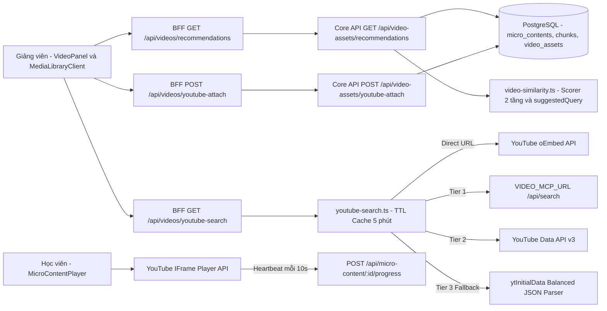
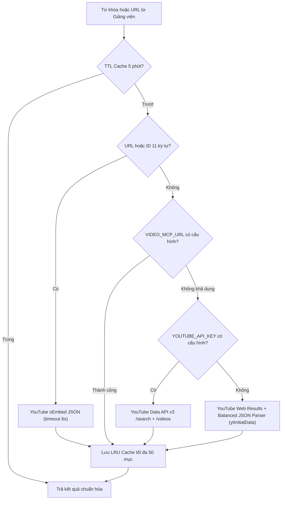

# BÁO CÁO KỸ THUẬT: ĐỀ XUẤT VIDEO TƯƠNG TỰ TRONG KHO HỌC LIỆU (VIDEO DAM) & TÌM KIẾM, GẮN PHÁT VIDEO YOUTUBE TRONG MICRO-CONTENT

> **Nhánh phát triển**: `feat/micro-content-feature` (`core-api: 827f919`, `web: 2d8256b`, `DA: c7adb88`)  
> **Phạm vi**: Bổ sung thuật toán đề xuất video tương tự từ Video DAM, pipeline tìm kiếm YouTube 3 tầng kèm cắt đoạn (`startSec`–`endSec`), lưu trữ tái sử dụng trên PostgreSQL/DAM và trình phát YouTube nhúng có theo dõi tiến độ xem cho học viên.  
> **Tài liệu liên quan**: [Báo cáo tổng kết Micro-Content Lai & Khung Đánh giá 3 chiều](bao-cao-tong-ket-micro-content-manim-hybrid.md)

---

## 1. Mục tiêu & Bài toán Nghiệp vụ

Trong quy trình biên soạn bài học vi mô (*Micro-Content*, thời lượng 2–5 phút), bên cạnh hai hướng tạo nội dung mới (**Tải video lên** và **Sinh video bằng AI / Manim Hybrid**), giảng viên thường xuyên có nhu cầu tận dụng lại học liệu sẵn có để tiết kiệm chi phí render/lưu trữ và làm phong phú góc nhìn giải thích thuật toán:

1. **Bài toán tái sử dụng từ Kho Học liệu (`Video DAM`)**: Phiên bản trước của `MediaLibraryClient` chỉ liệt kê toàn bộ `video_assets` theo thứ tự thời gian (`created_at DESC`) và hỗ trợ lọc từ khóa thủ công. Khi số lượng video tăng lên qua nhiều khóa học, giảng viên phải tự nhớ tên video để tìm lại, dẫn đến bỏ sót nhiều học liệu liên quan sẵn có trong kho dùng chung (`COURSE` hoặc `PUBLIC`).
2. **Bài toán khai thác học liệu mở chất lượng cao trên YouTube**: Nhiều khái niệm khoa học máy tính (ví dụ *Merge Sort*, *QuickSort*, *Divide and Conquer*) đã có sẵn các video trực quan hóa xuất sắc trên YouTube. Giảng viên cần tìm nhanh video có nội dung tương đồng trực tiếp trong trình soạn Micro-Content, xem thử, chọn riêng đoạn trọng tâm (`startSec`–`endSec` vừa khung 2–5 phút), gắn vào bài học và vẫn đảm bảo **theo dõi tiến độ xem thực tế** của sinh viên trước khi mở khóa bài tập củng cố (*Quiz Gate*).

---

## 2. Kiến trúc Đầu–Cuối (End-to-End Architecture)

Tính năng được thiết kế xuyên suốt theo kiến trúc 3 tầng (**Web UI → Next.js BFF → NestJS Core API → PostgreSQL / YouTube**), tái sử dụng toàn bộ cơ chế kiểm soát quyền truy cập RBAC (`BffJwtGuard`, `AuthzService`) và thống kê tái sử dụng (`usage_count`) của phân hệ Video DAM.

### Bảng Hợp đồng API (API Contracts)

| Tầng | Phương thức & Đường dẫn | Chức năng & Cơ chế bảo mật | Tệp hiện thực |
| :--- | :--- | :--- | :--- |
| **Core API** | `GET /api/video-assets/recommendations?microContentId=&limit=` | Xếp hạng tối đa `20` video `READY` khả dụng trong kho theo điểm tương đồng nội dung; kiểm tra `STAFF_ROLES` trên khóa học. | `core-api/src/modules/video-asset/video-asset.controller.ts` |
| **Core API** | `POST /api/video-assets/youtube-attach` | Kiểm định ID 11 ký tự, `endSec > startSec`, tạo/tái sử dụng bản ghi `video_assets` (`YOUTUBE`) và cập nhật `micro_contents` trong transaction. | `core-api/src/modules/video-asset/video-asset.service.ts` |
| **Web BFF** | `GET /api/videos/recommendations` | Xác thực phiên LTI (`readSessionFromRequest`) và ủy quyền về Core API kèm JWT claims. | `web/src/app/api/videos/recommendations/route.ts` |
| **Web BFF** | `GET /api/videos/youtube-search?q=&lang=&limit=` | Xác thực phiên LTI, tìm kiếm YouTube 3 tầng / link trực tiếp kèm bộ lọc ngôn ngữ (`all` / `vi` / `en`). | `web/src/app/api/videos/youtube-search/route.ts` |
| **Web BFF** | `POST /api/videos/youtube-attach` | Kiểm tra phiên LTI + chống CSRF (`isValidOrigin`) trước khi chuyển tiếp yêu cầu gắn video YouTube. | `web/src/app/api/videos/youtube-attach/route.ts` |
| **Web Proxy** | `GET /api/micro-content/[id]/video` & `GET /api/videos/[id]/stream` | Bảo vệ luồng nhị phân: trả về `HTTP 400` kèm `embedUrl` nếu asset là `video/youtube`, không fetch HTML như MP4. | `web/src/app/api/micro-content/[id]/video/route.ts` |

---

## 3. Thuật toán Đề xuất Video Tương tự từ Kho Học liệu (`video-similarity.ts`)

Thay vì phụ thuộc vào dịch vụ embedding nặng khi số lượng video trong kho ở quy mô vừa ($< 500$ video/tenant), hệ thống sử dụng bộ chấm điểm từ vựng đa trường có giải thích (*Explainable Multi-Field Lexical Similarity Scorer*), đạt độ trễ dưới `20 ms` ngay trong tiến trình Node.js của `core-api`.

### 3.1. Chuẩn hóa Song ngữ & Hồ sơ Trọng số Đa trường

1. **Chuẩn hóa tiếng Việt – tiếng Anh (`normalizeViText`)**: chuyển chữ thường, đổi `đ → d`, tách dấu tổ hợp Unicode `NFD` và lọc bỏ khoảng trắng/ký tự thừa. Cách làm này giúp khớp chính xác cả khi tên file upload không dấu (ví dụ `sap-xep-tron-merge-sort.mp4`) với tiêu đề có dấu của bài giảng (*Sắp xếp trộn — Merge Sort*).
2. **Loại bỏ từ dừng (*Stopwords*) & Suy giảm tần suất dưới tuyến tính (*Sublinear TF*)**: các từ dừng phổ biến tiếng Việt/tiếng Anh (`va`, `cua`, `bai`, `hoc`, `video`, `slide`, `the`, `and`, `tutorial`, ...) bị loại; tần suất lặp lại trong một trường văn bản dài bị nén theo hệ số $1.0 \rightarrow 0.35$ (lần $2$–$3$) $\rightarrow 0.10$ (từ lần $4$ trở đi) để tránh một trường dài lấn át tiêu đề.
3. **Trọng số trường của Micro-Content nguồn (`buildMicroContentQueryProfile`)**:
   - `title`: **$3.0$**
   - `learning_outcome.statement_vi` (Chuẩn đầu ra LO): **$2.0$**
   - `description`: **$1.8$**
   - `ai_prompt` & văn bản trích xuất từ `ai_script` (`topic`, `scenes[].title`, `bullets`, `narration`): **$1.4$**
   - `source_document.title`: **$1.1$**
   - `slideChunkTexts` (tối đa $6$ chunk đầu thuộc khoảng trang `source_page_from..source_page_to`, giới hạn `2500` ký tự): **$0.9$**
4. **Trọng số trường của Video ứng viên (`video_assets`)**: `title` ($3.0$), `tags` ($2.6$, bỏ thẻ kỹ thuật `youtube`), `description` ($1.8$), và nội dung giàu ngữ cảnh (`transcript_text`, `ai_prompt`, `ai_script`: $1.2$).

### 3.2. Công thức Tính điểm & Tạo Truy vấn Gợi ý (`suggestedQuery`)

Đặt $\cos_{\text{uni}}$ và $\cos_{\text{bi}}$ lần lượt là độ tương đồng Cosine có trọng số trên tập *unigram* và *bigram*, và $\text{Recall}_{\text{title}}$ là tỷ lệ từ khóa tiêu đề bài học xuất hiện trong video ứng viên:

$$\text{Sim}_{\text{lex}} = 0.45 \cdot \cos_{\text{uni}} + 0.30 \cdot \cos_{\text{bi}} + 0.25 \cdot \text{Recall}_{\text{title}}$$

$$\Delta_{\text{course}} = \begin{cases} 0.08 & \text{nếu cùng khóa học và } \text{Sim}_{\text{lex}} > 0.05 \\ 0 & \text{ngược lại} \end{cases}$$

$$\text{matchScore} = \min\!\Big(99,\; \max\!\big(1,\; \text{round}((\text{Sim}_{\text{lex}} + \Delta_{\text{course}}) \times 100)\big)\Big)$$

Điều kiện $\text{Sim}_{\text{lex}} > 0.05$ trước khi cộng $\Delta_{\text{course}}$ đảm bảo các video **không liên quan** nhưng nằm trong cùng khóa học (ví dụ video về *Hệ điều hành* trong khi bài đang soạn về *Merge Sort*) sẽ không bị đẩy điểm giả tạo. Hệ thống chỉ giữ các ứng viên có $\text{matchScore} \ge 10$, sắp xếp theo `matchScore DESC → usage_count DESC → created_at DESC`, trả kèm:
- **`matchedKeywords`**: tối đa $4$ cụm từ/từ khóa trùng lặp cao nhất (ưu tiên *bigram* và tự loại *unigram* dư thừa đã nằm trong *bigram*).
- **`matchReasons`**: nhãn giải thích trực quan bằng tiếng Việt (*"Khớp từ khóa: merge sort, chia để trị"*, *"Cùng khóa học"*, *"Trùng nội dung lời giảng / kịch bản"*).
- **`suggestedQuery`**: trích tự động từ tiêu đề đã làm sạch tiền tố (`Bài 1:`, `Micro-content:`, `[Draft]`), tự bổ sung $1$–$2$ từ khóa trọng tâm từ LO nếu tiêu đề quá ngắn ($< 25$ ký tự) để nạp sẵn vào thanh tìm kiếm YouTube.

### 3.3. Giới hạn Truy vấn & Phân quyền Bảo mật

- Chỉ xét tối đa $200$ ứng viên có `deleted_at IS NULL`, `status = 'READY'` và thỏa quyền nhìn thấy RBAC: `owner_id = claims.sub` OR `visibility = 'PUBLIC'` OR (`course_id = mc.course_id` AND `visibility = 'COURSE'`).
- Không lộ video `PRIVATE` của giảng viên khác sang kết quả gợi ý.

---

## 4. Tìm kiếm YouTube 3 Tầng, Cắt đoạn & Quản trị Tái sử dụng (Video DAM)

### 4.1. Chiến lược Tìm kiếm Chịu lỗi (3-Tier Fallback + Direct URL)

- **Bộ phân tích `extractBalancedJsonObject`**: thay vì dùng biểu thức chính quy (*regex*) dễ gãy trên HTML lớn của YouTube, trình phân tích duyệt cân bằng dấu ngoặc nhọn `{...}` (có theo dõi chuỗi `"..."` và ký tự thoát `\\`) để trích chính xác khối `ytInitialData`, sau đó thu thập các `videoRenderer` hợp lệ (tự động loại livestream chưa có `lengthText`).
- **Hỗ trợ dán link trực tiếp**: chấp nhận mọi định dạng `youtube.com/watch?v=`, `youtu.be/`, `youtube.com/embed/`, `youtube.com/shorts/` hoặc ID $11$ ký tự và truy vấn nhanh qua `oEmbed`.

### 4.2. Mở rộng Lược đồ CSDL & Chuẩn hóa Đường dẫn Phát

Migration `core-api/prisma/migrations/20261125203000_youtube_video_source/migration.sql` cập nhật ràng buộc `CHECK`:
- `micro_contents.video_source IN ('UPLOAD', 'AI', 'YOUTUBE')` *(cột `VARCHAR(10)` chứa vừa `'YOUTUBE'` 7 ký tự mà không cần đổi kiểu cột)*.
- `video_assets.source_type IN ('USER_UPLOAD', 'AI_STUDIO', 'YOUTUBE')` *(cột `VARCHAR(20)`)*.

Khi gắn một video YouTube:
1. Lưu `object_key = "youtube:<11-char-id>"`, `mime_type = "video/youtube"`, và JSON metadata an toàn trong `ai_options` (`youtubeVideoId`, `channelTitle`, `thumbnailUrl`, `watchUrl`, `startSec`, `endSec`).
2. **Chống trùng lặp trong khóa học**: trước khi tạo bản ghi mới, hệ thống kiểm tra `(course_id, object_key, source_type='YOUTUBE', deleted_at IS NULL)` có trùng khoảng cắt `(startSec, endSec)` hay không; nếu trùng sẽ **tái sử dụng** chính `asset_id` đó và chỉ tăng `usage_count`.
3. **Tính thời lượng hiệu dụng**: nếu có `startSec` và `endSec > startSec`, đặt `duration_ms = (endSec - startSec) * 1000` để thanh tiến độ xem học viên phản ánh đúng phần trích đoạn được giao, không bắt học viên xem cả video gốc dài hơn.
4. **An toàn URL & Chống XSS/SSRF**: mọi `youtubeVideoId` đều được kiểm định bằng `/^[A-Za-z0-9_-]{11}$/`; URL nhúng (`youtube.com/embed/...`) và URL ảnh thumbnail (`i.ytimg.com/vi/.../hqdefault.jpg`) luôn được tái tạo ở phía server thay vì tin URL client gửi lên. `MicroContentVideoService.getVideoUrl()` và `VideoAssetService.getStreamUrl()` nhận diện `YOUTUBE` để trả về link nhúng mà tuyệt đối không gọi `storage.createPresignedDownloadUrl()` lên MinIO.

---

## 5. Giao diện Giảng viên & Trình phát Học viên (Anti-Seek-Cheat)

1. **Trong trình soạn Micro Content (`VideoPanel` + `MediaLibraryClient`)**:
   - Tab thứ ba đổi tên thành **📚 Chọn từ Kho học liệu & YouTube** với hai sub-tab con:
     - **📚 Kho học liệu & Đề xuất tương tự**: tải tự động khung **✨ Đề xuất video có nội dung tương tự trong kho** kèm huy hiệu `Khớp XX%`, thẻ từ khóa bài học, lý do khớp, xem thử (hỗ trợ cả MP4 MinIO và YouTube nhúng) và chọn gắn $1$ chạm.
     - **▶ Tìm trên YouTube (nội dung tương tự)**: điền sẵn `suggestedQuery` từ bài học, tự tìm kiếm lần đầu khi mở tab, hỗ trợ lọc ngôn ngữ (`Tất cả`, `Tiếng Việt`, `English`), chip gợi ý nhanh (`+ giải thích`, `+ visualization`), và modal **Xem thử & Cắt đoạn** nhập `startSec`/`endSec`.
   - Khung **Xem thử Video đã sẵn sàng** ở đầu `VideoPanel` tự động chuyển giữa `<video>` (MP4) và `<iframe>` (YouTube kèm thông tin kênh & đoạn cắt).
2. **Trong trang học tập của Sinh viên (`MicroContentPlayer`)**:
   - Nạp bất đồng bộ **YouTube IFrame Player API** (`https://www.youtube.com/iframe_api`) để lắng nghe sự kiện `PLAYING (1)`, `PAUSED (2)` và `ENDED (0)`.
   - Khi video YouTube đang thực sự phát (`PLAYING`), bộ đếm mỗi giây cộng dồn `playedAccMs` (giới hạn mỗi nhịp $\le 2500\text{ ms}$ chống tua thời gian giả mạo) và gửi heartbeat về `POST /api/micro-content/:id/progress` mỗi $10$ giây cũng như ngay khi tạm dừng/kết thúc — tương thích hoàn toàn với cơ chế mở khóa quiz theo `requiredWatchPercent` ở `MicroContentAttemptService`.
   - Có **cơ chế dự phòng (*fallback*) sau $5$ giây**: nếu trình duyệt chặn script IFrame API của YouTube, trình phát tự chuyển sang `<iframe>` chuẩn (`youtubeEmbedUrl`) để học viên vẫn xem được bài học.

---

## 6. Danh mục Tệp Thay đổi & Kết quả Kiểm thử Thực chứng

### 6.1. Tổng hợp Mã nguồn đã Commit & Push (`feat/micro-content-feature`)

| Repo & Commit | Nhóm tệp | Tóm tắt thay đổi |
| :--- | :--- | :--- |
| **`core-api`** (`827f919`) — 9 tệp | `prisma/migrations/20261125203000_youtube_video_source/migration.sql` | Mở rộng `CHECK` constraint cho `YOUTUBE` trên `micro_contents` và `video_assets`. |
| | `src/modules/video-asset/video-similarity.ts` | Bộ chấm điểm tương đồng song ngữ Việt–Anh, `suggestedQuery` và helper chuẩn hóa YouTube. |
| | `src/modules/video-asset/dto/video-asset.dto.ts`, `video-asset.controller.ts`, `video-asset.service.ts` | Thêm `GET /recommendations`, `POST /youtube-attach`, cập nhật `attachToMicroContent` và `getStreamUrl`. |
| | `src/modules/micro-content/services/micro-content.service.ts`, `micro-content-video.service.ts` | Trả về metadata YouTube và chặn gọi nhầm MinIO cho `video_source = 'YOUTUBE'`. |
| | `src/modules/video-asset/video-asset.service.spec.ts`, `micro-content-video.spec.ts` | Bổ sung unit test cho xếp hạng tương đồng, attach YouTube, kiểm tra ID/thời gian và luồng stream URL. |
| **`web`** (`2d8256b`) — 11 tệp | `src/lib/youtube-search.ts`, `src/lib/core-api.ts` | Module tìm kiếm YouTube 3 tầng + cache TTL + parser JSON cân bằng; thêm client call Core API. |
| | `src/app/api/videos/recommendations/route.ts`, `youtube-search/route.ts`, `youtube-attach/route.ts` | BFF routes có kiểm tra LTI session và origin chống CSRF. |
| | `src/app/api/micro-content/[id]/video/route.ts`, `src/app/api/videos/[id]/stream/route.ts` | Chặn proxy nhị phân nếu asset là `video/youtube`. |
| | `src/app/manage/media/media-library-client.tsx`, `src/app/manage/micro-content/[id]/edit/video-panel.tsx` | Sub-tab Đề xuất tương tự + Tìm kiếm YouTube + Xem thử & Cắt đoạn + thẻ YouTube trong DAM. |
| | `src/app/learn/micro-content/[id]/learn-micro-content-client.tsx`, `player.tsx` | Trình phát YouTube IFrame API tích hợp heartbeat tiến độ xem. |
| **`DA`** (`c7adb88`) | Submodule pointers | Đồng bộ tham chiếu mới của `core-api` và `web`. |

### 6.2. Kết quả Kiểm thử & Xác minh Trực tiếp (Sau lần sửa mã cuối)

| Hạng mục kiểm tra | Môi trường thực thi | Kết quả quan sát trực tiếp |
| :--- | :--- | :--- |
| **Database Migration** | `da-core-api-1` (`npx prisma migrate deploy`) | Áp dụng sạch `20261125203000_youtube_video_source` trên PostgreSQL (27 migrations). |
| **TypeScript Backend** | `da-core-api-1` (`npx tsc --noEmit`) | **0 lỗi biên dịch**; biên dịch ra `dist/src/modules/video-asset/` thành công và map đủ route `/api/video-assets/recommendations`, `/api/video-assets/youtube-attach`. |
| **Unit Tests Backend** | `da-core-api-1` (`npx jest`) | **5/5 suite có thể chạy đều PASS (`90 passed, 2 skipped, 0 failed`)**: `video-asset.service.spec.ts`, `micro-content.spec.ts`, `micro-content-attempt.spec.ts`, `micro-content-video.spec.ts`, `micro-content-video-result.handler.spec.ts`. *(Ghi chú: `micro-content-grading-result.handler.spec.ts` không chạy trong container do đường dẫn fixture `/app/src/testing/__missing_contracts__/fixtures/v1/valid` nằm ngoài mount container, không phải lỗi logic code.)* |
| **TypeScript Frontend** | `da-web-1` (`npx tsc --noEmit`) | Thoát mã **0** (**0 lỗi TypeScript**). |
| **Tìm kiếm YouTube Thực tế** | `da-web-1` (Node `fetch` trực tiếp) | Truy vấn `"Merge Sort chia để trị"` (`hl=vi`) trả **HTTP 200** với **12 `videoRenderer`** thực tế (ví dụ: *28tech — `46:00`*, *Học Giải Thuật Cùng HPN — `10:58`*, *Cấu trúc Dữ liệu & Giải thuật - Nguyễn Văn Linh — `21:19`*, *MikiTech — `14:39`*); kiểm tra link trực tiếp qua `oEmbed` trả **HTTP 200** (*"Merge sort in 3 minutes" — Michael Sambol*). |
| **Hệ thống Docker & Tunnel** | Stack 9 container + `cloudflared` | `http://localhost:3001/` **HTTP 200**, `https://app-binh.canxphung.dev/` **HTTP 200**, `http://localhost:8086/health` **HTTP 200**, `da-core-api-1` cổng `4000` hoạt động ổn định. |

---

## 7. Hạn chế Hiện tại & Hướng Mở rộng

1. **Kết hợp truy xuất ngữ nghĩa (*Hybrid Lexical + Dense Embedding*)**: Bộ chấm điểm hiện tại dựa trên trùng khớp từ vựng song ngữ không dấu, nên chưa bắt được các cặp đồng nghĩa thuần túy khác gốc từ (ví dụ *"độ phức tạp không gian"* vs. *"memory overhead"*) nếu tiêu đề/mô tả không chứa từ khóa chung. Khi kho đạt $> 500$ video, có thể cộng thêm cosine từ `embedding-service` / Qdrant làm tín hiệu thứ hai bên cạnh bộ lexical hiện tại.
2. **Tự động chấm 3 chiều & Gợi ý đoạn cắt từ Transcript YouTube**: Có thể gọi dịch vụ `video-mcp` (`POST /api/transcript`) bóc phụ đề YouTube theo timestamp khi giảng viên bấm xem thử, từ đó tự gợi ý khoảng `(startSec, endSec)` sát nhất với nội dung slide và chạy thử đánh giá Content Fidelity 3 chiều trước khi gắn vào bài học.
3. **Cấu hình `YOUTUBE_API_KEY` cho môi trường Production**: Tầng 3 (`ytInitialData` HTML) hoạt động không cần khóa API trên môi trường dev/demo, nhưng ở lưu lượng lớn nên bổ sung `YOUTUBE_API_KEY` để có quota ổn định từ Google YouTube Data API v3.
