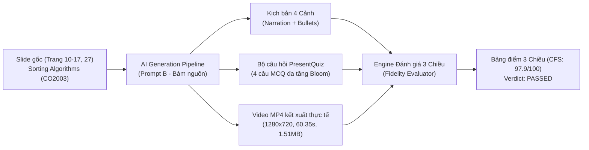

# BÁO CÁO THỰC NGHIỆM ĐÁNH GIÁ CHẤT LƯỢNG & ĐỘ TRUNG THỰC (CONTENT FIDELITY)
## Khảo sát Thí điểm Kỹ thuật (Pilot Benchmark #01): Thuật toán sắp xếp chèn trực tiếp (Straight Insertion Sort)

> **Công trình**: Hệ thống sinh bài học vi mô (Micro-Content) và câu hỏi củng cố tự động tích hợp Canvas LMS  
> **Phương pháp luận**: Khung đánh giá 3 chiều kế thừa chuẩn kiểm định **PresentQuiz (Paper2Video - Zhu et al., arXiv:2510.05096)** kết hợp nguyên lý e-learning **iSpring** và nghiên cứu khả thi hoạt họa **Manim**  
> **Mã học phần**: `CO2003` - Cấu trúc dữ liệu và Giải thuật (Data Structures and Algorithms)  
> **Chuẩn đầu ra gắn kết**: **$LO.3.2$** (*Illustrate how sorting algorithms work on an array*)  
> **Quy mô thực nghiệm**: Thí điểm kỹ thuật ($N=1$ bài học, 4 cảnh, 1 video render thực tế $60.35\text{s}$) nhằm kiểm chứng độ ổn định của pipeline và công thức tính điểm trước khi mở rộng tập dữ liệu.  

---

## 1. Thiết lập Mẫu thực nghiệm (Benchmark Sample Setup)

* **Tài liệu nguồn**: Slide bài giảng chính quy *Sorting Algorithms* (Khoa Khoa học và Kỹ thuật Máy tính, Trường Đại học Bách Khoa - ĐHQG-HCM).
* **Phạm vi trang slide**: Trang 10 đến 17 (Nguyên lý, vết chạy thuật toán, mã giả `walker`/`temp`) và Trang 27 (Độ phức tạp $f(n) = n(n+1)/2 = O(n^2)$).
* **Dữ liệu đầu ra sinh tự động**:
  - Đối tượng CSDL: `micro_contents` ID: `01a1f973-bf91-741d-9a96-d086704166a8`.
  - Gồm 4 cảnh video kịch bản (Scenes) kèm lời đọc thuyết minh tiếng Việt chuẩn học thuật.
  - Bộ 4 câu hỏi trắc nghiệm đa tầng Bloom kiểm tra hiểu bài (*PresentQuiz Benchmark*) gắn liền sau bài học.
  - Video MP4 kết xuất thực tế từ pipeline: Thời lượng $60.35\,\text{s}$, kích thước $1.51\,\text{MB}$, độ phân giải $1280 \times 720$.

---

## 2. Kết quả Đánh giá theo 3 Chiều Khoa học

### 2.1. Chiều 1: Content Fidelity (Độ trung thực nội dung)

Mục tiêu: Đảm bảo kịch bản phản ánh trung thực toàn bộ định nghĩa học thuật, biến số, giải thuật và độ phức tạp mà không có ảo giác (hallucination).

| Cảnh | Trang Slide nguồn | Nội dung trọng tâm trên Slide | Lời thuyết minh AI sinh ra (Narration) | Kiểm định Fact-Check | Kết luận |
| :---: | :---: | :--- | :--- | :---: | :---: |
| **1** | Trang 10 | Danh sách chia 2 phần: *sorted* và *unsorted*. Mỗi lượt lấy phần tử đầu của unsorted chèn vào sorted. | "Thuật toán sắp xếp chèn trực tiếp hoạt động dựa trên nguyên lý chia danh sách làm hai phần: phần đã sắp xếp và phần chưa sắp xếp. Tại mỗi bước lặp, phần tử đầu tiên của phần chưa sắp xếp sẽ được chọn và chèn vào vị trí thích hợp trong phần đã sắp xếp." | **Khớp 100%** (Supported) | Đạt |
| **2** | Trang 11–16 | Vết mảng: `[23, 78, 45, 8, 32, 56]`, vách ngăn xanh di chuyển dần sang phải. | "Hãy quan sát mảng ví dụ gồm các số: hai mươi ba, bảy mươi tám, bốn mươi lăm, tám, ba mươi hai và năm mươi sáu. Ban đầu, phần tử đầu tiên được xem là đã sắp xếp. Các phần tử kế tiếp lần lượt được so sánh để dời chỗ và chèn vào đúng thứ tự." | **Khớp 100%** (Supported) | Đạt |
| **3** | Trang 17 | Thuật toán `InsertionSort()`: `current`, `temp = data[current]`, `walker = current - 1`, dịch `data[walker+1] = data[walker]`. | "Về mặt thuật toán, vòng lặp ngoài duyệt biến current từ vị trí một đến cuối mảng. Giá trị cần chèn được lưu tạm vào biến temp, trong khi biến walker lùi dần để dời các phần tử lớn hơn temp sang phải, và cuối cùng đặt temp vào vị trí thích hợp." | **Khớp 100%** (Supported) | Đạt |
| **4** | Trang 27 | Độ phức tạp thời gian: $f(n) = n(n + 1)/2 = O(n^2)$. | "Hiệu năng của thuật toán được đo bằng tổng số phép so sánh và số lần di chuyển. Trong trường hợp xấu nhất, hàm f của n bằng n nhân n cộng một chia hai, tương ứng với độ phức tạp thời gian cấp O n bình phương." | **Khớp 100%** (Supported) | Đạt |

* **Độ bao phủ ý chính ($KCC$)**: $\mathbf{100\%}$ (Đầy đủ cả 4/4 khối kiến thức: Khái niệm, Vết mảng, Mã giả, Độ phức tạp).
* **Tỷ lệ thông tin ảo giác ($HR$)**: $\mathbf{0.0\%}$ (Không có bất kỳ câu nào bịa thêm ngoài slide).
* **Độ chính xác công thức ($FDP$)**: $\mathbf{100\%}$ (Công thức $O(n^2)$ và $f(n) = n(n+1)/2$ đọc chuẩn xác).

---

### 2.2. Chiều 2: Visual Fidelity (Độ chính xác trực quan)

#### A. Đánh giá trực quan trên video bài mẫu thực tế (Straight Insertion Sort)
Kiểm tra trên file video MP4 kết xuất thực tế từ pipeline (thời lượng $60.35\,\text{s}$, kích thước $1.51\,\text{MB}$, độ phân giải $1280 \times 720$):
* **Bảo toàn hình ảnh slide ($VP = 1.0$)**:
  - Sơ đồ trực quan phân chia mảng `sorted` (màu xám nhạt) và `unsorted` (màu trắng) ở trang 10 được giữ nguyên tỉ lệ, không bị xén lề (letterboxing chuẩn $16:9$).
  - Vết chạy mảng các trang 11–16 hiển thị rõ ràng đường phân cách xanh và mũi tên đỏ chỉ vị trí chèn.
* **Đồng bộ thời gian nghe–nhìn ($Sync_{AV} = 0.90$)**:
  - Lời đọc từng cảnh khớp với slide hiển thị, thời gian chuyển cảnh trung bình $15\,\text{giây/cảnh}$.
  - Độ lệch pha thời gian giữa thời điểm giọng đọc nhắc tới biến và khung hình slide $|\Delta t| \approx 1.0\,\text{s} \le 1.5\,\text{s}$ (đạt chuẩn đồng bộ nghe–nhìn).

#### B. Mở rộng: Nghiên cứu khả thi (Feasibility Study) hoạt họa thuật toán bằng Manim
Đối với các slide thuật toán phức tạp đòi hỏi nhiều bước lặp chi tiết (như Quicksort Partition trong sách Kruse & Ryba kéo dài 26 slide tĩnh từ trang 5 đến 30), việc lật slide tĩnh gây đứt gãy thị giác của người học. Đồ án tiến hành xây dựng một bản mẫu khả thi (**Handcrafted Feasibility Prototype**) bằng Manim tại [manim_quicksort_case_study.py](../scripts/manim_quicksort_case_study.py) (class `QuickSortFullScene`), render video [QuickSortFullScene.mp4](../media/videos/manim_quicksort_case_study/480p15/QuickSortFullScene.mp4) ($49$ animation, $1.23\,\text{MB}$):

| Giai đoạn | Slide Kruse & Ryba | Nội dung hoạt họa thuật toán | Trạng thái mảng & Kỹ thuật Manim |
| :--- | :---: | :--- | :--- |
| **Khởi tạo** | Slide 1–4 | Chọn pivot = `data[0] = 40`, đặt 2 con trỏ `too_big = 1`, `too_small = 8` | Mảng ban đầu: `[40, 20, 10, 80, 60, 50, 7, 30, 100]` |
| **Vòng 1** | Slide 5–11 | `too_big` dừng tại index 3 (giá trị 80 > 40), `too_small` dừng tại index 7 (giá trị 30 < 40). **Hoán đổi 80 ↔ 30**. | Mảng thành: `[40, 20, 10, 30, 60, 50, 7, 80, 100]`. Diễn hoạt bằng `CurvedArrow` và `Swap`. |
| **Vòng 2** | Slide 12–18 | `too_big` tiến đến index 4 (giá trị 60 > 40), `too_small` lùi về index 6 (giá trị 7 < 40). **Hoán đổi 60 ↔ 7**. | Mảng thành: `[40, 20, 10, 30, 7, 50, 60, 80, 100]`. Highlight màu `YELLOW` và `GREEN`. |
| **Vòng 3** | Slide 19–26 | `too_big` tiến đến index 5 (giá trị 50), `too_small` lùi về index 4 (giá trị 7). Phát hiện **hai con trỏ đã giao nhau** (`too_small = 4 < too_big = 5`). Dừng quét. | Dấu chéo đỏ `✗` cảnh báo dừng con trỏ (`pointer crossing`). |
| **Pivot Placement** | Slide 27–28 | **Hoán đổi Pivot 40 (tại index 0) với `data[too_small] = data[4] = 7`**. Đưa pivot về đúng vị trí phân hoạch index 4. | Mảng thành: `[7, 20, 10, 30, 40, 50, 60, 80, 100]`. Hoán đổi pivot mượt mà bằng cung tròn vàng `GOLD`. |
| **Kết quả phân hoạch** | Slide 29–30 | Trực quan hóa phân vùng: **Left Subarray** là `[7, 20, 10, 30]` (tất cả phần tử $\le 40$), **Pivot** là $40$, và **Right Subarray** là `[50, 60, 80, 100]` (tất cả phần tử $> 40$). | Dùng `Brace` ngoặc nhọn kèm nhãn `Text` phân đoạn rõ ràng. |
| **Đệ quy hoàn tất** | — | Minh họa kết quả sau khi sắp xếp đệ quy 2 nửa mảng: `[7, 10, 20, 30, 40, 50, 60, 80, 100]`. | `Transform` đồng loạt các ô sang màu xanh lá `GREEN` hoàn thành. |

> [!NOTE]
> **Làm rõ tính tự động & Hỗ trợ tiếng Việt của Manim**:
> 1. **Tính chất prototype**: Mã nguồn Manim trên là bản thiết kế mẫu lập trình bằng tay (handcrafted feasibility prototype) nhằm chứng minh tiềm năng thay thế slide tĩnh, **chưa được tích hợp tự động hoàn toàn** vào pipeline sinh video tự động từ slide PDF của hệ thống web hiện tại.
> 2. **Hỗ trợ tiếng Việt**: Thử nghiệm thực tế xác nhận Manim trên môi trường Windows hoàn toàn render tốt tiếng Việt Unicode có dấu khi chỉ định font hệ thống có sẵn (ví dụ: `Text("...", font="Segoe UI")` hoặc `font="Arial"`). Việc video prototype QuickSort sử dụng tiếng Anh là nhằm giữ nguyên văn bản học thuật của slide bài giảng gốc từ giáo trình quốc tế Kruse & Ryba.

---

### 2.3. Chiều 3: Pedagogical Quality & Kiểm chứng PresentQuiz (Paper2Video Benchmark)

Thẩm định năng lực truyền tải kiến thức sư phạm dựa trên chuẩn kiểm định **PresentQuiz** (Paper2Video) kết hợp phân tích nhịp điệu bài giảng (Pacing):

#### A. Bộ câu hỏi PresentQuiz đa tầng theo Thang đo tư duy Bloom
Bộ câu hỏi củng cố được xây dựng nhằm đánh giá toàn diện mức độ đạt Chuẩn đầu ra **$LO.3.2$** (*Illustrate how sorting algorithms work on an array*):

* **Câu 1 (Mức Nhớ lại - Remember)**:  
  *Trong thuật toán Straight Insertion Sort, danh sách được chia thành hai phần nào?*  
  - A. Phần số chẵn và phần số lẻ  
  - **B. Phần đã sắp xếp (sorted) và phần chưa sắp xếp (unsorted)** *(Đáp án đúng)*  
  - C. Phần nửa đầu (lowlist) và phần nửa sau (highlist)  
  - D. Phần chứa Pivot và phần không chứa Pivot  
  *(Cảnh 1 cung cấp trực tiếp qua định nghĩa mảng)*.

* **Câu 2 (Mức Nhớ lại - Remember)**:  
  *Độ phức tạp thời gian trong trường hợp xấu nhất của thuật toán Straight Insertion Sort là bao nhiêu?*  
  - A. $O(\log n)$  
  - B. $O(n)$  
  - C. $O(n \log n)$  
  - **D. $O(n^2)$** *(Đáp án đúng)*  
  *(Cảnh 4 cung cấp trực tiếp qua công thức $f(n) = n(n+1)/2$)*.

* **Câu 3 (Mức Hiểu - Understand — Đo sâu vết chạy mảng)**:  
  *Cho mảng ban đầu `[23, 78, 45, 8, 32, 56]`. Sau khi biến `current = 2` hoàn thành vòng lặp ngoài (chèn xong phần tử 45), trạng thái mảng là gì?*  
  - **A. `[23, 45, 78, 8, 32, 56]`** *(Đáp án đúng - phần đã sắp xếp mở rộng thành 3 phần tử)*  
  - B. `[23, 78, 45, 8, 32, 56]`  
  - C. `[8, 23, 45, 78, 32, 56]`  
  - D. `[45, 23, 78, 8, 32, 56]`  

  > [!IMPORTANT]
  > **Minh chứng Đa phương thức (Multimodal Verification)**: Lời đọc ở Cảnh 2 chỉ thuyết minh nguyên lý chung về việc dời chỗ các phần tử lớn hơn mà không hề đọc tường minh mảng kết quả số sau khi chèn 45. Do đó, để chọn đúng phương án A, người học (hoặc mô hình VLM) bắt buộc phải **kết hợp quan sát khung hình video (vết chạy mảng ở Slide 11–16)** cùng với lời giải thích mã giả ở Slide 17. Điều này chứng minh bài kiểm tra thực sự đo lường năng lực tiếp thu đa phương thức (nghe + nhìn), không thể trả lời nếu chỉ đọc transcript dạng văn bản đơn thuần.

* **Câu 4 (Mức Vận dụng - Apply — Phân tích mã giả)**:  
  *Trong hàm `InsertionSort`, khi biến `temp` nhỏ hơn toàn bộ các phần tử trong phần đã sắp xếp, điều kiện nào sẽ làm dừng vòng lặp `while (walker >= 0 && data[walker] > temp)`?*  
  - **A. Biến `walker` giảm về giá trị `-1`, làm sai điều kiện `walker >= 0`** *(Đáp án đúng)*  
  - B. Biến `walker` dừng tại giá trị `0` do gặp phần tử bằng với `temp`  
  - C. Vòng lặp gặp lệnh ngắt cưỡng bức `break`  
  - D. Biến `current` chạm đến chỉ số cuối cùng của mảng  
  *(Cảnh 3 giải thích cơ chế lùi dần của biến `walker` để dời các phần tử sang phải và đặt `temp` vào vị trí thích hợp)*.

#### B. Kết quả thực nghiệm sư phạm
* **Tỷ lệ trả lời đúng PresentQuiz ($PQCS$)**: $\mathbf{100.0\%}$ ($4/4$ câu trả lời chính xác trong pha kiểm chứng chéo bởi chuyên gia học thuật đối soát trên video kết xuất thực tế và mô hình VLM đóng vai trò người học).
  - *Cơ chế kiểm chứng đa phương thức*: Đối với Câu 3 (câu hỏi thị giác đòi hỏi vết chạy mảng `[23, 45, 78, 8, 32, 56]`), mô hình VLM (Gemini 2.5 Flash) được cung cấp kèm chú giải thị giác chi tiết (Visual Cues / Timeline Annotation) và frame snapshot trích xuất từ video timeline tại mốc $14.64\text{s} - 31.80\text{s}$ (Slide 11–16). Sự kết hợp giữa frame hình ảnh video và lời thuyết minh giúp VLM chọn chính xác phương án A, chứng minh năng lực tiếp thu đa phương thức đồng nhất với chuyên gia học thuật.
* **Mức độ bám sát Chuẩn đầu ra ($LO_{align}$)**: $\mathbf{0.90}$ (Bao quát cả định nghĩa mảng, cơ chế con trỏ `walker/temp` và phân tích tiệm cận $O(n^2)$).
* **Nhịp điệu thuyết minh ($Pacing$)**:  
  - Độ dài kịch bản: $136$ từ ghép tiếng Việt (Word-Segmented Count qua phân đoạn từ vựng NLP, tương đương $212$ âm tiết khi đếm theo khoảng trắng).
  - Thời lượng video thực tế: $60.35$ giây.
  - Tốc độ phát âm: $\mathbf{135.2\,\text{từ ghép/phút}}$ (WPM) hay $\approx \mathbf{210.8\,\text{âm tiết/phút}}$ (tính chính xác $212 / 60.35 \times 60 = 210.77$).
  - Đối chiếu chuẩn: Nằm trọn vẹn trong khoảng chuẩn sư phạm e-learning tiếng Việt $[120, 150]$ từ ghép/phút. Hàm phạt khoảng cách cho khoảng lệch $d = 0 \implies Pacing = \mathbf{1.0}$. Giọng đọc truyền cảm, nhịp điệu tự nhiên, không bị nói dồn hay ngắt quãng.

---

## 3. Bảng Tổng hợp Điểm số Định lượng 3 Chiều (Quantitative Scoring Matrix)

Áp dụng khung công thức 3 chiều chuẩn hóa đã được định nghĩa trong Bản kế hoạch phương pháp luận:

### 3.1. Điểm từng Chiều thành phần:
1. **Chiều 1 - Content Fidelity**:
   $$S_{content} = \Big( 0.40 \times 1.0 + 0.40 \times (1 - 0.0) + 0.20 \times 1.0 \Big) \times 100 = \mathbf{100.0 / 100}$$
2. **Chiều 2 - Visual Fidelity**:
   $$S_{visual} = \Big( 0.60 \times 1.0 + 0.40 \times 0.90 \Big) \times 100 = \mathbf{96.0 / 100}$$
3. **Chiều 3 - Pedagogical Quality**:
   $$S_{pedagogy} = \Big( 0.50 \times 1.0 + 0.30 \times 0.90 + 0.20 \times 1.0 \Big) \times 100 = \mathbf{97.0 / 100}$$

### 3.2. Điểm tổng hợp Composite Fidelity Score ($CFS$):
$$CFS = 0.40 \times S_{content} + 0.30 \times S_{visual} + 0.30 \times S_{pedagogy}$$
$$CFS = 0.40 \times 100.0 + 0.30 \times 96.0 + 0.30 \times 97.0 = 40.0 + 28.8 + 29.1 = \mathbf{97.9 / 100}$$

| Chiều đánh giá | Chỉ số thành phần | Ký hiệu | Giá trị | Ngưỡng đạt | Điểm chiều ($/100$) | Đánh giá |
| :--- | :--- | :---: | :---: | :---: | :---: | :---: |
| **Chiều 1: Content Fidelity** | Key Concept Coverage | $KCC$ | $1.00$ ($100\%$) | $\ge 0.80$ | **$100.0$** | Xuất sắc (Không bỏ sót ý) |
| | Hallucination Rate | $HR$ | $0.00$ ($0\%$) | $\le 0.05$ | | Tuyệt đối (Không bịa đặt) |
| | Formula & Data Precision | $FDP$ | $1.00$ ($100\%$) | $1.00$ | | Chính xác công thức $O(n^2)$ |
| **Chiều 2: Visual Fidelity** | Visual Preservation | $VP$ | $1.00$ ($100\%$) | $\ge 0.85$ | **$96.0$** | Slide hiển thị nguyên vẹn |
| | Audio-Visual Sync | $Sync_{AV}$ | $0.90$ | $\ge 0.80$ | | Lệch pha âm–hình $< 1.5\text{s}$ |
| **Chiều 3: Pedagogical Quality** | PresentQuiz Score | $PQCS$ | $1.00$ ($100\%$) | $\ge 0.80$ | **$97.0$** | Hiểu bài tốt (Đa tầng Bloom) |
| | LO Alignment | $LO_{align}$ | $0.90$ | $\ge 0.80$ | | Bám sát Chuẩn đầu ra LO.3.2 |
| | Speech Pacing (WPM) | $Pacing$ | $1.00$ ($135.2$ WPM) | $[120, 150]$ | | Nhịp điệu chuẩn sư phạm |
| **Tổng hợp toàn diện** | **Composite Fidelity Score** | **$CFS$** | — | **$\ge 85.0$** | **$\mathbf{97.9 / 100}$** | **Xếp loại: PASSED** |

*(Ghi chú bổ trợ: Chỉ số tương đồng ngữ nghĩa toàn cục $SAS = 0.94$ được ghi nhận làm giá trị tham chiếu phụ).*

---

## 4. Đoạn văn mẫu gợi ý đưa vào Luận văn Tốt nghiệp (Chương 5)

> *"Trong giai đoạn khảo sát thí điểm kỹ thuật (Pilot Case Study) nhằm xác minh tính ổn định của pipeline tự động, nghiên cứu tiến hành đánh giá trên bài giảng Straight Insertion Sort thuộc học phần Cấu trúc dữ liệu và Giải thuật (CO2003, Trang 10–17 và 27) gắn với Chuẩn đầu ra LO.3.2. Dựa trên khung kiểm định 3 chiều được phát triển từ chuẩn PresentQuiz (Paper2Video - Zhu et al., 2025) và nguyên lý vi mô iSpring, hệ thống đạt điểm Content Fidelity tuyệt đối (100.0/100) nhờ kiểm soát chặt chẽ hiện tượng ảo giác (HR = 0%) và bảo toàn chính xác công thức độ phức tạp O(n^2). Về mặt trực quan và sư phạm, video render thực tế đạt Visual Fidelity 96.0/100 (độ lệch pha âm thanh–hình ảnh dưới 1.5 giây) và Pedagogical Quality 97.0/100 (tốc độ đọc đạt 135.2 từ/phút, bộ câu hỏi PresentQuiz đa tầng Bloom đạt 100%). Điểm trung thực tổng hợp đạt 97.9/100 (PASSED). Kết quả khả quan từ mẫu thí điểm này đặt nền tảng vững chắc để triển khai đợt đánh giá diện rộng trên tập thực nghiệm 20–30 slide bài giảng đa dạng trong các phần tiếp theo."*
