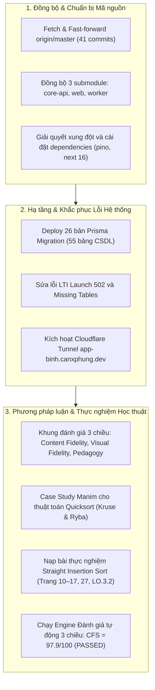

# BÁO CÁO TỔNG HỢP TIẾN ĐỘ & CÁC CÂU HỎI ĐÃ GIẢI QUYẾT
## Hệ sinh thái sinh Video Micro-Content và Trắc nghiệm tự động tích hợp Canvas LMS

> **Người thực hiện**: Đồ án tốt nghiệp / Luận văn tốt nghiệp  
> **Nhánh phát triển**: `feat/micro-content-feature`  
> **Thời điểm cập nhật**: 23/11/2026 (Phiên bản 3 — Cập nhật đồng bộ toàn diện khung 3 chiều, PresentQuiz và Benchmark)  

---

## PHẦN 1: CÁC CÔNG VIỆC KỸ THUẬT ĐÃ HOÀN THÀNH

### 1. Đồng bộ mã nguồn từ nhóm và giải quyết xung đột
- Nhánh `feat/micro-content-feature` đã được kéo (fetch) và fast-forward merge thành công 41 commits mới nhất từ `origin/master`.
- Đồng bộ toàn diện trên cả 3 submodule:
  - `core-api`: Commit `6f805f3` (Bổ sung logging Pino, API micro-content, Prisma schema mới).
  - `web`: Commit `98fd5b8` (Giao diện Next.js 16 Turbopack, các route `/manage/micro-content` và LTI launch).
  - `worker`: Commit `4eccd00` (Prompt micro-content bám nguồn, worker xử lý video và outbox).

### 2. Sửa lỗi hạ tầng, Database và LTI Launch trên Canvas
- **Khắc phục lỗi biên dịch `core-api`**: Bổ sung package `pino` và `nestjs-pino`, sinh lại Prisma Client, đưa TypeScript về trạng thái **0 lỗi**.
- **Khắc phục lỗi thiếu bảng CSDL (Code 42P01)**: Trước đó database PostgreSQL nội bộ bị trống, gây lỗi `relation lms_user_mappings does not exist` khi Canvas POST sang `/lti/launch`. Tôi đã thực thi lệnh `npx prisma migrate deploy`, áp dụng toàn bộ **26 bản migration** và tạo thành công **55 bảng dữ liệu**.
- **Khắc phục lỗi kết nối `refused to connect`**: Xử lý việc tunnel Cloudflare bị gián đoạn, đưa `cloudflared` vào hoạt động ổn định để giữ kết nối giữa domain `https://app-binh.canxphung.dev` và cổng `http://localhost:3001`.

### 3. Hiện thực hóa các công cụ thực nghiệm cho Luận văn
- **Nghiên cứu khả thi Manim (Handcrafted Prototype) — QuickSort Partition đầy đủ**: Tạo file [manim_quicksort_case_study.py](../scripts/manim_quicksort_case_study.py) (class `QuickSortFullScene`) mô phỏng độc lập **toàn bộ thuật toán phân hoạch QuickSort** trên mảng `[40, 20, 10, 80, 60, 50, 7, 30, 100]` theo slide Kruse & Ryba, bao gồm:
    - **Vòng 1 (Slide 5–11)**: Quét con trỏ `too_big` / `too_small`, hoán đổi 80 ↔ 30 (mảng thành `[40, 20, 10, 30, 60, 50, 7, 80, 100]`)
    - **Vòng 2 (Slide 12–18)**: Quét tiếp, hoán đổi 60 ↔ 7 (mảng thành `[40, 20, 10, 30, 7, 50, 60, 80, 100]`)
    - **Vòng 3 (Slide 19–26)**: Con trỏ giao nhau (`too_small=4 < too_big=5`), dừng quét
    - **Pivot Placement (Slide 27–28)**: Hoán đổi pivot 40 tại index 0 với `data[4]=7` (mảng thành `[7, 20, 10, 30, 40, 50, 60, 80, 100]`)
    - **Trực quan hóa kết quả**: Chia mảng thành **Left subarray** `[7, 20, 10, 30]` $\le 40$, Pivot 40 tại index 4, và **Right subarray** `[50, 60, 80, 100]` $> 40$ với `Brace`
    - **Recursive Completion**: Hiển thị mảng đã sắp xếp hoàn chỉnh `[7, 10, 20, 30, 40, 50, 60, 80, 100]`
  - Tổng cộng **49 animation**, render 480p15, output: [QuickSortFullScene.mp4](../media/videos/manim_quicksort_case_study/480p15/QuickSortFullScene.mp4) (1.23 MB).
  - **Lưu ý khoa học**: Đây là bản mẫu lập trình thủ công (prototype) phục vụ nghiên cứu mở rộng trong Luận văn; thử nghiệm xác nhận Manim render tốt tiếng Việt Unicode trên Windows qua `font="Segoe UI"`. Video prototype giữ tiếng Anh để đồng nhất với slide gốc Kruse & Ryba.
- **Engine Đánh giá tự động**: Tạo file [evaluate_content_fidelity.py](../scripts/evaluate_content_fidelity.py) định lượng các chỉ số 3 chiều $S_{content}, S_{visual}, S_{pedagogy}$ và $CFS$.
- **Nạp dữ liệu mẫu vào CSDL**: Khởi tạo bài học thí điểm *Straight Insertion Sort* (Trang 10–17 và 27 slide Bách Khoa môn `CO2003`), gắn Chuẩn đầu ra $LO.3.2$, sinh kịch bản 4 cảnh và bộ câu hỏi trắc nghiệm củng cố đa tầng Bloom. Điểm tổng hợp 3 chiều đạt **$97.9/100$ (PASSED)**.

---

## PHẦN 2: TỔNG HỢP CÁC CÂU HỎI ĐÃ ĐƯỢC GIẢI QUYẾT & THỐNG NHẤT

### A. 6 Câu hỏi chốt hướng làm Giai đoạn B (Mục §8 trong `ke-hoach-video-micro-content.md`)

| STT | Vấn đề đặt ra | Phương án đã thống nhất & Triển khai thực tế | Căn cứ & Ý nghĩa khoa học |
| :---: | :--- | :--- | :--- |
| **1** | **Ngôn ngữ thuyết minh**: Slide tiếng Anh thì lời đọc nên dịch thế nào? | **Giảng bằng tiếng Việt tự nhiên**, dịch các từ ngữ thông thường, nhưng **giữ nguyên 100% tên riêng và thuật ngữ chuyên ngành tiếng Anh** (ví dụ: *Straight Insertion Sort, walker, temp, pivot, array, O(n^2)*). | Giúp sinh viên Việt Nam tiếp thu kiến thức bản địa hóa tốt nhất nhưng không bị bỡ ngỡ khi đọc tài liệu quốc tế. |
| **2** | **Cảnh bị cảnh báo (FLAGGED)**: Nếu 1 cảnh không qua vòng kiểm chứng AI thì xử lý sao? | **Giữ lại cảnh báo vàng (FLAGGED)** trên giao diện cho giảng viên xem dẫn chứng và tự sửa/duyệt; **không tự ý hủy bỏ**. | Tránh làm đứt mạch kịch bản video của bài giảng; trao quyền kiểm duyệt cuối cùng (Human-in-the-loop) cho giảng viên. |
| **3** | **Đẩy điểm về Canvas LMS**: Điểm bài củng cố micro-content có đẩy về Canvas ngay không? | **Chưa đẩy ngay**, hiện tại chỉ lưu trữ nội bộ trong CSDL hệ thống (`micro_content_attempts`, `micro_content_answers`). | Bài kiểm tra micro-content là bài luyện tập vi mô (Formative Assessment) giúp ôn tập tức thì, không nên gây áp lực điểm số vào Gradebook chính thức của khóa học. |
| **4** | **Gắn Chuẩn đầu ra (LO)**: Mỗi bài micro-content gắn 1 LO chính hay nhiều LO? | Mỗi bài Micro-Content gắn với **ĐÚNG 1 LO lá chính** (Ví dụ: bài sắp xếp gắn $LO.3.2$). | Đảm bảo tính tập trung cao độ của bài học vi mô (Microlearning principle): 1 video chỉ tập trung giải quyết trọn vẹn 1 mục tiêu học tập cụ thể. |
| **5** | **Giao diện quản lý**: Tên nút bấm mới trên trang quản trị? | Sử dụng các nhãn nút bấm rõ ràng theo chuẩn UX: **"Đề xuất nội dung từ slide"** (để AI phân đoạn trang) và **"Sinh kịch bản AI"** (để tạo kịch bản từng cảnh). | Giảng viên nắm bắt ngay chức năng mà không cần hướng dẫn phức tạp. |
| **6** | **Mức độ diễn giải của AI**: Khi slide ít chữ, AI được mở rộng bài giảng đến đâu? | **Áp dụng Chính sách B (Bám nguồn có diễn giải sư phạm)**: AI được phép đặt câu hỏi dẫn dắt, tạo câu chuyển ý; nhưng **CẤM TUYỆT ĐỐI** tự thêm số liệu, ngày tháng, công thức hoặc kiến thức nằm ngoài slide (chống Hallucination). | Đảm bảo tính hấp dẫn sư phạm nhưng giữ vững tính trung thực học thuật (Content Fidelity). |

---

### B. Các câu hỏi nghiên cứu học thuật của Thầy hướng dẫn

#### 1. "Nghiên cứu tập trung vào 3 chiều đánh giá nào?"
* **Chiều 1: Content Fidelity (Độ trung thực nội dung)**: Đo lường độ bao phủ ý chính ($KCC$), tỷ lệ ảo giác/bịa đặt ($HR$), và độ chính xác công thức ($FDP$).
* **Chiều 2: Visual Fidelity (Độ chính xác trực quan)**: Đo lường mức độ bảo toàn hình ảnh, đồ thị trên slide, tính đồng bộ giữa âm thanh - hình ảnh, và giải pháp nâng cao bằng hoạt họa Manim.
* **Chiều 3: Pedagogical Quality (Chất lượng sư phạm)**: Đo lường nhịp điệu bài giảng (120–150 từ/phút), mức độ bám sát Chuẩn đầu ra (LO) và năng lực truyền đạt thông qua chuẩn kiểm định **PresentQuiz** (Paper2Video).

#### 2. "Ứng dụng các tài liệu tham khảo của Thầy vào đâu trong Đồ án?"
1. **Paper2Video (Show Lab, NUS — Zhu et al., 2025, arXiv:2510.05096)**:
   - Áp dụng phương pháp đánh giá **PresentQuiz**: Cho AI sinh bộ câu hỏi trắc nghiệm khách quan đa tầng Bloom từ slide, đo lường khả năng truyền đạt kiến thức của video một cách định lượng khách quan.
   - Định hướng kiểm soát đồng bộ nghe–nhìn (**Visual Alignment**). *(Lưu ý: Không áp dụng metric IP Memory của bài báo vì hệ thống tập trung vào bài giảng slide, không sử dụng MC ảo talking-head)*.
2. **iSpring Solutions (Chuẩn công nghiệp e-Learning)**:
   - Áp dụng triết lý Microlearning: Mỗi bài học vi mô co gọn trong 3–5 phút, gắn với đúng 1 chuẩn đầu ra lá ($LO$).
   - Áp dụng cơ chế **Formative Assessment**: Sinh viên xem xong video là làm bài củng cố ngay lập tức trên cùng giao diện, điểm số lưu nội bộ để tự đánh giá năng lực nắm bài, chưa đẩy vào Gradebook chính thức.
3. **Manim (3Blue1Brown)**:
   - Đưa vào như một **Nghiên cứu khả thi (Feasibility Study Prototype)** cho các bài toán giải thuật và cấu trúc dữ liệu phức tạp. Cụ thể, đã xây dựng hoạt họa **toàn bộ thuật toán QuickSort Partition** (3 vòng quét con trỏ, phát hiện giao nhau, hoán đổi pivot mảng `[7, 20, 10, 30]`, đệ quy hoàn thành) gồm **49 animation liên tục**, thay thế 26 trang slide tĩnh Kruse & Ryba bằng **một video duy nhất** mượt mà.
   - **Xác thực kỹ thuật**: Manim hoàn toàn render tốt tiếng Việt Unicode trên Windows qua `font="Segoe UI"`. Video prototype giữ tiếng Anh để đồng nhất với slide gốc.
   - **Video output**: [QuickSortFullScene.mp4](../media/videos/manim_quicksort_case_study/480p15/QuickSortFullScene.mp4) (1.23 MB, 480p15fps).

---

## PHẦN 3: CÁC TÀI LIỆU VÀ FILE MÃ NGUỒN CỐT LÕI ĐÃ TẠO

1. **Bản kế hoạch phương pháp luận**:  
   👉 [ke-hoach-danh-gia-content-fidelity-micro-content.md](./ke-hoach-danh-gia-content-fidelity-micro-content.md)
2. **Báo cáo thực nghiệm mẫu số 01**:  
   👉 [bao-cao-thuc-nghiem-fidelity-micro-content.md](./bao-cao-thuc-nghiem-fidelity-micro-content.md)
3. **Mã nguồn Case Study Manim** (class `QuickSortFullScene`, 49 animations):  
   👉 [manim_quicksort_case_study.py](../scripts/manim_quicksort_case_study.py)
4. **Video Case Study Manim đã render** (480p15, 1.23 MB):  
   👉 [QuickSortFullScene.mp4](../media/videos/manim_quicksort_case_study/480p15/QuickSortFullScene.mp4)
5. **Engine Đánh giá Fidelity tự động**:  
   👉 [evaluate_content_fidelity.py](../scripts/evaluate_content_fidelity.py)
6. **Script nạp CSDL mẫu**:  
   👉 [seed_sample_micro_content.sql](../scripts/seed_sample_micro_content.sql)
