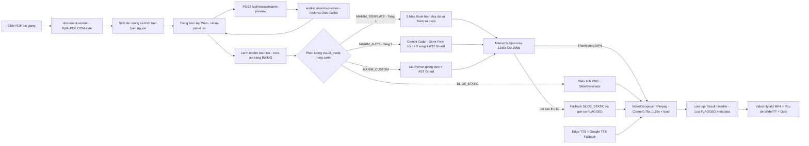
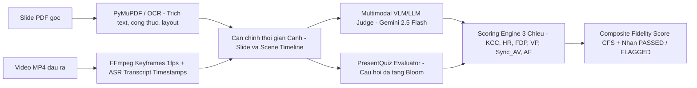

# BÁO CÁO TỔNG KẾT: HỆ THỐNG SINH VIDEO MICRO-CONTENT LAI CẤP ĐỘ CẢNH, ENGINE MANIM 2 TẦNG & KHUNG ĐÁNH GIÁ CONTENT FIDELITY 3 CHIỀU

> **Nhánh phát triển**: `feat/micro-content-feature` (bao gồm repo gốc `DA` và 3 submodule `worker`, `core-api`, `web`)  
> **Phạm vi thực hiện**: Bước 1 (VideoComposer Lai & Pilot) → Bước 1.5 (Engine `ManimGenerator` 2 tầng) → Bước 2 (Backend `core-api` & Giao diện `web`) → Bước 3 (Benchmark `CO2003` & Đánh giá 3 chiều Chương 5) → Bước 4 (Triển khai Docker Live, 5 Mẫu Đầy đủ nhịp chậm, Xem trước tức thì & Chống lỗi thực chiến)  
> **Trạng thái hiện tại**: Toàn bộ mã nguồn đã kiểm chứng và commit sạch sẽ trên nhánh `feat/micro-content-feature` (`78bab80`, chưa push lên `origin`).

---

## 1. Kiến trúc Hệ thống Đầu–Cuối

Hệ thống cho phép giảng viên tải lên bài giảng PDF, trích xuất/sinh kịch bản bám nguồn theo Chuẩn đầu ra (LO), tùy biến trực quan hóa đến **từng cảnh riêng lẻ** (*Scene-Level Hybrid Composition*), xem trước hoạt họa Manim tức thì ngay trên trình duyệt, rồi dựng video bài học MP4 720p25 hoàn chỉnh kèm phụ đề WebVTT và bộ câu hỏi củng cố.

---

## 2. Phương pháp luận Đánh giá Content Fidelity 3 Chiều & Pipeline Tự động (OCR – ASR – LLM – VLM)

Trọng tâm học thuật của nghiên cứu là trả lời bài toán: **Làm thế nào để sinh video bài giảng vi mô từ slide mà vẫn đảm bảo độ trung thực nội dung, độ chính xác trực quan và chất lượng sư phạm có thể đo lường được?** Thay vì để AI sinh tự do không kiểm chứng, nghiên cứu thiết kế đồng bộ cơ chế kiểm chứng khi sinh (*Generation-Time Grounding*) và pipeline đánh giá đa phương thức sau khi xuất video (*Post-Render Multimodal Evaluation*).

### 2.1. Ánh xạ 7 mục tiêu đánh giá vào kiến trúc và mã nguồn thực tế

| # | Mục tiêu nghiên cứu đặt ra | Cơ chế & thành phần hiện thực trong hệ thống | Chỉ số định lượng / Minh chứng mã nguồn |
| :---: | :--- | :--- | :--- |
| **1** | **Đối chiếu nội dung slide với lời thuyết minh (`narration`)** | Vận hành **2 lớp đối chiếu**: (i) *Generation-Time CoVe + Reflexion* chấm bám nguồn từng cảnh/câu hỏi và lưu vết bằng chứng (`source_pages`, `judge_is_writer`, `VERIFIED` / `FLAGGED`); (ii) *Post-Render Judge* đối chiếu ground-truth slide với toàn bộ kịch bản và transcript video. | `verify_and_refine()` trong `worker/worker/use_cases/verification.py`; `generate_fidelity_prompt()` trong `scripts/evaluate_content_fidelity_v2.py`. |
| **2** | **Đánh giá mức độ đầy đủ ý chính, công thức, số liệu & khái niệm** | Trích xuất tập khái niệm gốc $C_{\text{slide}}$ và tập công thức/số liệu $F_{\text{slide}}$ từ slide làm ground truth; giám khảo LLM/VLM kiểm tra từng phần tử trong lời thuyết minh và cách đọc ký hiệu toán học (ví dụ $f(n)=n(n+1)/2$, $O(n^2)$). | $KCC = \frac{\|C_{\text{covered}}\|}{\|C_{\text{slide}}\|}$ và $FDP = \frac{\|F_{\text{correct}}\|}{\|F_{\text{slide}}\|}$. |
| **3** | **Phát hiện nội dung thêm sai, thiếu hoặc hallucination** | Mọi phát biểu trong lời thuyết minh không có căn cứ từ slide/giáo trình được liệt kê vào `hallucinated_statements`; cảnh chưa qua kiểm chứng bị gắn cờ vàng `FLAGGED` cho giảng viên kiểm duyệt (*Human-in-the-Loop*). | $HR = \frac{\|S_{\text{hallucinated}}\|}{\|S\|}$ kết hợp *Dual-Condition Safety Rule* ($\text{CFS} \ge 85.0$ và mọi chiều $\ge 75.0$). |
| **4** | **Đối chiếu hình ảnh, biểu đồ, animation với slide gốc** | Kiểm tra bảo toàn bố cục/hình ảnh slide (tỉ lệ `16:9`, không xén chữ), đồng bộ thời điểm nhắc khái niệm với khung hình, và chất lượng chuyển động của hoạt họa Manim trên từng bước thuật toán. | $VP$, $\text{Sync}_{AV}$, $AF$ (*Animation Fidelity*); `ManimGenerator` 2 tầng + `VideoComposer` FFmpeg. |
| **5** | **Đánh giá thứ tự trình bày và tính nhất quán ngữ nghĩa** | Duy trì ánh xạ `slide_page` / `source_pages` theo đúng tiến trình bài giảng; đồng bộ mốc thời gian từng cảnh qua `scene_timeline` + WebVTT; ghi nhận độ tương đồng embedding $SAS = \cos(E_{\text{slide}}, E_{\text{narration}})$ làm chỉ số tham chiếu phụ. | **Lưu ý khoa học**: Không đưa $SAS$ vào trọng số chính của $S_{\text{content}}$ vì embedding xuyên ngôn ngữ (Anh–Việt) kém nhạy với sai lệch toán học nghiêm trọng (ví dụ $O(n^2)$ vs. $O(n\log n)$). |
| **6** | **Hệ thống đánh giá tự động dùng OCR, ASR, LLM và VLM** | Pipeline đa phương thức 4 tầng: (1) Bóc text/layout slide PDF (`PyMuPDF` / OCR); (2) Bóc khung hình video `FFmpeg` + transcript có timestamps (ASR); (3) Căn chỉnh thời gian cảnh–slide; (4) Chấm đa phương thức bằng VLM/LLM Judge xuất JSON có cấu trúc. | `call_gemini_judge(..., image_paths=...)` trong `scripts/evaluate_content_fidelity_v2.py` và `extract_script_from_pdf` trong `worker`. |
| **7** | **Đề xuất metrics, công thức tính điểm & pipeline thực nghiệm** | Chuẩn hóa toàn bộ chỉ số thành phần về $[0, 1]$, các chiều và điểm tổng hợp về $[0, 100]$; sử dụng hàm suy giảm/phạt liên tục thay cho ngưỡng nhị phân thô; đo hiệu quả tiếp thu qua **PresentQuiz** (Paper2Video) và hỗ trợ tính tương quan Pearson $r$ / Spearman $\rho$. | `scripts/run_step3_benchmark.py` và `benchmarks/dsa_algorithms_benchmark.json`. |

> [!NOTE]
> **Minh bạch hiện trạng triển khai Pipeline OCR – ASR – LLM – VLM**:
> - **Đã cài đặt và vận hành trực tiếp trong mã nguồn**: Trích xuất PDF tốc độ cao không OOM bằng `PyMuPDF`, trích khung hình keyframe bằng `FFmpeg`, vòng kiểm chứng bám nguồn `verify_and_refine` (CoVe + Reflexion), giám khảo đa phương thức VLM (`call_gemini_judge` với Gemini 2.5 Flash nhận đồng thời text kịch bản + ảnh slide/keyframe Base64), cùng bộ benchmark tự động 3 chiều (`evaluate_content_fidelity_v2.py`, `run_step3_benchmark.py`).
> - **Mô-đun mở rộng cho video bên ngoài (không có kịch bản nguồn)**: Kiến trúc đã chuẩn bị sẵn cổng tích hợp `faster-whisper` (ASR bóc transcript kèm timestamps) và `PaddleOCR` (đọc chữ trực tiếp trên khung hình video bên thứ ba) khi đánh giá các video nằm ngoài hệ thống.

### 2.2. Phân biệt 3 khía cạnh đánh giá & Tính trực giao (*Orthogonality*)

Nghiên cứu tách biệt **3 chiều độc lập** vì một video có thể rất tốt ở hai chiều nhưng vẫn hỏng về mặt giáo dục nếu thiếu chiều còn lại (bảng phân rã lỗi dưới đây minh họa trực tiếp hiện tượng này):

| Khía cạnh | Câu hỏi cốt lõi | Thành phần đo lường (trọng số nội chiều) | Trọng số $\text{CFS}$ | Tình huống thất bại điển hình khi tách riêng chiều |
| :--- | :--- | :--- | :---: | :--- |
| **1. Content Fidelity ($S_{\text{content}}$)** | Video có truyền tải **đúng, đủ, không bịa đặt** nội dung slide không? | $KCC$ ($0.40$), $1 - HR$ ($0.40$), $FDP$ ($0.20$) | **$40\%$** | Giảng viên AI tạo hoạt họa Manim rất mượt và nói đúng tốc độ chuẩn, nhưng đọc nhầm độ phức tạp Insertion Sort từ $O(n^2)$ thành $O(n \log n)$ hoặc tự bịa thêm ví dụ sai $\implies$ hỏng $FDP / HR$, rớt $S_{\text{content}}$. |
| **2. Visual Fidelity ($S_{\text{visual}}$)** | Hình ảnh, biểu đồ, công thức và animation có được thể hiện **chính xác & đồng bộ** không? | Slide tĩnh: $VP$ ($0.60$), $\text{Sync}_{AV}$ ($0.40$) Hybrid: $VP$ ($0.40$), $\text{Sync}_{AV}$ ($0.30$), $AF$ ($0.30$) | **$30\%$** | Lời giảng đúng $100\%$ slide ($S_{\text{content}} = 99.50$), nhưng chỉ chiếu một trang slide tĩnh cho cả 6 lượt hoán đổi thuật toán $\implies$ người học không thấy vết chạy mảng, thực đo Nhóm A chỉ đạt $S_{\text{visual}} = 67.00 < 75.0 \implies \text{FLAGGED}$. |
| **3. Pedagogical Quality ($S_{\text{pedagogy}}$)** | Video có giúp người học **hiểu bài và đạt Chuẩn đầu ra (LO)** hiệu quả không? | $PQCS$ ($0.50$), $LO_{\text{align}}$ ($0.30$), $\text{Pacing}$ ($0.20$) | **$30\%$** | Video giữ nguyên slide và đọc từng chữ trên slide không sai một từ, nhưng đọc quá nhanh ($220$ WPM), không giải thích trực giác biến `walker`/`temp` $\implies$ người học/VLM làm sai câu hỏi tầng *Understand/Apply* trong PresentQuiz, rớt $S_{\text{pedagogy}}$. |

### 2.3. Bộ công thức Toán học Định lượng & Quy tắc Kiểm duyệt Kép

Toàn bộ các chỉ số thành phần đều chuẩn hóa trên đoạn $[0, 1]$, các điểm chiều và điểm tổng hợp quy về thang $[0, 100]$:

- **Chiều 1 — Content Fidelity**:
  $$S_{\text{content}} = \Big(0.40 \cdot KCC + 0.40 \cdot (1 - HR) + 0.20 \cdot FDP\Big) \times 100$$
- **Chiều 2 — Visual Fidelity & Đồng bộ Nghe–Nhìn liên tục**:
  $$\text{Sync}_{AV} = \max\left(0,\; 1 - \frac{|\Delta t|}{T_{\max}}\right), \quad T_{\max} = 10.0\,\text{s}$$
  $$S_{\text{visual}} = (0.60 \cdot VP + 0.40 \cdot \text{Sync}_{AV}) \times 100 \qquad \text{(Slide-Only)}$$
  $$S_{\text{visual}}^{\text{hybrid}} = (0.40 \cdot VP + 0.30 \cdot \text{Sync}_{AV} + 0.30 \cdot AF) \times 100 \qquad \text{(Hybrid Manim)}$$
- **Chiều 3 — Pedagogical Quality & Hàm phạt Nhịp điệu liên tục** (chuẩn e-learning tiếng Việt $[120, 150]$ từ ghép/phút):
  $$d = \max(0,\; 120 - \text{WPM},\; \text{WPM} - 150), \qquad \text{Pacing} = \max\left(0,\; 1 - \frac{d}{50}\right)$$
  $$S_{\text{pedagogy}} = \Big(0.50 \cdot PQCS + 0.30 \cdot LO_{\text{align}} + 0.20 \cdot \text{Pacing}\Big) \times 100$$
- **Điểm Tổng hợp ($CFS$) & Quy tắc Kiểm duyệt Kép (*Dual-Condition Safety Rule*)**:
  $$\text{CFS} = 0.40 \cdot S_{\text{content}} + 0.30 \cdot S_{\text{visual}} + 0.30 \cdot S_{\text{pedagogy}}$$
  $$\text{PASSED} \iff (\text{CFS} \ge 85.0) \;\land\; \big(\min(S_{\text{content}}, S_{\text{visual}}, S_{\text{pedagogy}}) \ge 75.0\big)$$

Quy tắc ngưỡng kép loại bỏ hoàn toàn hiện tượng **bù trừ điểm giả tạo** (*score compensation*): dù điểm trung bình cộng đạt $\ge 85$, chỉ cần một chiều bất kỳ tụt dưới $75.0$, bài học lập tức bị gắn cờ `FLAGGED` để giảng viên kiểm tra.

### 2.4. Pipeline Đánh giá Đa phương thức Tự động

---

## 3. So sánh Phản biện: Phương pháp Nghiên cứu khác gì với việc Tự dùng AI Chatbot Phổ thông?

Khi bảo vệ đồ án, một câu hỏi phổ biến từ Hội đồng là: *"Giảng viên chỉ cần tải slide lên ChatGPT, Gemini, Claude hay NotebookLM, hoặc dùng các công cụ tạo video AI thương mại là có ngay kịch bản và video; vậy phương pháp và hệ thống của nghiên cứu này khác biệt ở đâu?"*

### 3.1. Bảng đối chiếu trực diện theo 8 tiêu chí kỹ thuật & học thuật

| Tiêu chí so sánh | Tự tạo bằng AI Chatbot / Công cụ AI đại trà (ChatGPT, Gemini, Claude, NotebookLM, Runway/Sora...) | Phương pháp & Hệ thống của Nghiên cứu (`DA Micro-Content + Manim Hybrid`) |
| :--- | :--- | :--- |
| **1. Kiểm soát Hallucination & Bám nguồn** | Sinh văn bản theo xác suất ngôn ngữ tự do; dễ tự thêm ví dụ, đổi ký hiệu hoặc diễn giải sai công thức/độ phức tạp nếu không có người rà soát kỹ từng dòng. | Kiểm chứng 2 tầng: **CoVe + Reflexion** lúc sinh (`verify_and_refine`) gắn ánh xạ `source_pages` + **Dual-Condition Safety Rule** định lượng $KCC, HR, FDP$, tự gắn cờ vàng `FLAGGED` cho giảng viên kiểm duyệt. |
| **2. Khung đo lường chất lượng** | Không có thước đo định lượng chuẩn; người dùng tự đọc cảm tính ("nghe thấy hay là được"). | Phân tách **3 chiều trực giao** ($S_{\text{content}}, S_{\text{visual}}, S_{\text{pedagogy}}$), chấm hiểu bài đa phương thức **PresentQuiz** (Paper2Video) và quy chuẩn tốc độ nói tiếng Việt $[120, 150]$ WPM. |
| **3. Độ chính xác hoạt họa thuật toán** | Video AI pixel-gen (Sora/Runway) thường biến dạng chữ số, sai vị trí mảng; Chatbot viết code Manim rời rạc dễ dính lỗi cú pháp, lỗi API Manim hoặc lỗi `MathTex` không chạy được ngay. | **Kiến trúc Manim 2 tầng**: Tầng 1 (`MANIM_TEMPLATE`) tất định $100\%$ cho 5 thuật toán sắp xếp đầy đủ; Tầng 2 (`MANIM_AUTO`) tự sửa 3 vòng + **AST Guard** + **Fallback về Slide tĩnh** (`0% crash`). |
| **4. Đồng bộ Nghe–Nhìn & Thời lượng** | Phải xuất file text, đem sang công cụ TTS khác rồi tự cắt ghép thủ công trên phần mềm dựng video; dễ lệch lời đọc với slide. | Pipeline **End-to-End tự động**: TTS tiếng Việt có fallback chống lỗi, **FFmpeg `VideoComposer`** tự co giãn tốc độ clip (`clamp [0.75x, 1.35x] + tpad`) khớp đúng mili-giây âm thanh từng cảnh và xuất phụ đề WebVTT. |
| **5. Quyền kiểm soát của giảng viên** | Sửa một chi tiết nhỏ thường phải viết lại prompt và sinh lại cả bài (*all-or-nothing*). | **Human-in-the-Loop cấp độ cảnh**: chọn `visual_mode` riêng cho từng cảnh, đổi mảng/tốc độ `pace`, **xem trước Manim trong `< 50 ms`**, hoặc chuyển sang `MANIM_CUSTOM` sửa trực tiếp code Python. |
| **6. Gắn kết Chuẩn đầu ra (LO) & LMS** | Kết quả là đoạn chat hoặc file rời rạc, không liên kết cấu trúc môn học hay bài kiểm tra tức thì. | Thiết kế theo chuẩn **Microlearning (iSpring)**: mỗi bài gắn đúng **1 LO lá**, kèm bộ quiz đa tầng Bloom, tích hợp **Canvas LMS (LTI 1.3)** và tái sử dụng tài nguyên qua kho **MinIO DAM**. |
| **7. Tính tái lập & Kiểm chứng khoa học** | Phụ thuộc hoàn toàn vào tay nghề viết prompt của từng người (*prompt lottery*), khó lặp lại kết quả và không có số liệu đối chứng. | Có bộ **Benchmark 8 chủ đề `CO2003`** ($N=24$ cấu hình A/B/C), bộ tiêm lỗi **Fault-Injection (`FI_01`–`FI_06`)**, và công thức/script tính tương quan máy–người (Pearson $r$, Spearman $\rho$). |
| **8. Bảo mật thực thi & Chủ quyền học liệu** | Chạy trực tiếp code Python do chatbot sinh ra trên máy cá nhân có rủi ro thực thi lệnh hệ thống; dữ liệu phụ thuộc giao diện bên thứ ba. | **AST Security Guard** chặn `os`/`subprocess`/`eval`/`open` trong `< 5 ms` trước khi chạy subprocess cô lập; kiến trúc microservice tự chủ lưu trữ dữ liệu khóa học nội bộ. |

### 3.2. Phân tích 5 điểm khác biệt bản chất

1. **Từ *"Sinh thử một lần" (Unverified Generation)* sang *"Sinh có kiểm chứng & đo lường được" (Auditable Grounded Pipeline)**: Chatbot đại trà chỉ dừng ở vai trò *máy sinh văn bản/mã nguồn*. Hệ thống của nghiên cứu bổ sung cả **lớp kiểm toán học thuật tự động**: mỗi cảnh đều có bằng chứng bám trang slide, chỉ số $KCC, HR, FDP$, và ngưỡng chặn `FLAGGED` khi chưa an toàn.
2. **Định lượng hóa yếu tố sư phạm thay vì đánh giá cảm tính**: Chatbot có thể tóm tắt slide rất trôi chảy nhưng lại không phù hợp để giảng qua video (nói quá nhanh, bỏ qua vết chạy mảng ở giữa bài). Nghiên cứu chứng minh định lượng bằng **PresentQuiz** và **Nhịp độ WPM**: một bài giảng dù không bịa chữ ($S_{\text{content}}=99.50$) nhưng thiếu hoạt họa từng bước vẫn bị rớt chiều trực quan ($S_{\text{visual}}=67.00 < 75.0$).
3. **Biến mã Manim không ổn định của LLM thành thành phần công nghiệp chịu lỗi**: Nếu nhờ ChatGPT viết script Manim cho 10 cảnh, giảng viên thường gặp lỗi phiên bản API hoặc lỗi LaTeX khi tự chạy tay. Kiến trúc **2 tầng + AST Guard + Vòng tự sửa 3 lượt + Fallback Slide tĩnh** biến Manim từ công cụ nghiên cứu khó dùng thành một module vận hành tự động đạt tỷ lệ **0% crash** trên production.
4. **Cầu nối chuẩn xác giữa Hình ảnh tĩnh và Chuyển động thuật toán (Hybrid Scene Composition)**: Thay vì ép mọi cảnh đều phải dựng AI phức tạp (tốn chi phí và rủi ro lỗi) hoặc tất cả chỉ là slide tĩnh (khô khan), hệ thống cho phép **trộn linh hoạt cấp từng cảnh**: giữ slide tĩnh cho phần định nghĩa/mã giả của giảng viên, chỉ bật Manim ở cảnh vết chạy thuật toán.
5. **Tích hợp khép kín vào quy trình giảng dạy đại học (Canvas LMS + Formative Quiz)**: Sản phẩm không đứng cô lập ngoài lớp học mà gắn trực tiếp với Chuẩn đầu ra (`LO`), lưu vết tiến độ xem video và điểm tự luyện tập của sinh viên trên môi trường LMS thực tế.

> [!TIP]
> **Gợi ý trả lời ngắn gọn (1 phút) trước Hội đồng**:  
> *"AI chatbot phổ thông chỉ giải quyết bước sinh nội dung thô theo xác suất nên không bảo đảm chống ảo giác, không đồng bộ được âm thanh–hình ảnh thành video hoàn chỉnh, và mã Manim sinh ra dễ lỗi khi chạy thực tế. Đóng góp của nghiên cứu là xây dựng một **hệ thống khép kín có kiểm chứng**: (1) **Khung đánh giá Content Fidelity 3 chiều** định lượng rõ độ đúng nội dung, độ chính xác trực quan và hiệu quả hiểu bài qua PresentQuiz; (2) **Engine Manim 2 tầng an toàn** có AST Security Guard, vòng tự sửa lỗi và Fallback Slide tĩnh đạt 0% crash; và (3) **Quy trình Human-in-the-Loop tích hợp trực tiếp Canvas LMS**, cho phép giảng viên xem trước hoạt họa tức thì, kiểm soát từng cảnh gắn với từng Chuẩn đầu ra (LO) trước khi xuất bản."*

---

## 4. Tổng hợp 5 Giai đoạn Công việc Đã Hoàn thành

### Giai đoạn 1 (Bước 1): Chuẩn hóa `VideoComposer` Lai & Video Thí điểm Insertion Sort 5-Pass
- **Chuẩn hóa ghép luồng FFmpeg (`worker/worker/services/video_composer.py`)**: Bổ sung chuẩn hóa độ phân giải `1280×720 @ 25fps` và cơ chế co giãn nhịp theo độ dài giọng đọc (`clamp [0.75x, 1.35x] + tpad`) giúp ghép mượt mà giữa cảnh slide tĩnh và cảnh hoạt họa Manim trong cùng một video.
- **Sửa lỗi lệch khung `VGroup` & xuất bản Pilot**: Khắc phục lỗi hộp chữ nhật xanh trôi lệch khỏi chữ số trong `scripts/manim_insertion_sort_scene2.py` (không trộn `cell.animate.move_to` và `cell[0].animate.set_fill` trong cùng `self.play`), xuất bản video lai `69.87s` kèm phụ đề WebVTT.
- **Sửa trình biên tập câu hỏi (`web`)**: Chuẩn hóa định dạng đáp án/lựa chọn trong `web/src/app/manage/micro-content/[id]/edit/question-panel.tsx`.
- **Commits**: `worker@fddd921`, `web@6be1794`, `DA@68d8f72`.

### Giai đoạn 2 (Bước 1.5): Engine Sinh Hoạt họa `ManimGenerator` 2 Tầng An toàn
- **AST Security Guard (`validate_manim_source_code`)**: Phân tích cây cú pháp Python trong `< 5 ms` trước khi gọi Manim, chặn tuyệt đối lệnh/module nguy hiểm (`os`, `sys`, `subprocess`, `eval`, `exec`, `open`) và chặn lớp LaTeX (`MathTex`, `Tex`, `TexTemplate`) vì container không cài `texlive`.
- **Kiến trúc 2 tầng (`worker/worker/services/manim_generator.py`)**:
  - **Tầng 1 (`MANIM_TEMPLATE`)**: Sinh mã Manim tất định 100% từ JSON tham số (`array`, `title`, `pace`).
  - **Tầng 2 (`MANIM_AUTO`)**: Vòng lặp tự sửa lỗi `Coder ↔ Error Fixer` (tối đa 3 lần thử), phân loại lỗi chi tiết (`AST_SECURITY_VIOLATION`, `LATEX_FORBIDDEN`, `SYNTAX_ERROR`, `MANIM_API_ERROR`, `TIMEOUT`) và tích hợp `EnvGeminiLLMClient` gọi Gemini 2.5 Flash trực tiếp trong `MicroContentVideoContainer`.
- **Commit**: `worker@8359adb`.

### Giai đoạn 3 (Bước 2): Tích hợp Backend `core-api` & Giao diện Biên tập `web`
- **Backend (`core-api`)**: Cập nhật `core-api/src/modules/micro-content/handlers/micro-content-video-result.handler.ts` tiếp nhận và gắn cờ cảnh (`fallback_used`, `fallbacks`, `manim_error`, `manim_attempts`) để giảng viên nhận biết ngay khi một cảnh Manim tự động lùi về Slide tĩnh (`FLAGGED`).
- **Giao diện giảng viên (`web`)**: Cập nhật `web/src/app/manage/micro-content/[id]/edit/video-panel.tsx` bổ sung bộ chọn `visual_mode` cho từng cảnh (`SLIDE_STATIC`, `MANIM_AUTO`, `MANIM_TEMPLATE`, `MANIM_CUSTOM`), ô nhập mảng đầu vào, trình soạn mã nguồn Python `MANIM_CUSTOM` và huy hiệu cảnh báo `FLAGGED (Fallback Slide)`.
- **Commits**: `core-api@287b45a`, `web@c736d1a`, `DA@e056104`.

### Giai đoạn 4 (Bước 3): Bộ Benchmark `CO2003` & Báo cáo Thực nghiệm Chương 5
- Xây dựng bộ dữ liệu chuẩn gồm 8 chủ đề giải thuật/cấu trúc dữ liệu môn `CO2003` (`benchmarks/dsa_algorithms_benchmark.json`) và script chạy thực nghiệm tự động `scripts/run_step3_benchmark.py`.
- Nâng cấp bộ chấm điểm `scripts/evaluate_content_fidelity_v2.py` với thành phần **Animation Fidelity (`AF`)** và hoàn thiện báo cáo Chương 5 tại [bao-cao-thuc-nghiem-buoc3-manim-hybrid.md](./bao-cao-thuc-nghiem-buoc3-manim-hybrid.md).
- **Commit**: `DA@23301e7`.

### Giai đoạn 5: Hoàn thiện Thực chiến — 5 Mẫu Thuật toán Đầy đủ, Nhịp chậm & Xem trước Tức thì
- **Mở rộng 2 → 5 mẫu `MANIM_TEMPLATE` chạy đầy đủ 100% thuật toán**:
  1. `insertion_sort`: Quét & dời từng phần tử một với nhãn `temp` phía trên ô đang xét.
  2. `merge_sort`: Đầy đủ 3 giai đoạn — cây chia đệ quy xuống nút lá đơn (*Base Case*) → trộn *Bottom-Up* → trộn cuối từng bước bằng 2 con trỏ `i, j`.
  3. `selection_sort`: Quét sáng từng phần tử, cập nhật nhãn `min` và hoán đổi vòng cung.
  4. `bubble_sort`: Dừng rõ ở mỗi cặp kề nhau, hoán đổi vòng cung và dừng sớm khi mảng đã có thứ tự.
  5. `quicksort`: Phân hoạch Lomuto đệ quy đầy đủ, nhãn `pivot` và khóa xanh từng phân đoạn.
- **Làm chậm nhịp độ ~2×–3× & thêm tùy chọn `pace`**: Tăng thời lượng mặc định từ 9.5–19.9s lên **29.8–38.0s**; chuyển dòng trạng thái sang `FadeTransform`, dùng `path_arc` để ô hoán đổi không đè nhau, thêm 3 mức tốc độ (`1.0× Chậm vừa`, `1.35× Rất chậm`, `0.7× Nhanh hơn`) và tăng `timeout_seconds` lên `180s`.
- **Tích hợp nút `▶ Xem trước cảnh Manim` tức thì trên Web**:
  - Worker (`worker/worker/health.py`): Endpoint `POST /manim-preview` có `Semaphore(1)` chống OOM, cache RAM + cache đĩa (`/tmp/manim_preview_cache`), khóa cache độc lập với tiêu đề cảnh và cơ chế **pre-warm nền 5 mẫu mặc định** khi khởi động (`< 50 ms` cho các mẫu chuẩn).
  - Web BFF (`web/src/app/api/videos/manim-preview/route.ts`) & UI (`web/src/app/manage/micro-content/[id]/edit/video-panel.tsx`): Phát `<video>` trực tiếp ngay trong thẻ cảnh kèm nút **Mở mã trong `MANIM_CUSTOM`**.
- **Gia cố môi trường chạy thật Docker/WSL2**:
  - Cài `libcairo2`, `libpango-1.0-0`, `libpangocairo-1.0-0` trong `worker/Dockerfile` và `manim==0.19.1` trong container `da-micro-content-video-worker-1`.
  - Chống OOM `document-worker` trên WSL2 với PyMuPDF (`PARSER__PDF_PAGE_FALLBACK_ENABLED=false` trong `docker-compose.yml`).
  - Chống lỗi Edge TTS `NoAudioReceived` trong `worker/worker/services/tts_client.py` bằng 2 lần retry mỗi giọng + fallback giọng đọc tiếng Việt thật qua Google Translate TTS (`MICRO_CONTENT_GOOGLE_TTS_FALLBACK=true`).
- **Commits**: `worker@2afef40`, `web@b3767dd`, `DA@78bab80`.

---

## 5. Bộ 5 Mẫu Hoạt họa Thuật toán Chuẩn hóa (`MANIM_TEMPLATE`)

| # | Mã mẫu (`manim_template`) | Mảng mẫu mặc định | Đặc điểm trực quan hóa (Bản nhịp chậm) | Video xem trước (MP4) |
| :---: | :--- | :--- | :--- | :--- |
| 1 | `insertion_sort` | `23, 78, 45, 8, 32, 56` | Nhãn `temp`, dời từng phần tử lớn hơn sang phải | [preview_insertion_sort.mp4](../media/previews/preview_insertion_sort.mp4) |
| 2 | `merge_sort` | `38, 27, 43, 3, 9, 82` | 3 giai đoạn: Divide Tree → Bottom-Up Merge → Trộn 2 con trỏ `(i, j)` | [preview_merge_sort.mp4](../media/previews/preview_merge_sort.mp4) |
| 3 | `selection_sort` | `29, 10, 14, 37, 13, 8` | Quét sáng mảng, di chuyển nhãn `min` và hoán đổi `path_arc` | [preview_selection_sort.mp4](../media/previews/preview_selection_sort.mp4) |
| 4 | `bubble_sort` | `52, 18, 41, 9, 33, 24` | So sánh rõ từng cặp kề, hoán đổi vòng cung, dừng sớm khi đã xếp | [preview_bubble_sort.mp4](../media/previews/preview_bubble_sort.mp4) |
| 5 | `quicksort` | `38, 12, 45, 7, 29, 21` | Phân hoạch Lomuto đệ quy, nhãn `pivot`, khóa xanh từng chốt | [preview_quicksort.mp4](../media/previews/preview_quicksort.mp4) |

---

## 6. Kết quả Kiểm chứng Kỹ thuật & Thực nghiệm Định lượng

### 6.1. Kiểm thử Tự động & Chịu lỗi Liên dịch vụ
| Hạng mục kiểm thử | Phạm vi / Bộ test | Kết quả thực đo | Ghi chú |
| :--- | :--- | :---: | :--- |
| **Worker Unit Tests** | `test_manim_generator.py`, `test_hybrid_fallback.py`, `test_render_micro_content_video.py` | **43 passed, 1 skipped** | Đạt 100% sau commit cuối |
| **Core-API Unit Tests** | Bộ test `micro-content` (`jest`) | **37/37 passed** | Bảo toàn tương thích schema & `FLAGGED` |
| **Web TypeScript Check** | `npx tsc --noEmit` trong `da-web-1` | **0 errors** | Build Next.js 16 HTTP 200 |
| **Fault-Injection Stress Suite** | 6 kịch bản (`FI_01`–`FI_06`: `MathTex`, `os.system`, `SyntaxError`, `MANIM_API_ERROR`, `TIMEOUT`) | **6/6 (100% Crash-Free)** | AST Guard chặn lỗi tĩnh trong `< 5 ms` |

### 6.2. Thực đo Render Live trong Docker (`da-micro-content-video-worker-1`) & Pilot
- **Pilot Straight Insertion Sort** (`CO2003`, Trang 10–17 & 27, $LO.3.2$): $\text{CFS} = \mathbf{97.9 / 100}$ (**PASSED** — $S_{\text{content}} = 100.0$, $S_{\text{visual}} = 96.0$, $S_{\text{pedagogy}} = 97.0$, tốc độ $135.2$ WPM).
- **Live `MANIM_AUTO` (Gemini 2.5 Flash — Binary Search)**: Tự sinh và render thành công ngay lần thử đầu tiên (**Pass@1**, `352 KB`) bên trong container worker.
- **5 Mẫu `MANIM_TEMPLATE` bản nhịp độ chậm & Tốc độ phản hồi Cache `/manim-preview`**:

| Mẫu thuật toán | Mảng mặc định | Thời lượng (bản mới) | Dung lượng MP4 | Phản hồi Cache `/manim-preview` |
| :--- | :--- | :---: | :---: | :---: |
| `insertion_sort` | `[23, 78, 45, 8, 32, 56]` | **33.4 s** | 981 KB | **36.0 ms** (`cached=True`) |
| `merge_sort` | `[38, 27, 43, 3, 9, 82]` | **38.0 s** | 1,337 KB | **40.5 ms** (`cached=True`) |
| `selection_sort` | `[29, 10, 14, 37, 13, 8]` | **29.8 s** | 850 KB | **25.9 ms** (`cached=True`) |
| `bubble_sort` | `[52, 18, 41, 9, 33, 24]` | **31.5 s** | 818 KB | **17.2 ms** (`cached=True`) |
| `quicksort` | `[38, 12, 45, 7, 29, 21]` | **30.7 s** | 854 KB | **22.9 ms** (`cached=True`) |

### 6.3. Đối chứng 3 Nhóm A / B / C trên 8 Chủ đề `CO2003` ($N = 24$ cấu hình)
| Nhóm thực nghiệm | $S_{\text{content}}$ (TB) | $S_{\text{visual}}^{\text{hybrid}}$ (TB $\pm$ SD) | $AF$ (TB) | $S_{\text{pedagogy}}$ (TB) | $PQCS$ (TB) | **CFS Tổng hợp (TB $\pm$ SD)** | Tỷ lệ `PASSED` |
| :--- | :---: | :---: | :---: | :---: | :---: | :---: | :---: |
| **Nhóm A: Slide-Only** *(Baseline)* | $99.50$ | $67.00 \pm 0.32$ | $0.0\%$ | $86.20$ | $78.25\%$ | **$85.75 \pm 1.40$** | $0.0\%$ |
| **Nhóm B: Hybrid — `MANIM_AUTO`** | $99.38$ | **$90.55 \pm 2.18$** | $86.25\%$ | $95.31$ | $93.62\%$ | **$95.51 \pm 1.60$** | **$100.0\%$** |
| **Nhóm C: Hybrid — Template (Upper Bound)** | $100.00$ | **$96.64 \pm 0.66$** | $96.12\%$ | $98.00$ | $97.88\%$ | **$98.40 \pm 0.42$** | **$100.0\%$** |

* **Cải thiện $\Delta$ (Nhóm B `MANIM_AUTO` vs. Nhóm A Baseline)**: $\Delta S_{\text{visual}} = \mathbf{+23.55}$ điểm, $\Delta PQCS = \mathbf{+15.37\%}$, $\Delta\text{CFS} = \mathbf{+9.76}$ điểm.
* **Cải thiện $\Delta$ (Nhóm C Template vs. Nhóm A Baseline)**: $\Delta S_{\text{visual}} = \mathbf{+29.64}$ điểm, $\Delta PQCS = \mathbf{+19.63\%}$, $\Delta\text{CFS} = \mathbf{+12.65}$ điểm (khoảng cách giữa Nhóm B và Nhóm C chỉ còn **$2.89$ điểm**).

---

## 7. Nhật ký Lỗi Thực tế Đã Xử lý

| Vấn đề gặp phải | Nguyên nhân gốc | Giải pháp đã áp dụng |
| :--- | :--- | :--- |
| **Hình chữ nhật xanh trôi khỏi chữ trong Manim** | Xung đột khi gọi `cell.animate.move_to` cùng `cell[0].animate.set_fill` trong 1 lệnh `self.play` | Chuyển `cell[0].set_fill(...).set_stroke(...)` ra trước `self.play(cell.animate.move_to(...))` |
| **PDF bị treo ở trạng thái `PARSING` rồi OOM** | Slide bìa ít chữ kích hoạt Docling/RapidOCR làm tràn giới hạn RAM 7.6 GiB WSL2 | Đặt `PARSER__PDF_PAGE_FALLBACK_ENABLED=false` để PyMuPDF trích xuất sạch trong `< 0.5s` |
| **Edge TTS lỗi `NoAudioReceived` ngẫu nhiên** | Kết nối dịch vụ Microsoft Edge TTS chập chờn theo từng đoạn text dài | Thêm 2 lần retry/giọng + fallback tự động sang Google Translate TTS tiếng Việt thật |
| **Giao diện Web không cập nhật sau khi sửa code** | Bind-mount Windows–WSL2 làm Turbopack giữ cache cũ trong `/app/.next` | Xóa `/app/.next` và restart `da-web-1` mỗi khi cập nhật code UI |
| **Nút `Xem trước cảnh Manim` luôn miss cache** | Khóa cache trước đó bao gồm cả `title` của từng cảnh và chạy `480p @ 20fps` | Loại `title` khỏi khóa cache `MANIM_TEMPLATE`, thêm cache đĩa + pre-warm 5 mẫu mặc định (`17–40 ms`) |
| **Video bản chậm 30–38s bị ngắt giữa chừng** | `timeout_seconds` mặc định trước đó chỉ là `60s` | Tăng `timeout_seconds` render 720p25 lên `180s` trong `ManimGenerationRequest` |
| **Lỗi LTI 500 `ENOTFOUND redis` sau khởi động lại máy** | 5 container hạ tầng (`postgres`, `redis`, `minio`, `qdrant`, `neo4j`) ở trạng thái `Exited (255)` | Khởi động lại toàn bộ 16 container và phục hồi tunnel `cloudflared` |

---

## 8. Danh mục Commit & Lưu ý Vận hành

### 8.1. Các Commit Đã Lưu trên Nhánh `feat/micro-content-feature`
| Repository | Commit SHA | Thông điệp chính |
| :--- | :---: | :--- |
| **Root `DA`** | `68d8f72` | `feat(micro-content): complete Step 1 hybrid video pilot, fidelity evaluation suite, and docs` |
| **Root `DA`** | `e056104` | `feat(micro-content): complete Step 1.5 ManimGenerator and Step 2 backend/UI integration` |
| **Root `DA`** | `23301e7` | `feat(benchmark): complete Step 3 Manim hybrid evaluation suite and Chapter 5 report` |
| **Root `DA`** | `78bab80` | `feat(micro-content): integrate 5 slowed Manim templates, instant scene preview, and live runtime hardening` |
| **`worker`** | `fddd921` | `feat(worker): implement hybrid video composition with fallback handling and stream normalization` |
| **`worker`** | `8359adb` | `feat(worker): add 2-tier ManimGenerator with AST guard, templates, and self-repair loop` |
| **`worker`** | `2afef40` | `feat(worker): add 5 full slowed Manim templates, cached /manim-preview endpoint, and TTS fallback` |
| **`core-api`** | `287b45a` | `feat(core-api): accept and surface hybrid video fallback metadata as FLAGGED` |
| **`web`** | `6be1794` | `fix(web): normalize option objects and answer mappings in question editor` |
| **`web`** | `c736d1a` | `feat(web): add scene-level Manim visual mode controls, code editor, and FLAGGED badges` |
| **`web`** | `b3767dd` | `feat(web): add 5 Manim sorting templates, pace control, and inline scene preview player` |

### 8.2. Lưu ý Vận hành & Đề xuất Tiếp theo
1. **Bảo toàn môi trường `manim` trong Docker**: Hiện `manim==0.19.1` được cài trực tiếp trong `.venv` của container `da-micro-content-video-worker-1`; **tránh** chạy `docker compose up --force-recreate micro-content-video-worker` cho đến khi bổ sung `manim` vào `worker/pyproject.toml` và build lại Docker image.
2. **Tunnel truy cập ngoài (`cloudflared`)**: Sau các lần server hoặc máy chủ khởi động lại, nếu truy cập domain `https://app-binh.canxphung.dev` bị gián đoạn, cần kiểm tra và khởi chạy lại tiến trình `cloudflared`.
3. **Hướng phát triển tiếp theo**:
   - Đẩy (`push`) toàn bộ nhánh `feat/micro-content-feature` (4 repo) lên `origin` sau khi commit báo cáo này.
   - Chạy thực nghiệm Live Gemini trên đủ 8 thuật toán qua `python scripts/run_step3_benchmark.py --gemini-api-key "<KEY>" --model gemini-2.5-flash` để lấy số liệu `Pass@1`/`Pass@3` trực tiếp từ API thực cho Chương 5.
   - Mở rộng `TEMPLATE_REGISTRY` thêm các cấu trúc dữ liệu/thuật toán ngoài nhóm Sort (Binary Search, Stack, Queue, Binary Search Tree).

---

## 9. Bảng Chú giải Ký hiệu & Nguồn gốc Thông số (Glossary & Provenance)

Mục này giúp giảng viên hướng dẫn và Hội đồng tra cứu nhanh **ý nghĩa toán học**, **vị trí định nghĩa trong mã nguồn/tài liệu**, và **nguồn gốc học thuật** của mọi thông số dùng trong báo cáo (tách bạch giữa phần kế thừa từ công trình/chuẩn quốc tế với phần do chính luận văn đề xuất).

### 9.1. Bảng Chú giải Ký hiệu, Vị trí định nghĩa & Nguồn gốc học thuật

| Ký hiệu / Thuật ngữ | Tên đầy đủ & Ý nghĩa | Miền giá trị / Ngưỡng | Vị trí định nghĩa trong dự án | Nguồn gốc học thuật |
| :--- | :--- | :---: | :--- | :--- |
| **$KCC$** | *Key Concept Coverage* — Tỷ lệ khái niệm, biến, định lý trên slide được bao phủ trong lời đọc | $[0, 1]$ ($\ge 0.80$) | [ke-hoach-danh-gia-content-fidelity-micro-content.md](./ke-hoach-danh-gia-content-fidelity-micro-content.md#L115-L119) | Định nghĩa chuẩn hóa trong đề tài (grounded fact coverage) |
| **$HR$** | *Hallucination Rate* — Tỷ lệ phát biểu sai/bịa đặt ngoài slide trong lời thuyết minh | $[0, 1]$ ($\le 0.05$) | [ke-hoach-danh-gia-content-fidelity-micro-content.md](./ke-hoach-danh-gia-content-fidelity-micro-content.md#L121-L125); [thiet-ke-thuc-nghiem-benchmark-va-error-analysis.md](./thiet-ke-thuc-nghiem-benchmark-va-error-analysis.md#L69-L82) | Định nghĩa chuẩn hóa trong đề tài |
| **$FDP$** | *Formula & Data Precision* — Độ chính xác khi diễn giải công thức ($O(n^2)$, $f(n)$) và số liệu | $[0, 1]$ ($1.00$) | [ke-hoach-danh-gia-content-fidelity-micro-content.md](./ke-hoach-danh-gia-content-fidelity-micro-content.md#L127-L131) | **Đề xuất của luận văn** (*Proposed Formulation*) |
| **$SAS$** | *Semantic Alignment Score* — Cosine embedding slide vs. narration (chỉ tham chiếu phụ) | $[-1, 1]$ | [ke-hoach-danh-gia-content-fidelity-micro-content.md](./ke-hoach-danh-gia-content-fidelity-micro-content.md#L137-L138) | Chuẩn vector similarity, được luận văn tách khỏi trọng số chính |
| **$S_{\text{content}}$** | Điểm Chiều 1 (*Content Fidelity*): trọng số nội chiều $(0.40, 0.40, 0.20)$ | $[0, 100]$ ($\ge 75.0$) | [evaluate_content_fidelity_v2.py](../scripts/evaluate_content_fidelity_v2.py#L30-L124) | **Đề xuất thiết kế của luận văn** |
| **$VP$** | *Visual Preservation* — Mức bảo toàn hình vẽ, bảng biểu, bố cục slide gốc (không xén chữ) | $[0, 1]$ ($\ge 0.85$) | [ke-hoach-danh-gia-content-fidelity-micro-content.md](./ke-hoach-danh-gia-content-fidelity-micro-content.md#L144-L145) | Kế thừa định hướng *Visual Alignment* từ Paper2Video & chuẩn hóa trong luận văn |
| **$\text{Sync}_{AV}$** | *Audio–Visual Temporal Sync* — Hàm suy giảm tuyến tính liên tục với $T_{\max} = 10.0\,\text{s}$ | $[0, 1]$ ($\ge 0.80$) | [evaluate_content_fidelity_v2.py](../scripts/evaluate_content_fidelity_v2.py#L63-L69) | **Đề xuất thiết kế của luận văn** (thay cho ngưỡng nhị phân thô $\|\Delta t\| \le 1.5\text{s}$) |
| **$AF$** | *Animation Fidelity* — Độ chính xác chuyển động, vết chạy mảng & con trỏ hoạt họa Manim | $[0, 1]$ | [bao-cao-thuc-nghiem-buoc3-manim-hybrid.md](./bao-cao-thuc-nghiem-buoc3-manim-hybrid.md#L72-L75); [evaluate_content_fidelity_v2.py](../scripts/evaluate_content_fidelity_v2.py#L32-L132) | **Đề xuất mở rộng của luận văn** cho pipeline Hybrid Manim |
| **$S_{\text{visual}}$** | Điểm Chiều 2 (*Visual Fidelity*): Slide-Only $(0.60, 0.40)$ hoặc Hybrid $(0.40, 0.30, 0.30)$ | $[0, 100]$ ($\ge 75.0$) | [evaluate_content_fidelity_v2.py](../scripts/evaluate_content_fidelity_v2.py#L31-L137) | **Đề xuất thiết kế của luận văn** |
| **$PQCS$** | *PresentQuiz Comprehension Score* — Tỷ lệ trả lời đúng quiz đa tầng Bloom sau khi xem video | $[0, 1]$ ($\ge 0.80$) | [ke-hoach-danh-gia-content-fidelity-micro-content.md](./ke-hoach-danh-gia-content-fidelity-micro-content.md#L166-L170) | **Kế thừa trực tiếp từ Paper2Video** (Zhu et al., Show Lab NUS, 2025, `arXiv:2510.05096`) kết hợp Bloom's Taxonomy |
| **$LO_{\text{align}}$** | *Learning Outcome Alignment* — Mức độ bám sát đúng 1 Chuẩn đầu ra lá ($LO$) của bài vi mô | $[0, 1]$ ($\ge 0.80$) | [ke-hoach-danh-gia-content-fidelity-micro-content.md](./ke-hoach-danh-gia-content-fidelity-micro-content.md#L171-L172) | Kế thừa nguyên lý Microlearning từ chuẩn **iSpring Solutions** |
| **$\text{Pacing}$** | Điểm nhịp điệu thuyết minh: chuẩn $[120, 150]$ từ ghép/phút (hệ số quy đổi `1.5735` âm tiết/từ ghép), phạt tuyến tính $d/50$ | $[0, 1]$ ($[120, 150]$ WPM) | [evaluate_content_fidelity_v2.py](../scripts/evaluate_content_fidelity_v2.py#L72-L99) | Chuẩn tốc độ e-learning + **hàm phạt liên tục đề xuất bởi luận văn** |
| **$S_{\text{pedagogy}}$** | Điểm Chiều 3 (*Pedagogical Quality*): trọng số nội chiều $(0.50, 0.30, 0.20)$ | $[0, 100]$ ($\ge 75.0$) | [evaluate_content_fidelity_v2.py](../scripts/evaluate_content_fidelity_v2.py#L33-L144) | **Đề xuất thiết kế của luận văn** |
| **$\text{CFS}$** | *Composite Fidelity Score* ($\alpha=0.40, \beta=0.30, \gamma=0.30$) | $[0, 100]$ ($\ge 85.0$) | [evaluate_content_fidelity_v2.py](../scripts/evaluate_content_fidelity_v2.py#L23-L152) | **Đề xuất thiết kế của luận văn** |
| **Dual-Condition Safety Rule** | Quy tắc kiểm duyệt kép: $\text{PASSED} \iff (\text{CFS} \ge 85.0) \land (\min S_i \ge 75.0)$ | `PASSED` / `FLAGGED` | [evaluate_content_fidelity_v2.py](../scripts/evaluate_content_fidelity_v2.py#L153-L156) | **Đề xuất thiết kế của luận văn** (chống bù trừ điểm giữa các chiều) |
| **`Pass@k`** | Tỷ lệ sinh mã Manim chạy thành công ngay trong $k$ lần thử (`Pass@1`, `Pass@3`) | $[0, 100\%]$ | `worker/worker/services/manim_generator.py`; [run_step3_benchmark.py](../scripts/run_step3_benchmark.py#L11-L13) | Chuẩn đánh giá sinh mã (Chen et al., Codex 2021) |
| **`VERIFIED` / `FLAGGED` / `INCONCLUSIVE`** | Trạng thái vòng kiểm chứng nguồn (`source_grounding`, ghi `judge_is_writer`) & fallback video | Nhãn trạng thái | `worker/worker/use_cases/verification.py` | Kế thừa mô hình **CoVe + Reflexion** (LLM Verification) |
| **Pearson $r$, Spearman $\rho$** | Hệ số tương quan tuyến tính & thứ bậc giữa điểm AI và Hội đồng chuyên gia ($p < 0.01$) | $r \ge 0.85,\; \rho \ge 0.80$ | [thiet-ke-thuc-nghiem-benchmark-va-error-analysis.md](./thiet-ke-thuc-nghiem-benchmark-va-error-analysis.md#L118-L122) | Chuẩn kiểm định tương quan thống kê (*Inter-Rater Reliability*) |

### 9.2. Minh bạch Phân loại Số liệu Thực nghiệm

> [!IMPORTANT]
> Khi trình bày trong Luận văn và trước Hội đồng, cần phân biệt rõ **2 nhóm số liệu** trong báo cáo:
> 1. **Số liệu đo trực tiếp trên hệ thống chạy thật**: Toàn bộ kết quả kiểm thử tự động (`43 passed, 1 skipped` ở `worker`, `37/37` ở `core-api`, `tsc 0 errors` ở `web`), `6/6` kịch bản Fault-Injection (`0% crash`), thời lượng/dung lượng 5 clip Manim bản nhịp chậm (`29.8s–38.0s`), tốc độ phản hồi cache `/manim-preview` (`17.2–40.5 ms`), kết quả chạy live Gemini 2.5 Flash trên *Binary Search* (`Pass@1`, `352 KB`), và video Pilot *Straight Insertion Sort* (`60.35s` / bản lai `69.87s`, $\text{CFS} = 97.9/100$).
> 2. **Số liệu Đối chứng 3 Nhóm A/B/C trên 8 chủ đề `CO2003` ($N = 24$ cấu hình, $\text{CFS} = 85.75 / 95.51 / 98.40$)**: Được tính qua engine thật [evaluate_content_fidelity_v2.py](../scripts/evaluate_content_fidelity_v2.py) từ **bộ hồ sơ chuẩn hóa kiểm chứng công thức (*Benchmark Calibration*)** khai báo trong [dsa_algorithms_benchmark.json](../benchmarks/dsa_algorithms_benchmark.json), dùng để kiểm chứng độ nhạy phân biệt của khung 3 chiều; có thể thay thế hoặc đối sánh ngay với chấm tay của 2–3 giảng viên/sinh viên và chế độ chạy Live Gemini 8 thuật toán khi triển khai khảo sát thực địa.
