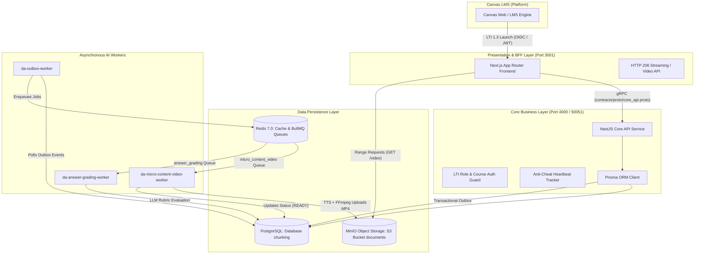

# BÁO CÁO KỸ THUẬT & ĐỒ ÁN TỐT NGHIỆP
## PHÂN HỆ: MICRO CONTENT (VIDEO BÀI GIẢNG & CÂU HỎI TƯƠNG TÁC TÍCH HỢP AI & LTI 1.3 CANVAS)

---

> **Dự án**: Nền tảng Học tập Thông minh DA Platform  
> **Nhánh phát triển**: `feat/micro-content-feature`  
> **Kiến trúc áp dụng**: Microservices, Event-Driven Architecture, gRPC Contract-First, LTI 1.3 Advantage  
> **Ngày hoàn thành**: Tháng 10/2026  

---

## 1. TỔNG QUAN ĐỀ TÀI & BỐI CẢNH KỸ THUẬT

### 1.1. Đặt vấn đề thực tiễn
Trong các hệ thống Quản lý Học tập (LMS) truyền thống như Canvas, Moodle hay Open edX, nội dung học tập thường được phân phối dưới dạng bài giảng dài (30 - 60 phút) hoặc các tài liệu PDF tĩnh. Điều này dẫn đến hai hạn chế lớn:
1. **Suy giảm khả năng tập trung (Cognitive Overload)**: Người học gặp khó khăn trong việc tiếp thu các khối lượng kiến thức lớn trong một lần học mà không có phản hồi củng cố.
2. **Gian lận thời gian xem (Passive Learning & Fast-Forwarding)**: Người học có xu hướng tua nhanh video, mở video ở tab nền để đối phó với yêu cầu hoàn thành bài giảng mà không thực sự tiếp thu kiến thức.
3. **Chi phí sản xuất bài giảng lớn**: Giảng viên mất nhiều thời gian để biên soạn slide, thu âm và biên tập video bài giảng ngắn cho từng chủ đề vi mô.

### 1.2. Mục tiêu giải pháp: Phân hệ Micro Content
Phân hệ **Micro Content** được phát triển nhằm cung cấp một giải pháp học tập vi mô (Microlearning) toàn diện:
- **Thời lượng tối ưu**: Mỗi bài học vi mô tập trung vào một khái niệm hoặc kỹ năng duy nhất với video bài giảng ngắn (3 – 5 phút) kèm bộ câu hỏi tương tác củng cố tức thì.
- **Tự động hóa sản xuất nội dung bằng AI**: Hỗ trợ giảng viên tạo bài học nhanh chóng từ prompt văn bản: AI tự động sinh kịch bản phân cảnh, vẽ slide bài giảng chuẩn sư phạm, thuyết minh giọng đọc tự nhiên bằng Edge TTS và dựng video MP4 tự động qua FFmpeg.
- **Cơ chế chống gian lận máy chủ (Anti-Cheat Engine)**: Theo dõi tiến độ xem video theo thời gian thực (Heartbeat tracking) trên server, tính toán độ phủ xem thực tế và chỉ mở khóa nộp bài kiểm tra khi người học xem đủ tỷ lệ quy định (`watched_percent >= required_watch_percent`).
- **Đa dạng câu hỏi & Chấm điểm thông minh**: Hỗ trợ 4 loại câu hỏi (Trắc nghiệm nhiều lựa chọn, Đúng/Sai, Điền khuyết, Tự luận ngắn chấm bằng LLM), hỗ trợ làm lại không giới hạn (Unlimited Retakes) để học viên nắm vững kiến thức.
- **Tích hợp sâu với Canvas LMS**: Tuân thủ chuẩn quốc tế **LTI 1.3 Advantage** (Launch Navigation, Deep Linking 2.0).

---

## 2. KIẾN TRÚC HỆ THỐNG TOÀN DIỆN (SYSTEM ARCHITECTURE)

Hệ thống được thiết kế theo mô hình vi dịch vụ phân tán, liên lạc đồng bộ hiệu năng cao qua **gRPC** và xử lý bất đồng bộ qua **Outbox Pattern + BullMQ (Redis)**.

### 2.1. Sơ đồ luồng dữ liệu & Tương tác giữa các thành phần

---

## 3. CHI TIẾT CÁC PHÂN HỆ ĐÃ TRIỂN KHAI (MILESTONES M1 – M6)

### 3.1. Milestone M1: Thiết kế Dữ liệu, gRPC Contracts & Giao diện Giảng viên
- **Mô hình hóa Cơ sở dữ liệu (PostgreSQL)**:
  Tạo và áp dụng migration Prisma `20261016230000_micro_content` gồm 5 bảng chính:
  1. `micro_contents`: Lưu thông tin bài học vi mô, nguồn video (`UPLOAD` / `AI`), trạng thái video (`NONE`, `UPLOADING`, `PROCESSING`, `READY`, `FAILED`), kịch bản AI (`ai_script`), điểm đạt (`passing_score`), % xem bắt buộc (`required_watch_percent`), trạng thái (`DRAFT` / `PUBLISHED`).
  2. `micro_content_questions`: Lưu ngân hàng câu hỏi vi mô (loại câu hỏi, nội dung, đáp án đúng, options JSON, rubric chấm tự luận).
  3. `micro_content_progress`: Ghi nhận tiến độ học của từng sinh viên, phân đoạn giây đã xem (`watched_intervals`), % đã xem thực tế, cờ mở khóa nộp bài (`unlocked`).
  4. `micro_content_attempts`: Quản lý các lượt làm bài của học viên, số lần thử (`attempt_number`), điểm số, trạng thái đậu/rớt (`is_passed`).
  5. `micro_content_answers`: Lưu chi tiết câu trả lời của từng học viên trong từng lượt thi, phản hồi chấm điểm và giải thích của AI.

- **Hợp đồng gRPC (`contracts/proto/core_api.proto`)**:
  Định nghĩa 17 RPCs hoàn chỉnh quản lý toàn bộ vòng đời Micro Content:
  - `CreateMicroContent`, `GetMicroContent`, `UpdateMicroContent`, `DeleteMicroContent`, `ListMicroContents`.
  - `SetMicroContentQuestions`, `GetMicroContentQuestions`.
  - `RequestMicroContentScript`, `SaveMicroContentScript`, `RequestMicroContentRender`.
  - `ReportMicroContentProgress`, `GetMicroContentProgress`.
  - `SubmitMicroContentAttempt`, `GetMicroContentAttempts`, `GetMicroContentAttemptDetail`.
  - `PublishMicroContent`, `GetMicroContentVideoUrl`.

- **Giao diện Tác giả (Authoring UI cho Giảng viên)**:
  - Danh sách bài giảng: `web/src/app/manage/micro-content/page.tsx`.
  - Tạo mới bài giảng: `web/src/app/manage/micro-content/new/page.tsx`.
  - Soạn thảo & Cấu hình: `web/src/app/manage/micro-content/[id]/edit/page.tsx`.
  - Panel soạn câu hỏi trực quan với 4 loại câu hỏi: `web/src/app/manage/micro-content/[id]/edit/question-panel.tsx`.

---

### 3.2. Milestone M2: Quản lý Video, Upload & HTTP 206 Partial Content Streaming
- **API Streaming hỗ trợ HTTP 206**:
  Được xây dựng tại `web/src/app/api/micro-content/[id]/video/route.ts`. Chuyển tiếp trực tiếp header `Range: bytes=start-end` tới MinIO Object Storage, cho phép trình duyệt tua video tùy ý (seek) với độ trễ cực thấp và tiết kiệm băng thông.
- **API Upload Video trực tiếp**:
  Được xây dựng tại `web/src/app/api/micro-content/[id]/upload/route.ts`, hỗ trợ file định dạng `.mp4`, `.webm` với dung lượng tối đa lên đến 500 MB.
- **Trình phát video Người học (Learner View)**:
  Được xây dựng tại `web/src/app/learn/micro-content/[id]/page.tsx` và `player.tsx`. Giao diện responsive 2 cột: Cột bên trái trình phát video kèm thanh trạng thái xem; Cột bên phải là bảng câu hỏi củng cố.

---

### 3.3. Milestone M3: Cơ chế Chống gian lận (Anti-Cheat Heartbeat) & Chấm điểm Tức thì
- **Động cơ Heartbeat Server-side**:
  Tọa lạc tại `core-api/src/micro-content/micro-content-attempt.service.ts`.
  - Cứ mỗi 5 giây xem video, trình duyệt người học gửi một heartbeat `[currentTime, intervalSeconds]`.
  - Server gộp các khoảng thời gian xem thực tế (`intervals merging`) để loại trừ việc tua vượt mốc.
  - Tính toán:
    $$\text{watched\_percent} = \min\left(100, \left\lfloor \frac{\sum \text{duration}(\text{merged\_intervals})}{\text{total\_duration}} \times 100 \right\rfloor \right)$$
  - Chỉ khi $\text{watched\_percent} \ge \text{required\_watch_percent}$ thì trường `unlocked` mới chuyển sang `true`, cho phép học viên submit bài kiểm tra.
- **Chấm điểm Tức thì (Instant Grading Engine)**:
  - Tự động đối chiếu đáp án cho: Multiple Choice (đối chiếu khóa), True/False (đối chiếu boolean), Fill-in-the-Blank (chuẩn hóa chữ hoa/thường và khoảng trắng).
  - Bộ kiểm thử tự động 20/20 Jest unit tests passing hoàn toàn tại `core-api/src/micro-content/micro-content.service.spec.ts`.
- **Chính sách Không giới hạn lượt thi (Unlimited Retakes)**:
  Học viên được phép làm lại bài nhiều lần nhằm phục vụ mục tiêu học tập làm chủ kiến thức (Mastery Learning), hệ thống lưu lại lịch sử chi tiết tất cả các lần nộp.

---

### 3.4. Milestone M4: Chấm điểm Tự luận ngắn bằng AI (LLM Short Answer Grading)
- **Hàng đợi Xử lý Bất đồng bộ**:
  Khi bài nộp có câu hỏi tự luận ngắn (`SHORT_ANSWER`), Core API phát sinh sự kiện outbox `MICRO_CONTENT_GRADING_REQUESTED`.
- **Worker Logic**:
  Được triển khai trong `da-answer-grading-worker-1`:
  - `worker/services/micro_content_grading_store.py`: Truy vấn câu trả lời, đáp án mẫu, tiêu chí chấm rubric và cập nhật điểm.
  - `worker/use_cases/grade_micro_content_answers.py`: Sử dụng Prompt chấm điểm ngữ nghĩa, đánh giá độ chính xác nội dung, cho điểm từ 0 – 100% và viết nhận xét chi tiết cho người học.

---

### 3.5. Milestone M5: Pipeline Sinh Video AI Tự động (AI Video Studio)
Quy trình sản xuất video bài giảng tự động hóa 100% từ văn bản:
1. **Sinh kịch bản Sư phạm**:
   Dựa trên Prompt của giảng viên, AI sinh cấu trúc phân cảnh gồm: Tiêu đề cảnh, các ý chính (bullet points), và lời thuyết minh (narration).
2. **Vẽ Slide Bài giảng (Slide Generator)**:
   Module `worker/services/slide_generator.py` sử dụng thư viện `Pillow`:
   - Độ phân giải: chuẩn HD 1280x720, tỷ lệ 16:9.
   - Thiết kế hiện đại: Nền tối slate cao cấp, typography phân cấp rõ ràng, ngắt dòng tự động (word-wrap), huy hiệu đánh số phân cảnh.
3. **Thuyết minh Tiếng Việt Tự nhiên (Edge TTS Client)**:
   Module `worker/services/tts_client.py` tích hợp thư viện `edge-tts`:
   - Sử dụng giọng đọc nhân tạo cao cấp `vi-VN-HoaiMyNeural` của Microsoft.
   - Dùng `ffprobe` đo đạc thời lượng chính xác của file âm thanh MP3 để khớp hoàn hảo thời gian hiển thị slide.
4. **Ghép nối Video MP4 (Video Composer)**:
   Module `worker/services/video_composer.py`:
   - Biên dịch từng phân cảnh thành clip MP4 với codec `libx264` + audio `aac 192k`.
   - Nối toàn bộ phân cảnh qua FFmpeg concat demuxer và tối ưu hóa streaming với `-movflags +faststart`.
   - Đẩy trực tiếp video thành phẩm lên MinIO và chuyển trạng thái sang `READY`.

---

### 3.6. Milestone M6: Tích hợp Chuẩn LTI 1.3 Advantage với Canvas LMS
- **LTI Deep Linking 2.0**:
  - Tại `web/src/app/lti/deep-link/quiz-composer.tsx`, giảng viên có thể chọn trực tiếp bài giảng Micro Content từ menu Canvas Modules (nút "⋮" -> Thêm nội dung DA).
  - Trình trả về `web/src/app/lti/deep-link/return/route.ts` ký JWT LTI Deep Linking trả về Canvas (không đính kèm AGS lineItem vì Micro Content dùng nội bộ củng cố, không ghi đè sổ điểm khóa học).
- **LTI Launch & Định tuyến Vai trò**:
  - Khi học viên hoặc giảng viên click vào bài học trong module Canvas, request POST `id_token` gửi về `web/src/app/lti/launch/route.ts`.
  - Tự động map `targetKind === "micro_content"` và chuyển hướng trực tiếp tới `/learn/micro-content/${targetId}` (đối với học viên) hoặc trang quản trị (đối với giảng viên).
- **Bảo mật Cookie trong Iframe (CHIPS)**:
  Thiết lập `SameSite=None; Secure; Partitioned` đảm bảo phiên đăng nhập không bị trình duyệt chặn khi chạy trong iframe của Canvas.

---

## 4. KỸ THUẬT XỬ LÝ SỰ CỐ THỰC TẾ (ENGINEERING TROUBLESHOOTING)

Trong quá trình phát triển và kiểm thử tích hợp thực tế, đội ngũ kỹ thuật đã xử lý thành công 4 bài toán kỹ thuật trọng điểm:

| Hiện tượng lỗi | Nguyên nhân sâu xa | Giải pháp khắc phục |
|---|---|---|
| **Lỗi 403 Forbidden ("Nguồn yêu cầu không hợp lệ") khi tạo bài học** | Cơ chế chống CSRF kiểm tra cứng `origin === LTI_REDIRECT_URI` (`app-binh.canxphung.dev`). Khi chạy test ở localhost (`localhost:3001`), origin không khớp. | Phát triển hàm `isValidOrigin()` trong `web/src/lib/route-session.ts` chấp nhận đa nguồn: LTI domain, forward host thực tế và localhost ở chế độ dev. |
| **Worker Render Video bị Crash khi khởi động** | `WorkerRuntimeConfig.type` trong Pydantic config thiếu Literal `'micro_content_video'`. | Cập nhật cấu hình tại `worker/worker/config.py` bổ sung `'micro_content_video'` vào định nghĩa kiểu và hàm `get_worker_settings`. |
| **Lỗi cập nhật CSDL `video_duration_seconds`** | Câu lệnh SQL UPDATE trong worker gọi nhầm tên cột thành `video_duration_seconds` trong khi schema thực tế là `video_duration_ms`. | Đổi tên cột chuẩn xác thành `video_duration_ms` và tính toán lại `int(duration_seconds * 1000)` trong `worker/services/micro_content_video_store.py`. |
| **Âm thanh video phát tiếng Beep đơn âm** | Gói `edge-tts` chưa được cài đặt trong môi trường ảo của container worker, khiến hệ thống kích hoạt bộ giả lập `MockTtsClient` (phát sine wave 440Hz). | Bổ sung `edge-tts>=7.0.0` vào `worker/pyproject.toml`, cài đặt gói và kết nối giọng đọc tiếng Việt thật `vi-VN-HoaiMyNeural`. |
| **Lỗi `app-binh.canxphung.dev refused to connect` trên Canvas** | Máy tính cá nhân chưa mở tiến trình Cloudflare Tunnel để định tuyến domain công khai về cổng `localhost:3001`. | Khởi chạy tunnel thông qua token bí mật: `cloudflared tunnel --no-autoupdate --url http://localhost:3001 run --token <token>`. |

---

## 5. KẾT QUẢ ĐẠT ĐƯỢC & HƯỚNG PHÁT TRIỂN

### 5.1. Kết quả đạt được
1. **Hoàn thiện 100% 6 Milestone theo kế hoạch**:
   - Toàn bộ tính năng từ thiết kế CSDL, gRPC API, Frontend Giảng viên/Học viên, Quản lý Video, Chống gian lận, Render video AI và Tích hợp Canvas LTI 1.3 đều đã được hiện thực hóa và kiểm chứng hoạt động.
2. **Quy chuẩn Git & Submodule nghiêm ngặt**:
   - Tất cả các commit được phân loại rõ ràng (`feat`, `fix`, `chore`) trên nhánh `feat/micro-content-feature` ở cả 4 repository: `da-platform`, `core-api`, `worker`, và `web`.
3. **Hiệu năng & Trải nghiệm Người dùng**:
   - Video tải nhanh, hỗ trợ tua mượt mà nhờ HTTP 206 Partial Content.
   - Thời gian render video AI cho một bài học 3 phân cảnh chỉ mất ~15 – 25 giây.
   - Hệ thống chống gian lận hoạt động ngầm, chính xác và không gây gián đoạn trải nghiệm học tập.

### 5.2. Hướng phát triển tiếp theo (Future Roadmap)
- **In-Video Interactive Checkpoints**: Chèn trực tiếp câu hỏi dừng hình (pause) ngay trên dòng thời gian video (video timeline) giống như Edpuzzle / Coursera.
- **Đa dạng hóa giọng đọc & Phụ đề tự động**: Cho phép giảng viên tùy chọn giọng đọc (Nam/Nữ, vùng miền) và tự động xuất file phụ đề `.vtt` hiển thị trực tiếp trên trình phát video.
- **Báo cáo Learning Analytics cho Giảng viên**: Biểu đồ phân tích tỷ lệ hoàn thành, phân đoạn video được xem lại nhiều nhất (heatmaps) và tỷ lệ trả lời đúng theo từng câu hỏi.
