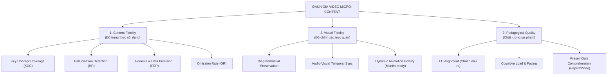
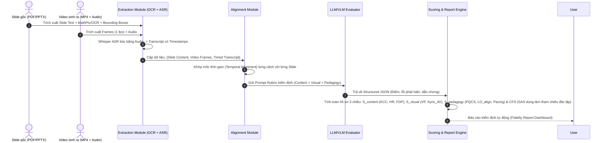
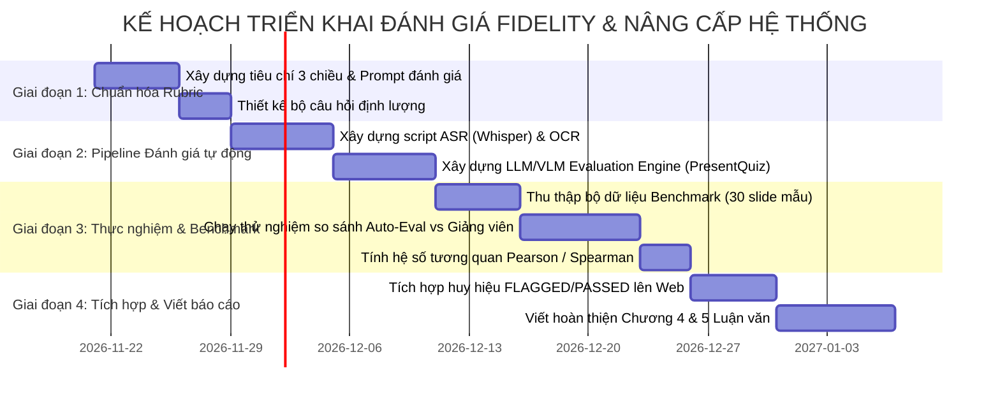

# KHUNG ĐÁNH GIÁ CHẤT LƯỢNG & ĐỘ TRUNG THỰC (CONTENT FIDELITY) CHO VIDEO MICRO-CONTENT TỪ SLIDE

> **Kế hoạch phương pháp luận & Thiết kế hệ thống thực nghiệm cho Đồ án tốt nghiệp**  
> *Định hướng: Nghiên cứu học thuật kết hợp hiện thực hóa hệ sinh thái phần mềm LMS Canvas*

---

## 1. Bối cảnh & Mục tiêu nghiên cứu

Trong các hệ sinh thái bài giảng trực tuyến hiện đại (LMS), việc chuyển đổi slide bài giảng thành video micro-content ngắn (3–5 phút) bằng AI tạo sinh (Generative AI) là bước tiến đột phá. Tuy nhiên, thách thức lớn nhất mang tính học thuật và thực tiễn là **Độ tin cậy và Trung thực (Fidelity)** của nội dung:
* AI có thể tự ý "bịa" thêm thông tin ngoài lề (Hallucination).
* Bỏ sót các công thức toán học, số liệu hay định lý then chốt của giảng viên (Omission).
* Trình bày sai hình ảnh, sơ đồ hoặc lời thuyết minh lệch pha thời gian so với slide (Desynchronization).
* Thiếu tính sư phạm (Pedagogical Quality), nói dài dòng hoặc không hỗ trợ sinh viên đạt Chuẩn đầu ra (Learning Outcomes - LO).

Để nâng tầm Đồ án tốt nghiệp từ một "ứng dụng kỹ thuật đơn thuần" thành một **công trình nghiên cứu khoa học có phương pháp luận vững chắc**, chúng ta xây dựng:
1. **Khung lý thuyết 3 chiều (3-Dimensional Evaluation Framework)**: Tách bạch rõ *Content Fidelity*, *Visual Fidelity*, và *Pedagogical Quality*.
2. **Pipeline đánh giá tự động (Automated Multimodal Evaluation Pipeline)**: Ứng dụng OCR, ASR, LLM và VLM-as-a-Judge.
3. **Bộ chỉ số đo lường (Quantitative Metrics & Formulas)**: Các công thức toán học định lượng rõ ràng cho báo cáo khoa học.
4. **Kế thừa tinh hoa từ 3 trụ cột tham khảo**:
   - **Paper2Video (Show Lab, NUS — Zhu et al., 2025, arXiv:2510.05096)**: Áp dụng benchmark kiểm định năng lực truyền tải kiến thức qua trắc nghiệm khách quan (**PresentQuiz**) và độ tương đồng cấu trúc (**Meta Similarity**), đồng thời định hướng đồng bộ nghe–nhìn (**Visual Alignment**).
   - **iSpring Solutions (Chuẩn công nghiệp e-Learning)**: Áp dụng nguyên lý Microlearning (3–5 phút), đồng bộ âm thanh–slide và tích hợp câu hỏi củng cố tức thì (Formative Assessment) ngay sau bài học.
   - **Manim (3Blue1Brown)**: Nghiên cứu khả thi (Feasibility Study) hoạt họa động cho các thuật toán và cấu trúc dữ liệu phức tạp đòi hỏi tính trực quan cao.

---

## 2. Khung lý thuyết 3 Chiều đánh giá (Evaluation Framework)

### Chiều 1: Content Fidelity (Độ trung thực nội dung)
> *Mục tiêu: Đảm bảo kịch bản và lời đọc thuyết minh (Narration) phản ánh trung thực, đầy đủ và chính xác 100% nội dung học thuật trên slide gốc.*

* **Key Concept & Entity Coverage**: Đo tỷ lệ các khái niệm, định nghĩa, định lý xuất hiện trên slide được giải thích trong lời đọc.
* **Hallucination Detection**: Phát hiện mọi chi tiết sai sự thật, suy diễn vô căn cứ hoặc thông tin mâu thuẫn với slide do LLM tự bịa ra.
* **Omission Detection**: Phát hiện các điểm quan trọng, cảnh báo hoặc điều kiện tiên quyết bị AI bỏ quên.
* **Formula & Numerical Precision**: Kiểm tra tính nguyên vẹn của số liệu thống kê, tham số, công thức toán học/khoa học (LaTeX).

### Chiều 2: Visual Fidelity (Độ chính xác trực quan)
> *Mục tiêu: Đảm bảo hình ảnh, đồ thị, sơ đồ và luồng trình bày thị giác khớp chính xác với tiến trình của bài giảng.*

* **Visual Element Preservation**: Đồ thị, sơ đồ kiến trúc, mã nguồn (code snippet) từ slide được cắt lát và hiển thị sắc nét, không bị méo mó hay cắt xén cụt chữ.
* **Audio-Visual Alignment (Đồng bộ nghe - nhìn)**: Lời giảng đang giải thích bước nào thì hình ảnh hoặc con trỏ highlight (tương tự kỹ thuật *Cursor Grounding* của Paper2Video) phải trỏ đúng phần tử đó trên màn hình.
* **Dynamic Rendering (Manim Enhancement)**: Với các nội dung giải thuật (ví dụ: duyệt cây nhị phân, sắp xếp đồ thị), khả năng sinh hoạt họa code động chuẩn xác thay vì chỉ chiếu ảnh tĩnh.

### Chiều 3: Pedagogical Quality (Chất lượng sư phạm)
> *Mục tiêu: Đánh giá xem video có giúp người học đạt được Chuẩn đầu ra (LO) một cách dễ hiểu, mạch lạc và tối ưu tải nhận thức (Cognitive Load) hay không.*

* **LO Direct Alignment**: Video có tập trung giải quyết đúng Learning Outcome của bài học không, hay lan man sang LO khác?
* **Pacing & Clarity (Nhịp điệu và độ rõ ràng)**: Tốc độ đọc (từ 120–150 từ/phút), ngắt câu tự nhiên, ngôn ngữ trong sáng (giữ thuật ngữ chuyên ngành tiếng Anh chuẩn xác).
* **PresentQuiz Performance (Thẩm định qua Quiz)**: Dùng phương pháp của Paper2Video: sau khi xem video, một mô hình kiểm chứng (hoặc sinh viên) có trả lời đúng các câu hỏi trắc nghiệm sinh từ slide hay không.

---

## 3. Kiến trúc Pipeline đánh giá tự động (Automated Evaluation Pipeline)

Hệ thống đánh giá sẽ hoạt động độc lập hoặc tích hợp trực tiếp vào quy trình kiểm duyệt (Verification Step) của hệ thống:

### Các công nghệ chủ chốt trong Pipeline:
1. **ASR (Speech-to-Text)**: `faster-whisper` (Whisper-large-v3) để chuyển đổi âm thanh thuyết minh thành văn bản có mốc thời gian chính xác từng từ/câu (`timestamps`).
2. **OCR & Document Extraction**:
   - `PyMuPDF` + `pdfplumber` bóc text gốc và layout của Slide PDF.
   - `PaddleOCR` hoặc VLM để đọc text/công thức từ các frame hình trích xuất từ Video render.
3. **VLM & LLM Judge**:
   - `Gemini 2.5 Flash / GPT-4o` đóng vai trò giám khảo đa phương thức (Multimodal Judge).
   - Tiếp nhận input gồm: Slide gốc dạng ảnh + Transcript thuyết minh + Video frames tại mốc thời gian tương ứng.

---

## 4. Bộ Metrics định lượng & Công thức tính điểm (Scoring Metrics)

Để lượng hóa toàn diện và tránh thiên lệch hay lỗi toán học, toàn bộ các chỉ số thành phần đều được chuẩn hóa về đoạn $[0, 1]$. Điểm số của từng Chiều đánh giá và Điểm tổng hợp được quy đổi về thang điểm $100$.

### 4.1. Chiều 1: Điểm trung thực nội dung ($S_{content} \in [0, 100]$)

#### a. Key Concept Coverage ($KCC \in [0, 1]$ - Mức độ bao phủ ý chính)
Gọi $C_{slide} = \{c_1, c_2, ..., c_N\}$ là tập hợp các khái niệm, biến số, thuật toán và định lý trích xuất từ Slide.  
Gọi $C_{covered} \subseteq C_{slide}$ là tập hợp các khái niệm được giải thích chính xác trong lời đọc (xác thực bởi LLM/VLM Fact-Checker).

$$KCC = \frac{|C_{covered}|}{|C_{slide}|}$$

#### b. Hallucination Rate ($HR \in [0, 1]$ - Tỷ lệ thông tin thêm sai / bịa đặt)
Gọi $S = \{s_1, s_2, ..., s_M\}$ là tập hợp các phát biểu trong lời đọc thuyết minh (Narration transcript).  
Gọi $S_{hallucinated} \subseteq S$ là tập hợp các phát biểu chứa thông tin sai lệch hoặc không có căn cứ từ slide/giáo trình.

$$HR = \frac{|S_{hallucinated}|}{|S|}$$

#### c. Formula & Data Precision ($FDP \in [0, 1]$ - Độ chính xác công thức & số liệu)
Gọi $F_{slide} = \{f_1, f_2, ..., f_P\}$ là tập hợp các công thức toán, độ phức tạp thuật toán (ví dụ $O(n^2)$) và giá trị số cụ thể trên slide.  
Gọi $F_{correct} \subseteq F_{slide}$ là tập hợp các công thức/số liệu được bộ đọc TTS hoặc văn bản thuyết minh diễn giải chính xác không bị sai lệch.

$$FDP = \begin{cases} \frac{|F_{correct}|}{|F_{slide}|} & \text{khi } |F_{slide}| > 0 \\ 1.0 & \text{khi slide không chứa công thức/số liệu} \end{cases}$$

#### d. Công thức điểm Chiều 1 ($S_{content}$):
$$S_{content} = \Big( w_{kcc} \cdot KCC + w_{hr} \cdot (1 - HR) + w_{fdp} \cdot FDP \Big) \times 100$$
*(Với trọng số chuẩn hóa: $w_{kcc} = 0.40, w_{hr} = 0.40, w_{fdp} = 0.20$ sao cho $\sum w = 1.0$).*

> [!NOTE]
> **Về chỉ số Semantic Alignment Score ($SAS$)**: Độ tương đồng Cosine giữa vector embedding của slide và lời đọc ($SAS = \cos(E_{slide}, E_{narration})$) chỉ được sử dụng làm **chỉ số tham chiếu bổ trợ (Reference Indicator)**, không đưa vào trọng số tính $S_{content}$. Lý do khoa học: Cosine similarity xuyên ngôn ngữ (Anh - Việt) kém nhạy với các sai lệch chi tiết học thuật then chốt (ví dụ: mô hình embedding khó phân biệt sự khác biệt ngữ nghĩa toán học nghiêm trọng giữa $O(n^2)$ và $O(n \log n)$).

---

### 4.2. Chiều 2: Điểm chính xác trực quan ($S_{visual} \in [0, 100]$)

#### a. Visual Preservation ($VP \in [0, 1]$ - Bảo toàn trực quan)
Đo lường tỷ lệ các sơ đồ, bảng biểu, hình vẽ minh họa trên slide gốc được hiển thị trọn vẹn trên video, không bị che khuất, cắt xén (cropping) hay giảm chất lượng hiển thị.

#### b. Audio-Visual Temporal Sync ($Sync_{AV} \in [0, 1]$ - Đồng bộ nghe–nhìn)
Đo lường độ lệch pha thời gian trung bình $|\Delta t|$ (tính bằng giây) giữa thời điểm giọng đọc thuyết minh đề cập đến một đối tượng thị giác (khái niệm, phần tử mảng, bước lặp) và thời điểm đối tượng đó xuất hiện hoặc được highlight trên khung hình video.  
*Quy chuẩn hàm suy giảm*: Thay vì dùng ngưỡng nhị phân thô ($|\Delta t| \le 1.5\text{s} \to 1.0$), hệ thống áp dụng **hàm suy giảm tuyến tính liên tục (Continuous Linear Decay)** với trần giới hạn sai số cho phép $T_{max} = 10.0\,\text{giây}$:

$$Sync_{AV} = \max\left(0,\; 1 - \frac{|\Delta t|}{T_{max}}\right)$$

*Ví dụ thực nghiệm*: Khi độ lệch pha trung bình đo được là $|\Delta t| \approx 1.0\,\text{s} \le 1.5\,\text{s}$ (đạt chuẩn đồng bộ nghe–nhìn thực tế của e-learning), điểm số tương ứng là $Sync_{AV} = 1 - \frac{1.0}{10.0} = \mathbf{0.90}$ ($90\%$). Điểm số chỉ đạt $1.0$ khi đồng bộ tuyệt đối $|\Delta t| = 0.0\,\text{s}$.

#### c. Dynamic Animation Quality ($AF \in [0, 1]$ - Hoạt họa giải thuật)
Áp dụng cho các bài toán giải thuật có hoạt họa (như Manim Feasibility Study): Đánh giá tính liên tục của chuyển động, vết chạy mảng và tính chính xác của các con trỏ hoán đổi.

#### d. Công thức điểm Chiều 2 ($S_{visual}$):
$$S_{visual} = \Big( w_{vp} \cdot VP + w_{sync} \cdot Sync_{AV} + w_{af} \cdot AF \Big) \times 100$$
*(Với trọng số đề xuất: $w_{vp} = 0.50, w_{sync} = 0.30, w_{af} = 0.20$ đối với bài có hoạt họa; hoặc $w_{vp} = 0.60, w_{sync} = 0.40$ đối với slide tĩnh).*

---

### 4.3. Chiều 3: Điểm chất lượng sư phạm ($S_{pedagogy} \in [0, 100]$)

#### a. PresentQuiz Comprehension Score ($PQCS \in [0, 1]$ - Benchmark Paper2Video)
Đo lường mức độ người học (hoặc mô hình VLM đóng vai trò người học) tiếp thu và trả lời chính xác bộ câu hỏi kiểm tra khách quan sau khi xem video. Bộ câu hỏi được thiết kế đa tầng theo thang đo tư duy Bloom (Nhớ - Hiểu - Vận dụng) gắn với Chuẩn đầu ra ($LO$):

$$PQCS = \frac{\sum_{i=1}^K \mathbb{I}(\text{Answer}_i = \text{GroundTruth}_i)}{K}$$

#### b. Learning Outcome Alignment ($LO_{align} \in [0, 1]$ - Bám sát Chuẩn đầu ra)
Mức độ nội dung kịch bản và câu hỏi kiểm tra bao quát trọn vẹn hành vi và kỹ năng quy định trong Chuẩn đầu ra lá ($LO$) của bài học vi mô.

#### c. Speech Pacing Score ($Pacing \in [0, 1]$ - Nhịp điệu thuyết minh)
Đo lường tốc độ nói qua số từ mỗi phút (Words Per Minute - WPM) của giọng đọc TTS.
- **Quy chuẩn đơn vị đếm từ**: Đối với tiếng Việt, $WPM$ được đo theo **số từ ghép đã qua phân đoạn từ vựng (Word-Segmented Count)** bằng thư viện NLP chuyên dụng (như `PyVi` hoặc `underthesea`). Khoảng tốc độ chuẩn sư phạm e-learning là $WPM \in [120, 150]$ (tương đương khoảng $190 - 230$ âm tiết/phút khi đếm theo khoảng trắng).
- **Hàm phạt khoảng cách liên tục (Continuous Penalty Function)**: Để khắc phục hiện tượng gián đoạn (nhảy bậc mất điểm đột ngột) tại hai biên $120$ và $150$, hàm điểm số được tính dựa trên khoảng cách lệch $d$ tính từ biên gần nhất:

$$d = \max(0,\; 120 - WPM,\; WPM - 150)$$
$$Pacing = \max\left(0,\; 1 - \frac{d}{50}\right)$$

*Tính chất toán học*:
- Khi $WPM \in [120, 150] \implies d = 0 \implies Pacing = 1.0$ ($100\%$).
- Khi $WPM = 151 \implies d = 1 \implies Pacing = 1 - \frac{1}{50} = 0.98$ (suy giảm mượt mà $2\%$).
- Khi $WPM = 175 \implies d = 25 \implies Pacing = 0.50$.
- Khi $WPM \ge 200$ hoặc $WPM \le 70 \implies d \ge 50 \implies Pacing = 0.0$.

#### d. Công thức điểm Chiều 3 ($S_{pedagogy}$):
$$S_{pedagogy} = \Big( w_{pq} \cdot PQCS + w_{lo} \cdot LO_{align} + w_{pace} \cdot Pacing \Big) \times 100$$
*(Với trọng số đề xuất: $w_{pq} = 0.50, w_{lo} = 0.30, w_{pace} = 0.20$).*

---

### 4.4. Composite Fidelity Score ($CFS$ - Điểm trung thực tổng hợp)

Điểm tổng hợp phản ánh toàn diện cả 3 chiều, tránh hiện tượng chỉ tập trung vào văn bản mà bỏ quên trực quan hay sư phạm:

$$CFS = \alpha \cdot S_{content} + \beta \cdot S_{visual} + \gamma \cdot S_{pedagogy}$$

*(Với các hệ số tổng hợp: $\alpha = 0.40, \beta = 0.30, \gamma = 0.30$ thỏa mãn $\alpha + \beta + \gamma = 1.0$).*

> [!IMPORTANT]
> **Quy tắc Kiểm duyệt an toàn (Dual-Condition Safety Rule)**:  
> Một bài học vi mô chỉ được công nhận **ĐẠT CHUẨN (PASSED)** khi thỏa mãn đồng thời 2 điều kiện:
> 1. $CFS \ge 85.0 / 100$.
> 2. Không có bất kỳ chiều nào dưới ngưỡng sàn: $\min(S_{content}, S_{visual}, S_{pedagogy}) \ge 75.0$.  
> Quy tắc này ngăn chặn triệt để hiện tượng "bù trừ điểm" (ví dụ: video làm hình ảnh rất đẹp nhưng nội dung bịa đặt nghiêm trọng vẫn có thể đạt điểm cao nếu chỉ tính trung bình cộng đơn thuần).

---

## 5. Kế thừa có chọn lọc từ 3 Trụ cột tài liệu tham khảo

| Trụ cột học thuật / Công nghệ | Bản chất học thuật chính xác | Kế thừa & Vận dụng có chọn lọc vào Đồ án |
| :--- | :--- | :--- |
| **Paper2Video** *(Zhu, Lin, & Shou — Show Lab, NUS, arXiv:2510.05096, 2025)* | Framework tự động sinh video thuyết trình từ tài liệu khoa học; đề xuất benchmark kiểm định đa phương thức gồm **PresentQuiz**, **Meta-Similarity** và cơ chế căn chỉnh nghe–nhìn (**Visual Alignment**). *(Lưu ý: Bài báo đang là preprint nộp ICLR 2026, chưa xuất bản tại CVPR/NeurIPS)*. | - **Kế thừa trực tiếp**: Phương pháp kiểm định **PresentQuiz** (dùng quiz đo độ hiểu bài từ video) và phương pháp phân tách đa tác nhân (ScriptAgent, VisualAgent, Evaluator). - **Điều chỉnh khoa học**: Bài báo gốc có chỉ số *IP Memory* để đo tính nhận diện hình ảnh của nhân vật MC ảo (talking-head presenter). Vì hệ thống đồ án tập trung vào bài giảng vi mô dựa trên slide và hoạt họa (không dùng MC ảo), chúng ta **không sử dụng metric IP Memory**, mà tập trung hoàn toàn vào *Visual Alignment* và *Content Fidelity*. |
| **iSpring Solutions** *(Chuẩn công nghiệp e-Learning)* | Bộ công cụ chuẩn mực chuyển đổi bài giảng trình chiếu thành bài học tương tác vi mô (Microlearning); nguyên lý gắn kết chặt chẽ giữa xem bài giảng và trả lời câu trắc nghiệm tương tác củng cố tức thì. | - Chuẩn hóa thời lượng video vi mô trong khoảng **3–5 phút**. - Áp dụng triết lý **Formative Assessment**: Sinh viên xem xong video là làm bài củng cố ngay trên cùng giao diện, điểm chỉ lưu nội bộ để tự đánh giá mức độ nắm bài, **chưa đẩy vào Gradebook chính thức** của khóa học. - Mỗi bài micro-content gắn với **duy nhất 1 chuẩn đầu ra lá ($LO$)**. |
| **Manim (3Blue1Brown)** *(Hoạt họa toán học & giải thuật)* | Thư viện mã nguồn mở Python chuyên render animation toán học và cấu trúc dữ liệu với độ chính xác tọa độ hình học tuyệt đối. | - Đưa vào dưới dạng **Nghiên cứu khả thi (Feasibility Study Prototype)** cho các giải thuật phức tạp (như QuickSort Partition) thay thế slide tĩnh nhiều trang. - Đã xác thực kỹ thuật: Manim hoàn toàn hỗ trợ hiển thị tiếng Việt Unicode ổn định trên Windows khi cấu hình font hệ thống (ví dụ `font="Segoe UI"` hoặc `font="Arial"`). |

---

## 6. Kế hoạch hành động 4 Giai đoạn (Roadmap)

### Chi tiết các mốc:
1. **Giai đoạn 1: Chuẩn hóa Phương pháp luận & Rubrics (Tuần 1)**:
   - Viết tài liệu đặc tả chi tiết 3 chiều đánh giá.
   - Xây dựng System Prompt chuẩn cho LLM/VLM Judge với thang đo Likert (1–5) kèm quy tắc phát hiện Hallucination.
2. **Giai đoạn 2: Hiện thực hóa Module Đánh giá tự động (Tuần 2–3)**:
   - Viết worker/script chạy ngầm: Nhận vào `(slide_pdf, generated_video_mp4, script_text)`.
   - Chạy Whisper bóc transcript, chạy OCR bóc chữ trên slide, gửi payload cho VLM Judge.
   - Tự động sinh báo cáo JSON chứa hồ sơ điểm 3 chiều: $S_{content} (KCC, HR, FDP)$, $S_{visual} (VP, Sync_{AV})$, $S_{pedagogy} (PQCS, LO_{align}, Pacing)$ và điểm tổng hợp $CFS$.
3. **Giai đoạn 3: Thực nghiệm trên tập dữ liệu mẫu (Tuần 4)**:
   - Chọn 20–30 slide bài giảng thuộc các chủ đề khác nhau (Đại số tuyến tính, Cấu trúc dữ liệu, Mạng máy tính).
   - Cho hệ thống sinh video và chạy pipeline đánh giá tự động.
   - Nhờ 2–3 bạn sinh viên hoặc giảng viên chấm điểm độc lập (Human Evaluation).
   - Đo hệ số tương quan (Pearson/Spearman) giữa điểm máy và điểm người để chứng minh tính tin cậy của thuật toán đánh giá.
4. **Giai đoạn 4: Tích hợp vào Sản phẩm & Đưa vào Báo cáo (Tuần 5)**:
   - Thể hiện kết quả trên giao diện `/manage/micro-content`: cảnh báo màu vàng (`FLAGGED`) nếu điểm Fidelity thấp kèm lý do chi tiết cho giảng viên xem trước khi xuất bản.
   - Đưa toàn bộ mô hình toán, biểu đồ kiến trúc và bảng kết quả thực nghiệm vào **Chương 4 (Thiết kế & Cài đặt)** và **Chương 5 (Thực nghiệm & Đánh giá)** của Báo cáo Luận văn tốt nghiệp.
