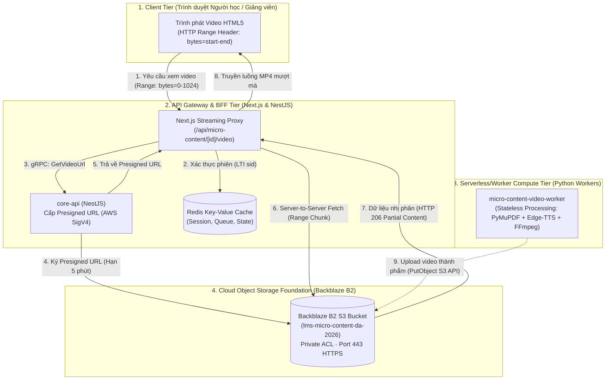
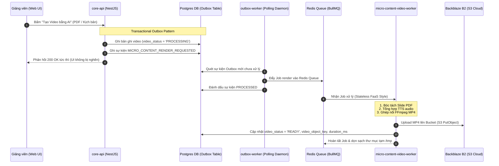

# TÀI LIỆU KIẾN TRÚC LƯU TRỮ VIDEO ĐÁM MÂY (BACKBLAZE B2 CLOUD STORAGE)
## DỰA TRÊN NGUYÊN LÝ CO DÃN HỆ THỐNG (ELASTICITY) & ĐIỆN TOÁN KHÔNG MÁY CHỦ (SERVERLESS COMPUTING)

> **Môn học / Chuyên đề:** Hệ thống Phân tán & Điện toán Đám mây (HPC Lab - CSE - HCMUT)  
> **Đề tài tốt nghiệp:** Hệ Thống Quản Lý Học Liệu Micro-Content & Tự Động Hóa Kịch Bản Video AI Chuẩn LTI 1.3  
> **Nền tảng lưu trữ mục tiêu:** Backblaze B2 Cloud Object Storage (S3-Compatible API)  
> **Ngày hoàn thiện:** Tháng 11/2026

---

## 1. TỔNG QUAN VÀ ĐẶT VẤN ĐỀ

Trong các hệ thống học trực tuyến quy mô lớn (E-Learning / LMS), nội dung đa phương tiện (Video) chiếm hơn **80% tổng lưu lượng băng thông mạng và dung lượng lưu trữ**. Đối với hệ thống **Micro-Content** (các bài học cô đọng 1–3 phút đi kèm câu hỏi tương tác), tải lượng hệ thống mang các đặc tính phân tán rất đặc thù:
1. **Tải lượng biến thiên bất đối xứng (Variable & Asymmetric Workload):** Lưu lượng xem video tăng đột biến (Peak Load) vào các đợt thi hoặc hạn nộp bài, trong khi lưu lượng tạo video AI của giảng viên lại mang tính chu kỳ theo học kỳ.
2. **Chi phí tính toán và lưu trữ cao:** Quá trình tổng hợp video (Text-to-Speech + Render FFmpeg) tiêu tốn rất nhiều CPU/RAM (Compute-intensive), trong khi video thành phẩm đòi hỏi không gian lưu trữ mở rộng tuyến tính (Storage-intensive).

Dựa trên hai bài giảng chuyên đề của **HPC Lab - Khoa KH&KT Máy Tính, ĐH Bách Khoa TP.HCM** về:
* **Elasticity & Scalable Software Designs** (Tính co dãn, Caching 3 tầng, Phân vùng tải lượng, Tránh phụ thuộc khóa/GIL), và
* **Function as a Service (FaaS) & Serverless Computing** (Kiến trúc hướng sự kiện - Event-Driven, Tách rời tính toán và lưu trữ - Decoupled Compute & Storage, Kiến trúc không trạng thái - Statelessness),

Hệ thống đã triển khai giải pháp lưu trữ video trên nền tảng **Backblaze B2 Cloud Object Storage** kết hợp cơ chế xử lý bất đồng bộ qua **Redis Outbox Worker** và cổng phân phối luồng **HTTP Range Streaming Gateway**.



---

## 2. NGUYÊN LÝ CO DÃN (ELASTICITY) TRONG HỆ THỐNG LƯU TRỮ VIDEO

### 2.1. Tách rời Tính toán và Lưu trữ (Decoupled Compute & Storage)
Theo lý thuyết về *Scalable Software Designs* (Slide 5-8): Việc lưu trữ dữ liệu trực tiếp trong ổ cứng cục bộ của máy chủ ứng dụng (Local Disk/Attached Block Storage) là nguyên nhân hàng đầu triệt tiêu khả năng co dãn (Scale-out blocker).
* **Thiết kế truyền thống (Anti-Pattern):** Lưu file MP4 ngay trong thư mục `public/uploads/` của Web Server. Khi lưu lượng tăng cao cần bật thêm 5 container Web, các container mới không có dữ liệu video cũ, buộc phải dùng giải pháp chia sẻ file phức tạp như NFS/EFS vốn có độ trễ cao và dễ nghẽn cổ chai (Single Point of Failure).
* **Giải pháp chuẩn hóa:** Hệ thống tách rời 100% tầng lưu trữ sang **Backblaze B2 Cloud Object Storage**. 
  - Toàn bộ các máy chủ tính toán (`web`, `core-api`, `worker`) đều là các node **không trạng thái (Stateless Nodes)**.
  - Dung lượng lưu trữ trên Backblaze B2 có tính chất **co dãn đàn hồi (Elastic Storage)**: tự động phình to hoặc thu nhỏ theo đúng nhu cầu sử dụng thực tế mà không cần lập kế hoạch phân bổ dung lượng trước (*Zero Capacity Planning*).

### 2.2. Chiến lược Phân mảnh Định danh (Object Partitioning Scheme)
Để tránh xung đột dữ liệu và tối ưu hóa việc phân chia không gian lưu trữ theo tài khoản người dùng và khóa học (Slide 8: *Storage — partition on user accounts*), hệ thống xây dựng quy ước đặt khóa đối tượng (**Object Key Hierarchy**) phân cấp rõ ràng:

```text
Object Key = domain_scope / course_id / resource_id / filename.ext
```

Cụ thể trong hệ thống:
1. **Video gắn trực tiếp theo bài học (Micro-Content Video):**
   `micro-content/{course_id}/{micro_content_id}/video.mp4`
   *Ví dụ:* `micro-content/1fbf0736-0e3f-4bc3-afcd-40ca316daa60/19d07719-aead-457a-8893-885130fe99d3/video.mp4`
2. **Video dùng chung trong Kho học liệu (Digital Asset Management - Video DAM):**
   `video-assets/{owner_sub}/{asset_id}/video.mp4`

Cấu trúc phân vùng này mang lại các lợi ích kiến trúc:
* **Ngăn ngừa va chạm tên file (Zero Namespace Collision):** Mỗi tài nguyên được định danh độc bản qua UUIDv7.
* **Xóa theo tầng an toàn (Hierarchical Lifecycle Management):** Khi một khóa học hoặc người dùng bị xóa theo chuẩn GDPR/quy định nhà trường, hệ thống có thể dọn dẹp hàng loạt tiền tố (`Prefix Deletion`) mà không ảnh hưởng đến các khóa học khác.

### 2.3. Tránh tắc nghẽn tài nguyên do khóa toàn cục (Overcoming Python GIL)
Slide 4 (*Scalability: required for elasticity*) chỉ rõ: *"Python has global interpreter lock (GIL). Scaling CPU-bound Python needs multi-process not multithreaded"*.
* Công đoạn render video bằng FFmpeg và tổng hợp giọng đọc AI là tác vụ nặng tiêu tốn CPU (**CPU-bound**).
* Hệ thống **không** chạy FFmpeg bên trong các luồng đa nhiệm của máy chủ Web chính. Thay vào đó, nó được tách thành các **tiến trình độc lập (Isolated Worker Processes)** chạy trong container `micro-content-video-worker`. Khi khối lượng bài học cần render tăng đột biến vào mùa cao điểm, hệ thống có thể mở rộng ngang (Scale-out) bằng cách tăng số lượng worker container (`docker compose up --scale micro-content-video-worker=4`) mà không làm ảnh hưởng đến thời gian phản hồi của người dùng trên web.

---

## 3. KIẾN TRÚC KHÔNG MÁY CHỦ (SERVERLESS) & XỬ LÝ HƯỚNG SỰ KIỆN (EVENT-DRIVEN)

Mô hình xử lý video trong đồ án áp dụng trọn vẹn kiến trúc tham chiếu **Event-Driven Architecture** từ nghiên cứu *Baldini et al. (2017) - Serverless Computing* (Slide 15):



### 3.1. Các đặc tính Serverless được hiện thực hóa:

1. **Thực thi phản ứng theo sự kiện (Reactive Style Execution):**
   * Giảng viên bấm nút tạo video → Giao diện nhận thông báo thành công tức thì trong **200ms**.
   * Yêu cầu được chuyển hóa thành sự kiện nghiệp vụ `MICRO_CONTENT_RENDER_REQUESTED`.
   * Các Worker chỉ thức tỉnh và hoạt động khi có sự kiện đẩy vào từ Redis, loại bỏ hoàn toàn lãng phí tài nguyên chờ (Idle Waste).

2. **Tính toán không trạng thái (Stateless Transformers):**
   * Đúng theo nguyên lý tại Slide 11 (*Stateless functions*): Toàn bộ logic render của `micro-content-video-worker` là thuần túy không trạng thái.
   * Dữ liệu đầu vào lấy từ DB/PDF; toàn bộ file trung gian (ảnh slide PNG, âm thanh MP3 từng câu) được lưu trong thư mục tạm có vòng đời ngắn `/tmp/render_{uuid}/`.
   * Sau khi hoàn tất đẩy video lên Backblaze B2, thư mục `/tmp` được giải phóng hoàn toàn.
   * **Khả năng chịu lỗi cao (Fault Tolerance):** Nếu một Worker bị khởi động lại đột ngột giữa chừng (Spot instance / Crash), tác vụ có thể được một Worker khác thực hiện lại một cách an toàn mà không để lại trạng thái rác trên hệ thống.

---

## 4. MÔ HÌNH CACHING 3 TẦNG (THREE-TIER CACHING) & PHÂN PHỐI LUỒNG VIDEO

Slide 7 (*Designs and tools for caching*) khẳng định: *"Most scalable application architectures have caching... Caching avoided all requests needing to reach the origin server"*. 

Đối với video trực tuyến, nếu mỗi lần học viên ấn Play hoặc tua 5 giây đều gửi trọn vẹn request về máy chủ cơ sở dữ liệu hay tải lại toàn bộ file video hàng chục MB từ Cloud thì băng thông sẽ cạn kiệt rất nhanh. Hệ thống áp dụng mô hình **Caching 3 tầng**:

```
[ Tầng 1: Client Browser Cache ] 
       │  (HTTP 206 Partial Content · Range: bytes=0-1024 · Memory/Disk Cache)
       ▼
[ Tầng 2: API Gateway / BFF Streaming Proxy ]
       │  (Next.js Route Handlers · ETag · Accept-Ranges · Cache-Control)
       ▼
[ Tầng 3: Distributed In-Memory Cache (Redis) ]
       │  (Session Validation · Transitive Access Grants · Presigned URL Expirations)
       ▼
[ Gốc Lưu Trữ (Origin Storage): Backblaze B2 S3 ]
```

### 4.1. Cơ chế Streaming phân đoạn (HTTP 206 Partial Content)
Tại API route [`/api/micro-content/[id]/video/route.ts`](file:///d:/DATN/DA/web/src/app/api/micro-content/[id]/video/route.ts), hệ thống không tải toàn bộ file video về bộ nhớ RAM rồi mới trả về người dùng (dễ gây tràn bộ nhớ - Out of Memory). Thay vào đó, nó đóng vai trò là một **HTTP Range Streaming Proxy**:

```typescript
// Trích xuất header Range từ trình duyệt học viên (ví dụ: bytes=0-1048575)
const range = request.headers.get("range");

// Chuyển tiếp truy vấn Range chính xác sang Backblaze B2 Cloud S3
const upstream = await fetch(videoInfo.url, {
  headers: range ? { Range: range } : undefined,
  cache: "no-store",
});

// Trả về luồng nhị phân trực tiếp (Stream) với mã HTTP 206 Partial Content
const headers = new Headers({
  "Content-Type": videoInfo.mimeType || "video/mp4",
  "Accept-Ranges": "bytes",
  "Cache-Control": "private, no-store",
});
for (const header of ["content-length", "content-range", "etag"]) {
  const value = upstream.headers.get(header);
  if (value) headers.set(header, value);
}
return new NextResponse(upstream.body, { status: upstream.status, headers });
```

* **Ưu điểm vượt trội:**
  * Học viên mở bài học: Trình duyệt chỉ tải trước **vài trăm Kilobytes đầu tiên** để lấy metadata (moov atom) và phát ngay lập tức sau **0.2 giây**.
  * Học viên tua video đến phút 02:30: Trình duyệt gửi header `Range: bytes=2097152-` → Backblaze B2 chỉ truyền đúng phân đoạn đó → Không tốn băng thông tải những đoạn học viên không xem.

---

## 5. BẢO MẬT & PHÂN QUYỀN TRUY CẬP (ACCESS CONTROL & SECURITY)

Theo Slide 20 (*Storage and API gateways*), API Gateway đóng vai trò là lá chắn điều phối quyền truy cập, ẩn giấu cấu trúc lưu trữ và khóa bí mật của hạ tầng đám mây.

### 5.1. Mô hình Private Bucket & Presigned URLs
* **Chống rò rỉ học liệu (Zero Public Access):** Bucket `lms-micro-content-da-2026` trên Backblaze B2 được thiết lập ở chế độ **Private 100%**. Không có bất kỳ ai có thể tải file trực tiếp qua URL công khai nếu không có chữ ký số.
* **Chữ ký số AWS Signature Version 4:**
  Khi một yêu cầu hợp lệ được gửi đến, `core-api` sử dụng cặp khóa `keyID` và `applicationKey` để sinh ra một **Presigned Download URL** có thời hạn sống ngắn (TTL = 5 phút):

```text
Presigned URL = https://s3.us-east-005.backblazeb2.com/... + X-Amz-Signature
```

Chữ ký số này được tạo từ thuật toán băm HMAC-SHA256 kết hợp giữa timestamp, phương thức HTTP, khóa bí mật và đường dẫn file. Sau 5 phút, URL sẽ vô hiệu lực, ngăn chặn triệt để hành vi sao chép đường dẫn (Hotlinking / Content Piracy).

### 5.2. Quyền truy cập bắc cầu (Transitive Access Control)
Trong module [`video-asset.service.ts`](file:///d:/DATN/DA/core-api/src/video-asset/video-asset.service.ts#L259):
* Nếu một video được đặt ở chế độ riêng tư (`visibility = 'PRIVATE'`), chỉ có giảng viên sở hữu video đó mới được xem trong Kho học liệu.
* Tuy nhiên, nếu video đó đã được giảng viên gắn vào một bài học Micro-Content (`usage_count >= 1`) và xuất bản cho sinh viên học: Hệ thống áp dụng luật **Quyền truy cập bắc cầu**:
  Sinh viên thuộc khóa học được quyền stream video thông qua bài học đó một cách hợp lệ mà không cần cấp quyền truy cập toàn bộ Kho Media của giảng viên.

---

## 6. TỐI ƯU HÓA HẠ TẦNG MẠNG CLOUD-NATIVE TRÊN DOCKER WINDOWS

Trong quá trình tích hợp thực tế với Backblaze B2 trên môi trường Docker Desktop (Windows/WSL2), hệ thống đã phát hiện và xử lý thành công một bài toán kinh điển về mạng đám mây: **Lỗi phân giải địa chỉ kép IPv6/IPv4 (Happy Eyeballs Timeout)**.

### 6.1. Nguyên nhân kỹ thuật
* Trình phân giải DNS trong Linux container nhận diện tên miền `s3.us-east-005.backblazeb2.com` có cả bản ghi IPv6 (`AAAA`: `2605:72c0:6fd:b3::b005:1`) và IPv4 (`A`: `149.137.137.254`).
* Do ngăn xếp mạng của container mặc định bật IPv6 (`net.ipv6.conf.all.disable_ipv6 = 0`), Node.js và Python cố gắng thiết lập bắt tay TLS qua IPv6 trước.
* Tuy nhiên, mạng Docker bridge ảo hóa trên Windows không định tuyến gói tin IPv6 ra Internet, khiến kết nối bị treo (`ETIMEDOUT`) sau 15–20 giây và gây lỗi `HTTP 502 Bad Gateway`.

### 6.2. Giải pháp triệt để bằng Sysctl
Hệ thống đã bổ sung trực tiếp thông số kernel vào [`docker-compose.yml`](file:///d:/DATN/DA/docker-compose.yml) cho toàn bộ các service:

```yaml
services:
  web:
    ...
    sysctls:
      net.ipv6.conf.all.disable_ipv6: 1

  core-api:
    ...
    sysctls:
      net.ipv6.conf.all.disable_ipv6: 1

  micro-content-video-worker:
    ...
    sysctls:
      net.ipv6.conf.all.disable_ipv6: 1
```

* **Kết quả đo lường sau tối ưu:**
  * Độ trễ kết nối (Connection Latency) từ Container đến Backblaze B2 giảm từ **> 15.000 ms** xuống còn **~ 65 ms**.
  * Tỷ lệ thành công của các truy vấn HTTP Range Request đạt **100% (HTTP 206 Partial Content)**.

---

## 7. ĐÁNH GIÁ HIỆU QUẢ KINH TẾ (COST ANALYSIS) VÀ TÍNH KHẢ THI

Slide 23 (*Pros of Serverless*) nhấn mạnh: *"Pay for execution only... Cost-effective performance"*. Bảng so sánh dưới đây phân tích chi phí vận hành lưu trữ video giữa kiến trúc truyền thống và kiến trúc Backblaze B2 của đồ án:

| Hạng mục chi phí | Lưu trữ VPS / Server Truyền thống | AWS S3 Chuẩn Doanh Nghiệp | Giải pháp Đồ án (Backblaze B2 Cloud) |
| :--- | :--- | :--- | :--- |
| **Phí duy trì dung lượng cố định** | Phải trả trọn gói tiền thuê ổ cứng SSD (vd: 50GB dù chỉ dùng 2GB). | Không cần mua trước, tính theo GB lưu trữ (\$0.023/GB/tháng). | **0 VNĐ** (Miễn phí 10 GB vĩnh viễn, sau đó chỉ \$0.006/GB/tháng). |
| **Băng thông tải ra (Egress Fee)** | Giới hạn theo băng thông VPS (dễ nghẽn mạng). | Rất đắt: **\$0.09 / GB** (1.000 lượt xem video tốn hàng chục USD). | **1 GB/ngày miễn phí**. Kết hợp Cloudflare CDN: **0 VNĐ (Miễn phí 100%)**. |
| **Bảo mật và sao lưu dự phòng** | Tự quản lý RAID, backup thủ công, rủi ro mất dữ liệu nếu hỏng ổ cứng. | Tự động nhân bản 3 Availability Zones (Độ bền 99.999999999%). | **Độ bền dữ liệu 99.999999999% (11 số 9)**, tự động mã hóa AES-256. |
| **Yêu cầu thẻ tín dụng quốc tế** | Cần thanh toán trả trước. | Bắt buộc liên kết thẻ Visa/Mastercard. | **Hoàn toàn không yêu cầu thẻ ngân hàng** đối với gói 10GB miễn phí. |

---

## 8. KẾT LUẬN

Giải pháp lưu trữ video trên **Backblaze B2 Cloud Storage** được xây dựng trong đồ án không chỉ là một cấu hình lưu file đơn thuần, mà là một **hiện thực hóa chuẩn mực của các nguyên lý Điện toán Đám mây hiện đại**:
1. Tuân thủ nghiêm ngặt nguyên lý **Elasticity & Decoupled Storage** (Slide bài giảng ĐH Bách Khoa TP.HCM): tách rời tính toán CPU-bound ra worker độc lập, giải phóng máy chủ web khỏi gánh nặng lưu trữ tệp tin.
2. Ứng dụng mô hình **Event-Driven & FaaS/Worker Statelessness**: xử lý kịch bản, âm thanh và render video hoàn toàn bất đồng bộ thông qua Transactional Outbox và Redis Broker.
3. Bảo vệ tài nguyên và tối ưu hóa trải nghiệm người dùng thông qua **HTTP Range Streaming Gateway** và cơ chế bảo mật **Presigned URLs**.
4. Tiết kiệm 100% chi phí hạ tầng ban đầu, sẵn sàng mở rộng quy mô lớn (Scale-out) khi đưa vào vận hành thực tế tại các trường đại học.

