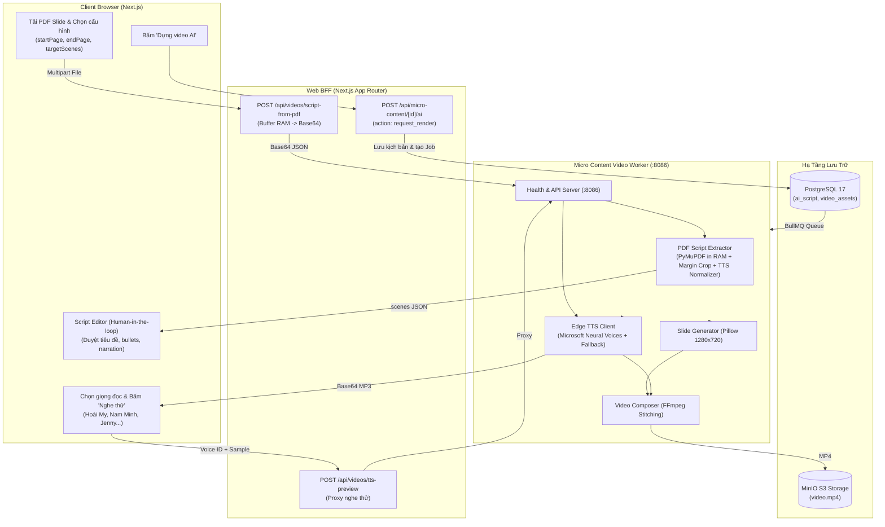

# Tài Liệu Kỹ Thuật: Tính Năng Trích Xuất Kịch Bản Video Từ PDF & Hệ Thống Giọng Đọc AI Đa Dạng

> **Môi trường**: Hệ thống Micro Content & AI Video Studio (Next.js 15 App Router / NestJS Core API / Python Worker / PyMuPDF / Microsoft Edge TTS / FFmpeg / MinIO).  
> **Trạng thái**: Đã triển khai và kiểm thử hoàn tất (End-to-End).

---

## 1. Tổng Quan & Bối Cảnh Nghiệp Vụ

Trong quy trình sản xuất bài giảng vi mô (**Micro Content Video**), hai nút thắt lớn nhất đối với giảng viên là:
1. **Rào cản soạn kịch bản từ đầu**: Việc yêu cầu giảng viên phải tự gõ prompt chi tiết hoặc nhập từng câu chữ cho 5–8 slide rất tốn thời gian. Trong khi đó, hầu hết giảng viên đại học và giáo viên trực tuyến đã có sẵn tài liệu bài giảng dạng slide thuyết trình (**PowerPoint xuất PDF**, **Canva**, **LaTeX Beamer**).
2. **Sự gò bó về giọng đọc và thiếu phản hồi tức thì**: Một video bài giảng chỉ có một giọng đọc mặc định duy nhất dễ gây nhàm chán hoặc không phù hợp với chủ đề (ví dụ: bài học tiếng Anh cần giọng bản xứ Mỹ, bài học kỹ thuật cần giọng nam dõng dạc). Đồng thời, việc phải chờ render video 1–3 phút mới biết giọng đọc thế nào gây lãng phí tài nguyên và ức chế trải nghiệm người dùng.

Để giải quyết triệt để hai bài toán này, hệ thống đã phát triển 2 tính năng trọng tâm:
- **Tính năng 1: Trích xuất kịch bản Video sư phạm từ PDF bài giảng / Slide (PDF-to-Script)** với cơ chế **Human-in-the-loop** (Giảng viên duyệt & chỉnh sửa trước khi xuất video).
- **Tính năng 2: Hệ thống Đa Giọng Đọc AI (Multi-Voice TTS) & Nghe Thử Tức Thì (Instant Voice Preview)** trước khi render.

---

## 2. Kiến Trúc Hệ Thống Tổng Thể



---

## 3. Chi Tiết Tính Năng 1: Trích Xuất Kịch Bản Từ PDF (PDF-to-Script)

### 3.1. Nguyên Tắc Thiết Kế Kỹ Thuật

1. **Human-in-the-loop (Con người kiểm soát ở trung tâm)**:
   - Hệ thống **KHÔNG** chạy thẳng từ PDF ra file video MP4.
   - Thay vào đó, dữ liệu trích xuất được nạp trực tiếp vào **Script Editor** trên giao diện để giảng viên duyệt từng cảnh, chỉnh sửa câu chữ, thêm/bớt slide trước khi bấm render. Cách tiếp cận này giúp tiết kiệm 100% tài nguyên render video nếu giảng viên muốn chỉnh lại lời thoại.

2. **Xử lý trực tiếp trong RAM (In-Memory Streaming)**:
   - Không lưu file PDF tạm lên MinIO hay ổ cứng máy chủ.
   - Trình duyệt gửi file PDF qua `multipart/form-data`, Next.js đọc thành buffer bộ nhớ và chuyển tiếp sang Worker qua Base64. Worker sử dụng `pymupdf.open(stream=pdf_bytes, filetype="pdf")` để bóc tách trong RAM trong vòng **50–150ms**.

3. **Cắt bỏ rác trình bày (Margin Cropping)**:
   - Slide xuất từ Canva/PowerPoint luôn có Header/Footer lặp lại (Tên trường, tên môn, ngày tháng, số trang `12/45`).
   - Hệ thống dùng `page.get_text("dict")` để loại bỏ toàn bộ các khối chữ có tọa độ $y < 7\%$ mép trên trang hoặc $y > 92\%$ mép dưới trang.
   - Tự động bỏ qua các dòng văn bản thuần số trang dạng regex: `^(\d+|trang\s*\d+|page\s*\d+)(\s*/\s*\d+)?$`.

4. **Nhận diện Tiêu đề bằng cỡ chữ lớn nhất (Max Font-Size Title Detection)**:
   - Trong một slide, dòng có `font_size` lớn nhất chính là Tiêu đề (`title`), chứ không nhất thiết là dòng xuất hiện đầu tiên theo thứ tự đọc.
   - Các dòng chữ có kích thước nhỏ hơn được gom vào danh sách các ý chính (`bullets`).

5. **Lọc slide kết thúc & Bắt lỗi PDF scan**:
   - Tự động bỏ qua các trang slide kết thúc dạng: `Thank You`, `Cảm ơn`, `Q&A`, `Hỏi đáp`.
   - Tính tổng ký tự trên dải trang được chọn; nếu trung bình $< 15$ ký tự/trang, hệ thống lập tức thông báo lỗi thân thiện: *"File PDF có vẻ là dạng ảnh scan (không có lớp chữ). Vui lòng sử dụng file PDF chứa văn bản (selectable text)."*

6. **Chuẩn hóa văn nói cho giọng đọc TTS (`normalize_for_tts`)**:
   - **`bullets`** (hiển thị bằng mắt trên slide): Giữ nguyên công thức toán, code, ký hiệu kỹ thuật ($O(N \log N)$, `->`, `>=`, `VD:`).
   - **`narration`** (lời đọc thành tiếng): Bắt buộc chuyển đổi toàn bộ ký hiệu và từ viết tắt sang văn nói tiếng Việt tự nhiên:

| Ký hiệu gốc | Chuẩn hóa sang văn nói TTS |
| :--- | :--- |
| `VD:` / `vd` | `Ví dụ:` |
| `T/c` / `Đ/n` | `Tính chất` / `Định nghĩa` |
| `v.v.` / `v.v` | `vân vân` |
| `->` / `→` | `dẫn đến` |
| `>=` / `<=` | `lớn hơn hoặc bằng` / `nhỏ hơn hoặc bằng` |
| `!=` / `≠` | `khác` |
| `O(N log N)` | `độ phức tạp ô N lô-ga-rít N` |
| `O(1)` | `độ phức tạp ô một` |
| `O(N^2)` | `độ phức tạp ô N bình phương` |
| `CSDL` / `CNTT` | `Cơ sở dữ liệu` / `Công nghệ thông tin` |

---

## 4. Chi Tiết Tính Năng 2: Đa Giọng Đọc AI & Nghe Thử Tức Thì

### 4.1. Danh Sách Giọng Đọc Được Tích Hợp

Hệ thống tích hợp trực tiếp **Microsoft Edge TTS** với các mô hình giọng nói Neural tự nhiên:

| Mã giọng (`voice`) | Tên hiển thị | Giới tính | Ngôn ngữ | Phong cách |
| :--- | :--- | :--- | :--- | :--- |
| `vi-VN-HoaiMyNeural` | **Hoài My** | Nữ | Tiếng Việt | Nhẹ nhàng, truyền cảm (Miền Bắc / Phổ thông) — *Mặc định* |
| `vi-VN-NamMinhNeural` | **Nam Minh** | Nam | Tiếng Việt | Trầm ấm, dõng dạc, chững chạc (Miền Bắc / Phổ thông) |
| `en-US-JennyNeural` | **Jenny** | Nữ | English (US) | Tự nhiên, sống động chuẩn bản xứ Mỹ |
| `en-US-GuyNeural` | **Guy** | Nam | English (US) | Đĩnh đạc, trầm ấm, chuyên nghiệp chuẩn Mỹ |
| `en-US-AriaNeural` | **Aria** | Nữ | English (US) | Chuẩn ngữ điệu học thuật, rõ ràng, sư phạm |

### 4.2. Cơ Chế Nghe Thử Tức Thì (Instant Preview)

- **Độ trễ phản hồi**: $\approx 1.2 - 2.0$ giây.
- **Quy trình hoạt động**:
  1. Giảng viên bấm nút **"▶ Nghe thử"** trên thẻ giọng đọc (hoặc bên cạnh từng cảnh).
  2. Frontend gửi request `POST /api/videos/tts-preview` kèm `voice` và đoạn `text` mẫu.
  3. Worker thực hiện synthesize đoạn âm thanh mẫu ra RAM/temp file, mã hóa Base64 và trả về JSON:
     ```json
     {
       "status": "ok",
       "voice": "vi-VN-NamMinhNeural",
       "duration": 2.45,
       "audio_base64": "//NkxAAAAANIAAAAAExBTUV..."
     }
     ```
  4. Trình duyệt giải mã Data URL `data:audio/mp3;base64,...` và phát bằng đối tượng `new Audio()` với hiệu ứng animate trạng thái đang phát.

### 4.3. Phân Cấp Giọng Đọc (Hierarchical Voice Assignment)

- **Cấp độ kịch bản toàn bài (`script.voice`)**: Áp dụng chung cho tất cả các cảnh của video.
- **Cấp độ từng cảnh riêng biệt (`scene.voice`)**: Cho phép ghi đè (override) giọng đọc cho từng cảnh cụ thể. Giảng viên có thể xây dựng video dạng hội thoại sư phạm (ví dụ: cảnh mở đầu dùng giọng Hoài My, cảnh phân tích tình huống dùng giọng Nam Minh).

### 4.4. Cơ Chế Dự Phòng (Resilient Fallback)

Trong [tts_client.py](file:///D:/DATN/DA/worker/worker/services/tts_client.py), `EdgeTtsClient` triển khai vòng lặp dự phòng:
- Nếu giọng chính `vi-VN-HoaiMyNeural` gặp sự cố mạng, hệ thống tự động thử tiếp giọng `vi-VN-NamMinhNeural`.
- Nếu giọng tiếng Anh `en-US-JennyNeural` lỗi, tự động chuyển sang `en-US-GuyNeural`.
- Tự động làm sạch văn bản (`clean_text`), thay thế chuỗi rỗng bằng câu mặc định để tránh lỗi kết nối WebSocket của Edge TTS.

---

## 5. Danh Mục File & Thành Phần Mã Nguồn Đã Chỉnh Sửa

| Tệp tin | Vị trí | Trách nhiệm chính |
| :--- | :--- | :--- |
| `pdf_script_extractor.py` | `worker/worker/services/` | Bóc tách slide theo font-size, margin cropping, kiểm tra PDF scan, phân cụm cảnh và chuẩn hóa văn nói TTS. |
| `health.py` | `worker/worker/` | Mở rộng HTTP Server cổng `8086` hỗ trợ `POST /script-from-pdf` và `POST /tts-preview`. |
| `tts_client.py` | `worker/worker/services/` | Cài đặt Edge TTS Client, hỗ trợ danh sách giọng đọc, cơ chế luân chuyển dự phòng và đo đạc thời lượng qua `ffprobe`. |
| `render_micro_content_video.py` | `worker/worker/use_cases/` | Nhận diện trường `voice` từ cấp `script` hoặc cấp `scene` để tổng hợp giọng nói tương ứng cho từng slide. |
| `route.ts` (script-from-pdf) | `web/src/app/api/videos/script-from-pdf/` | Next.js BFF endpoint tiếp nhận file PDF từ client và chuyển tiếp sang Worker. |
| `route.ts` (tts-preview) | `web/src/app/api/videos/tts-preview/` | Next.js BFF endpoint tiếp nhận yêu cầu nghe thử giọng đọc và trả về Base64 audio stream. |
| `video-panel.tsx` | `web/src/app/manage/micro-content/[id]/edit/` | Giao diện upload PDF, chọn dải trang, thẻ chọn giọng đọc kèm nút nghe thử, và Script Editor cho phép duyệt/sửa kịch bản. |

---

## 6. Đặc Tả API Mới

### 6.1. Trích xuất kịch bản từ PDF
- **Endpoint**: `POST /api/videos/script-from-pdf`
- **Content-Type**: `multipart/form-data`
- **Tham số Request**:
  - `file`: File nhị phân `.pdf` (tối đa 50MB).
  - `startPage`: Số nguyên (mặc định: `1`).
  - `endPage`: Số nguyên (mặc định: `20`).
  - `targetScenes`: Số nguyên (mặc định: `5`, khoảng: `2–10`).
  - `topic`: Chuỗi (tùy chọn, mặc định lấy tên file).
- **Phản hồi mẫu (HTTP 200)**:
  ```json
  {
    "status": "ok",
    "total_pages": 42,
    "extracted_slides": 18,
    "scenes": [
      {
        "title": "Thuật toán QuickSort & Phân vùng Lomuto",
        "bullets": [
          "Ý tưởng chia để trị (Divide and Conquer)",
          "Chọn phần tử chốt (Pivot)",
          "Độ phức tạp trung bình O(N log N)"
        ],
        "narration": "Chào mừng các bạn đến với phần Thuật toán QuickSort và Phân vùng Lomuto. Trong bài học này, chúng ta sẽ áp dụng ý tưởng chia để trị, chọn phần tử chốt và đạt độ phức tạp trung bình ô N lô-ga-rít N."
      }
    ]
  }
  ```

### 6.2. Nghe thử giọng đọc AI
- **Endpoint**: `POST /api/videos/tts-preview`
- **Content-Type**: `application/json`
- **Tham số Request**:
  ```json
  {
    "voice": "vi-VN-NamMinhNeural",
    "text": "Xin chào các bạn, chào mừng các bạn đến với khóa học."
  }
  ```
- **Phản hồi mẫu (HTTP 200)**:
  ```json
  {
    "status": "ok",
    "voice": "vi-VN-NamMinhNeural",
    "duration": 2.45,
    "audio_base64": "//NkxAAAAANIAAAAAExBTUV..."
  }
  ```

---

## 7. Hướng Dẫn Sử Dụng Dành Cho Giảng Viên

1. **Bước 1 — Mở bài học Micro Content**:
   - Truy cập vào trang chỉnh sửa bài học Micro Content bất kỳ (ví dụ: `/manage/micro-content/[id]/edit`).
   - Chuyển sang thẻ **✨ Tạo video bằng AI**.

2. **Bước 2 — Chọn giọng đọc AI ưa thích**:
   - Tại mục **🎙️ Giọng đọc giảng bài AI (TTS)**, xem danh sách các giọng (Hoài My, Nam Minh, Jenny, v.v.).
   - Nhấn nút **"▶ Nghe thử"** tại từng giọng để nghe mẫu ngữ điệu trực tiếp.
   - Nhấn chọn giọng bạn mong muốn.

3. **Bước 3 — Nạp tài liệu PDF**:
   - Chọn tab **📄 Tải file PDF bài giảng / Slide**.
   - Kéo thả hoặc chọn file slide `.pdf`.
   - Điều chỉnh **Khoảng trang trích xuất** (ví dụ từ trang 1 đến 15) và **Số cảnh mục tiêu** (khuyến nghị 4–6 cảnh).
   - Bấm **"🪄 Trích xuất kịch bản từ PDF vào Trình duyệt kịch bản"**.

4. **Bước 4 — Duyệt & Tinh chỉnh kịch bản (Human-in-the-loop)**:
   - Hệ thống tự động cuộn đến **Giai đoạn 2 (Duyệt & Chỉnh sửa kịch bản)**.
   - Giảng viên có thể:
     - Sửa lại tiêu đề slide hoặc các ý gạch đầu dòng.
     - Chỉnh sửa câu văn trong ô **Lời đọc thành tiếng (TTS)**.
     - Bấm **"▶ Nghe thử cảnh này"** để kiểm tra ngữ điệu riêng của từng cảnh.
     - Bấm **"+ Thêm cảnh"** hoặc **"Xóa cảnh"**.

5. **Bước 5 — Dựng video**:
   - Nhấn nút **"Dựng video AI"** (màu xanh lá).
   - Hệ thống tiến hành render slide ảnh, đọc âm thanh theo đúng giọng đã chọn và ghép nối thành file MP4 hoàn chỉnh.

