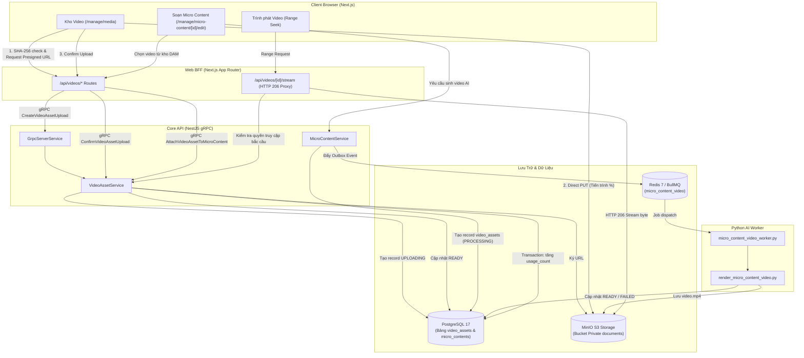

# Tài Liệu Kỹ Thuật: Hệ Thống Quản Lý & Tái Sử Dụng Học Liệu Video (Digital Asset Management - DAM)

> **Môi trường**: Hệ thống Micro Content & LMS (Open edX / Canvas / Next.js BFF / NestJS Core API / Python Worker / MinIO / PostgreSQL 17 / Redis 7).  
> **Trạng thái**: Đã hoàn thiện và kiểm thử thành công (End-to-End).

---

## 1. Mục Tiêu & Bối Cảnh Hệ Thống

Trong quá trình giảng dạy số và xây dựng bài giảng Micro Content, giảng viên có hai nguồn video chính:
1. **Video tự quay / tải lên từ thiết bị** (`USER_UPLOAD`): Các video bài giảng thực tế, quay màn hình hướng dẫn code, file `.mp4` hoặc `.webm`.
2. **Video bài giảng sinh tự động bằng AI** (`AI_STUDIO`): Được sinh ra từ kịch bản AI (Slide Generator + Text-to-Speech + FFmpeg ghép nhạc và phụ đề).

### Vấn đề tồn tại trước khi nâng cấp:
- **Trùng lặp dung lượng lưu trữ (Storage Duplication)**: Mỗi bài học micro content gắn cứng một video riêng biệt trên MinIO. Nếu cùng một video nền tảng được dùng cho 5 lớp học khác nhau, hệ thống tốn gấp 5 lần dung lượng lưu trữ và băng thông.
- **Lãng phí chi phí tính toán AI (Token & Compute Waste)**: Video sinh từ AI Studio mất 1–3 phút để render. Khi giảng viên khác muốn dùng cùng nội dung, hệ thống phải chạy lại toàn bộ quy trình sinh âm thanh và render video từ đầu.
- **Thiếu khả năng chia sẻ và tìm kiếm**: Không có nơi lưu trữ trung tâm để giảng viên duyệt, tìm kiếm theo chủ đề, hoặc tái sử dụng các video có sẵn.

### Giải pháp kỹ thuật đã triển khai:
Tách học liệu video thành một thực thể độc lập (**`video_assets`**) theo mô hình Digital Asset Management (DAM) hiện đại:
- **Quan hệ 1 - N**: Một `video_assets` có thể được liên kết và tái sử dụng bởi nhiều bài giảng `micro_contents` khác nhau.
- **Kiểm tra trùng lặp thông minh (Deduplication)**: Tính mã băm SHA-256 ngay trên trình duyệt trước khi upload. Nếu video đã tồn tại, hệ thống cho phép tái sử dụng tức thì mà không tiêu tốn một byte băng thông hay dung lượng MinIO nào.
- **Bảo mật & Quyền truy cập bắc cầu (Transitive Access)**: MinIO bucket hoàn toàn Private; hỗ trợ phân quyền `PUBLIC`, `COURSE`, `PRIVATE` và đảm bảo các bài học cũ vẫn phát được bình thường khi tác giả ẩn hoặc xóa video.
- **Nhân bản kịch bản AI (Fork AI Video)**: Giảng viên có thể nhân bản kịch bản video AI của đồng nghiệp để tinh chỉnh lại cho phù hợp với lớp học của mình.

---

## 2. Kiến Trúc & Luồng Dữ Liệu Tổng Thể

---

## 3. Chi Tiết Các Bước Kỹ Thuật Đã Triển Khai

### Bước 1: Thiết kế CSDL & Migration (PostgreSQL 17)
> **Nguyên tắc**: Giữ nguyên vẹn phiên bản PostgreSQL 17 và toàn bộ các bảng hiện có, migration mang tính thuần bổ sung (Additive).

- File migration: `core-api/prisma/migrations/20261021201500_video_assets_dam/migration.sql`
- Định nghĩa Schema bảng `video_assets`:
  - `asset_id`: Khóa chính UUID (tự sinh qua `uuidv7()`).
  - `title`, `description`, `tags`: Thông tin tìm kiếm học liệu.
  - `object_key`: Đường dẫn lưu trữ trên MinIO (cho phép `NULL` khi đang khởi tạo/render).
  - `duration_ms`, `size_bytes`, `mime_type`: Thông số kỹ thuật video.
  - `source_type`: Phân loại nguồn (`USER_UPLOAD` hoặc `AI_STUDIO`).
  - `status`: Máy trạng thái bất đồng bộ (`UPLOADING`, `PROCESSING`, `READY`, `FAILED`).
  - `transcript_status`: Trạng thái bóc băng lời thoại (`NONE`, `PENDING`, `PROCESSING`, `INDEXED`, `FAILED`).
  - `visibility`: Phạm vi chia sẻ (`PRIVATE`, `COURSE`, `PUBLIC`).
  - `usage_count`: Số bài học đang gắn video này (mặc định `0`).
  - `file_hash`: Chuỗi mã băm SHA-256 chống trùng lặp file.
  - `allow_fork`, `forked_from_id`: Hỗ trợ nhân bản kịch bản AI.
  - `ai_prompt`, `ai_script`, `error_message`: Lưu trữ ngữ cảnh sinh AI và lỗi khi render thất bại.
  - `deleted_at`: Hỗ trợ xóa mềm an toàn.
- Cập nhật bảng `micro_contents`:
  - Thêm cột `video_asset_id` kiểu `UUID` liên kết khóa ngoại với `video_assets(asset_id)`.
  - Tạo chỉ mục index `idx_micro_contents_video_asset` tăng tốc truy vấn nối bảng.

---

### Bước 2: Khắc Phục Các Chốt Chặn Kỹ Thuật Cốt Lõi

#### 1. Xử lý bẫy tuần tự hóa BigInt (BigInt Serialization Trap)
- **Vấn đề**: Trường `size_bytes` trong PostgreSQL là số nguyên lớn (BigInt). Hàm `JSON.stringify()` mặc định của Node.js ném lỗi `TypeError: Do not know how to serialize a BigInt` khi trả response về client.
- **Giải pháp**:
  - Tại `core-api/src/main.ts`: Bổ sung global polyfill `(BigInt.prototype as any).toJSON = function () { return Number(this); };`.
  - Tại `core-api/src/video-asset/video-asset.service.ts`: Viết hàm mapper `serializeVideoAsset` chủ động chuyển đổi `size_bytes` sang số `number` tiêu chuẩn trước khi trả về gRPC.

#### 2. Kiểm tra trùng lặp SHA-256 tức thì (Browser-side Deduplication)
- **Cơ chế**: Trước khi bắt đầu upload, trình duyệt đọc file qua Web Crypto API (`crypto.subtle.digest("SHA-256", buffer)`).
- Gửi hash lên backend kiểm tra qua API `POST /api/videos/check-hash`.
- Nếu video đã tồn tại trong hệ thống (công khai hoặc của chính giảng viên), giao diện lập tức hiển thị gợi ý tái sử dụng bản ghi cũ, giúp tiết kiệm 100% thời gian tải lên và dung lượng MinIO.

#### 3. Khởi tạo Eager khi sinh Video AI (AI Video Studio)
- **Cơ chế**: Trước khi đẩy job `MICRO_CONTENT_RENDER_REQUESTED` vào Redis / BullMQ, `MicroContentService.requestRender()` chủ động tạo/cập nhật bản ghi `video_assets` với trạng thái `PROCESSING`, gán sẵn `ai_prompt` và `ai_script`.
- **Lợi ích**: Giảng viên chuyển sang trang Kho Video sẽ thấy ngay video đang ở trạng thái *"Đang xử lý / render"* rất trực quan. Nếu worker gặp sự cố, thông tin lỗi `error_message` được lưu vào bản ghi đó để giảng viên có thể xem lý do và bấm Thử lại (Retry) mà không bị mất kịch bản.

#### 4. Quyền truy cập bắc cầu (Transitive Access Permission)
- **Bài toán**: Giảng viên A tạo video ở chế độ `PUBLIC`. Giảng viên B lấy video đó gắn vào bài giảng `micro_contents` của lớp mình (`usage_count = 1`). Sau đó Giảng viên A đổi video về `PRIVATE` hoặc xóa mềm.
- **Giải pháp**: Trong hàm `getStreamUrl()`, điều kiện cấp phép xem video gồm:
  1. Video là `PUBLIC`, HOẶC
  2. Người dùng hiện tại là tác giả (`owner_id`), HOẶC
  3. Video có phạm vi `COURSE` và người dùng thuộc khóa học đó, HOẶC
  4. Request gửi kèm `microContentId`: Người dùng đã ghi danh vào khóa học chứa `microContentId` đó thì vẫn được phép xem video (quyền được kế thừa bắc cầu qua bài giảng).

#### 5. Đồng bộ `usage_count` nguyên tử (Atomic Counter Sync)
- Khi một bài giảng gắn video mới, đổi video, hoặc gỡ video:
- Toàn bộ thao tác cập nhật `micro_contents.video_asset_id`, tăng `usage_count` ở video mới (+1) và giảm `usage_count` ở video cũ (-1) được bọc trong một `prisma.$transaction`.

#### 6. Streaming HTTP 206 bảo mật từ Private MinIO
- MinIO bucket `documents` nằm trong mạng nội bộ Docker (`minio:9000`), không mở public port ra ngoài Internet.
- Route `/api/videos/[id]/stream` tại Web BFF đóng vai trò proxy bảo mật: nhận request từ trình duyệt, kiểm tra session LTI và quyền bắc cầu, sau đó chuyển tiếp Range header sang MinIO và trả về luồng `HTTP 206 Partial Content`. Trình duyệt có thể tua video (seek) tự do mà không làm rò rỉ URL gốc của MinIO.

---

### Bước 3: Hợp Đồng Giao Thức & Backend Service (NestJS Core API)

1. **API HTTP REST** (`core-api/src/video-asset/video-asset.controller.ts`):
   Khai báo 10 endpoint dưới `/api/video-assets` (bảo vệ bằng `BffJwtGuard`, body kiểm bằng DTO `class-validator` trong `video-asset/dto/`):
   - `GET /api/video-assets` (danh sách), `GET /api/video-assets/:id`
   - `POST /api/video-assets/upload`, `POST /api/video-assets/:id/confirm-upload`
   - `GET /api/video-assets/:id/stream-url`, `PATCH /api/video-assets/:id`, `DELETE /api/video-assets/:id`
   - `POST /api/video-assets/:id/fork`, `POST /api/video-assets/check-hash`, `POST /api/video-assets/attach`

2. **Module & Service** (`core-api/src/video-asset/`):
   - `video-asset.service.ts`: Cài đặt logic nghiệp vụ phân quyền, upload presigned URL, xóa mềm an toàn, fork kịch bản AI.
   - `video-asset.module.ts`: Đóng gói `PrismaModule`, `AuthModule`, `DocumentModule` và export `VideoAssetService`.
   - `video-asset.controller.ts`: Nhận request HTTP, kiểm DTO và gọi phương thức tương ứng của `VideoAssetService`.

3. **Cập nhật Micro Content Service**:
   - `micro-content.service.ts`: Tích hợp khởi tạo eager bản ghi `video_assets` khi render kịch bản AI.
   - `micro-content-video.service.ts`: Tự động tạo bản ghi `video_assets` khi người dùng tải file trực tiếp trong màn hình soạn bài giảng.

---

### Bước 4: Nâng Cấp Python Video Worker

- **File cập nhật**:
  - `worker/worker/services/micro_content_video_store.py`
  - `worker/worker/use_cases/render_micro_content_video.py`
  - `worker/worker/runners/micro_content_video_worker.py`
- **Thay đổi**:
  - `parse_render_job`: Đọc thêm `asset_id` từ payload của job.
  - `update_video_ready`: Cập nhật đồng thời `micro_contents` và `video_assets` (`status = 'READY'`, `duration_ms`, `size_bytes`, `object_key`).
  - `update_video_failed`: Ghi nhận lỗi chi tiết vào cả hai bảng nếu quá trình render thất bại (`status = 'FAILED'`, `error_message`).

---

### Bước 5: Web Frontend & Next.js BFF

1. **Client HTTP Core API** (`web/src/lib/core-api.ts`):
   - Bổ sung 10 phương thức gọi backend tương ứng; mỗi call là một `fetch` tới `CORE_API_INTERNAL_URL` (`http://core-api:4000`) kèm JWT ký bằng `web/src/lib/bff-jwt.ts`.

2. **BFF REST API Routes** (`web/src/app/api/videos/`):
   - `GET /api/videos`: Tìm kiếm và phân trang video theo phạm vi.
   - `POST /api/videos/check-hash`: Kiểm tra băm SHA-256 để chống upload trùng.
   - `POST /api/videos/upload` & `POST /api/videos/confirm`: Khởi tạo và xác nhận tải lên MinIO.
   - `POST /api/videos/attach`: Gắn/gỡ video vào bài giảng Micro Content.
   - `GET`, `PATCH`, `DELETE /api/videos/[id]`: Đọc chi tiết, sửa metadata/visibility, xóa an toàn.
   - `POST /api/videos/[id]/fork`: Nhân bản kịch bản video AI.
   - `GET /api/videos/[id]/stream`: Stream video HTTP 206 Range.

3. **Giao diện Thư viện Video DAM** (`web/src/app/manage/media/`):
   - Thêm tab **"Kho Video"** trên thanh điều hướng [`InstructorNav`](file:///D:/DATN/DA/web/src/components/instructor-nav.tsx).
   - Banner thống kê: Tổng số video, số video upload, số video AI, tổng số lượt gắn vào bài học.
   - Bộ lọc tab: *Tất cả*, *Của tôi*, *Khoá học này*, *Công khai (Public)*.
   - Thanh tìm kiếm thời gian thực theo tiêu đề, mô tả và hashtag.
   - Dialog Upload video: Tự động tính SHA-256 và cảnh báo trùng lặp trước khi gửi file.
   - Card video: Hiển thị thumbnail xem trước, huy hiệu trạng thái (`READY`, `PROCESSING`), nguồn gốc (`Upload` vs `AI Studio`), thời lượng và dung lượng.
   - Modal xem trước video (preview player), modal đổi quyền chia sẻ (`PUBLIC` / `COURSE` / `PRIVATE`), nút **Fork AI Video**, nút Xóa an toàn.

4. **Tích hợp Video Picker vào Trình Soạn Bài Giảng Micro Content**:
   - Tại `web/src/app/manage/micro-content/[id]/edit/video-panel.tsx`:
   - Thêm tab thứ 3: **"📚 Chọn từ Kho học liệu (Video DAM)"**.
   - Giảng viên có thể duyệt toàn bộ video có sẵn trong kho, tìm kiếm và bấm **"Chọn video này"** để gắn ngay vào bài học hiện tại mà không cần upload hay render lại.

---

## 4. Ma Trận Các File Đã Thay Đổi & Tạo Mới

> (ghi chú 2026-11-16: kênh web→core-api nay là HTTP REST; các dòng trong bảng nhắc `contracts/proto/core_api.proto`, `grpc-server.service.ts` hay "gọi gRPC" chỉ còn giá trị lịch sử — hiện tại là `video-asset.controller.ts` + DTO trong core-api và các method trong `web/src/lib/core-api.ts`.)

| Phân hệ | Đường dẫn file | Hành động | Mục đích |
| :--- | :--- | :--- | :--- |
| **Contracts** | `contracts/proto/core_api.proto` | Chỉnh sửa | Khai báo 10 RPCs quản lý Video Assets |
| **Database** | `core-api/prisma/schema.prisma` | Chỉnh sửa | Thêm model `video_assets` & liên kết `micro_contents` |
| **Database** | `core-api/prisma/migrations/20261021201500_video_assets_dam/migration.sql` | Tạo mới | DDL migration thuần bổ sung cho PostgreSQL 17 |
| **Core API** | `core-api/src/main.ts` | Chỉnh sửa | Bổ sung `BigInt.prototype.toJSON` polyfill |
| **Core API** | `core-api/src/video-asset/video-asset.service.ts` | Tạo mới | Nghiệp vụ DAM, kiểm tra SHA-256, phân quyền, xóa mềm |
| **Core API** | `core-api/src/video-asset/video-asset.module.ts` | Tạo mới | Khai báo module NestJS cho Video Asset |
| **Core API** | `core-api/src/grpc/grpc-server.service.ts` | Chỉnh sửa | Ánh xạ 10 RPC gRPC vào VideoAssetService |
| **Core API** | `core-api/src/grpc/grpc.module.ts` | Chỉnh sửa | Import VideoAssetModule |
| **Core API** | `core-api/src/app.module.ts` | Chỉnh sửa | Đăng ký VideoAssetModule vào ứng dụng chính |
| **Core API** | `core-api/src/micro-content/micro-content.service.ts` | Chỉnh sửa | Eager initialization khi render video AI |
| **Core API** | `core-api/src/micro-content/micro-content-video.service.ts` | Chỉnh sửa | Tự động tạo video asset khi upload bài học |
| **Python Worker** | `worker/worker/services/micro_content_video_store.py` | Chỉnh sửa | Cập nhật đồng bộ status video_assets (READY/FAILED) |
| **Python Worker** | `worker/worker/use_cases/render_micro_content_video.py` | Chỉnh sửa | Truyền asset_id qua use case render video |
| **Python Worker** | `worker/worker/runners/micro_content_video_worker.py` | Chỉnh sửa | Trích xuất asset_id từ outbox payload |
| **Web BFF** | `web/src/lib/core-api.ts` | Chỉnh sửa | Khai báo 10 helper methods gọi gRPC |
| **Web BFF** | `web/src/components/instructor-nav.tsx` | Chỉnh sửa | Thêm tab "Kho Video" vào thanh điều hướng |
| **Web BFF** | `web/src/app/api/videos/route.ts` | Tạo mới | API danh sách video phân trang & lọc |
| **Web BFF** | `web/src/app/api/videos/check-hash/route.ts` | Tạo mới | API kiểm tra trùng lặp SHA-256 |
| **Web BFF** | `web/src/app/api/videos/upload/route.ts` | Tạo mới | API cấp presigned URL tải video lên MinIO |
| **Web BFF** | `web/src/app/api/videos/confirm/route.ts` | Tạo mới | API xác nhận upload hoàn tất |
| **Web BFF** | `web/src/app/api/videos/attach/route.ts` | Tạo mới | API liên kết video vào micro content |
| **Web BFF** | `web/src/app/api/videos/[id]/route.ts` | Tạo mới | API CRUD metadata và xóa mềm |
| **Web BFF** | `web/src/app/api/videos/[id]/fork/route.ts` | Tạo mới | API nhân bản kịch bản AI video |
| **Web BFF** | `web/src/app/api/videos/[id]/stream/route.ts` | Tạo mới | API stream HTTP 206 Range proxy |
| **Web UI** | `web/src/app/manage/media/page.tsx` | Tạo mới | Trang chủ Kho học liệu Video DAM |
| **Web UI** | `web/src/app/manage/media/media-library-client.tsx` | Tạo mới | Giao diện tương tác quản lý, upload, dedup, preview |
| **Web UI** | `web/src/app/manage/micro-content/[id]/edit/video-panel.tsx` | Chỉnh sửa | Tích hợp tab Video Picker vào bài học |

---

## 5. Hướng Dẫn Kiểm Thử & Nghiệm Thu Hệ Thống

### 1. Truy cập Kho Học Liệu Video
- Đăng nhập quyền Giảng viên từ Canvas / LMS hoặc dùng URL dev:
  `http://localhost:3001/manage/media?sid=dev-session`
- Kiểm tra hiển thị thanh điều hướng có mục **"Kho Video"**.
- Kiểm tra 4 thẻ thống kê: *Tổng số học liệu*, *Video tải lên*, *AI Video Studio*, *Lượt liên kết bài học*.

### 2. Kiểm thử Chống Trùng Lặp (SHA-256 Deduplication)
1. Bấm **"Tải video mới lên"**, chọn file video mẫu `sample.mp4`.
2. Trình duyệt tự động tính mã băm SHA-256 và thực hiện upload trực tiếp lên MinIO. Video chuyển sang trạng thái `READY`.
3. Bấm **"Tải video mới lên"** lần thứ hai và chọn lại chính file `sample.mp4` đó.
4. Hệ thống lập tức hiện thông báo cảnh báo màu vàng:  
   *"💡 Video này đã tồn tại trong hệ thống! Tên video: ... Bạn không cần tốn băng thông và dung lượng lưu trữ để upload lại."*

### 3. Kiểm thử Tái Sử Dụng Video (Video Picker trong Micro Content)
1. Vào trang chỉnh sửa bài học: `http://localhost:3001/manage/micro-content/[id]/edit?tab=video&sid=dev-session`.
2. Chuyển sang tab **"📚 Chọn từ Kho học liệu (Video DAM)"**.
3. Danh sách các video có sẵn sẽ hiện ra kèm thanh tìm kiếm. Bấm **"Chọn video này"**.
4. Video được gắn tức thì vào bài học. Kiểm tra số `usage_count` trong Kho Video tự động tăng thêm 1.

### 4. Kiểm thử Quyền Truy Cập Bắc Cầu & Xóa Mềm An Toàn
1. Tại Kho Video, đổi một video đang có `usage_count >= 1` sang chế độ `PRIVATE`.
2. Dùng tài khoản học viên mở bài học đã gắn video đó: video vẫn phát mượt mà qua luồng Range Stream mà không bị chặn quyền.
3. Bấm nút **Xóa video**: hệ thống hiển thị thông báo xác nhận xóa mềm an toàn, file vật lý trên MinIO không bị xóa mất nhằm bảo vệ trải nghiệm của học viên đang học bài cũ.

