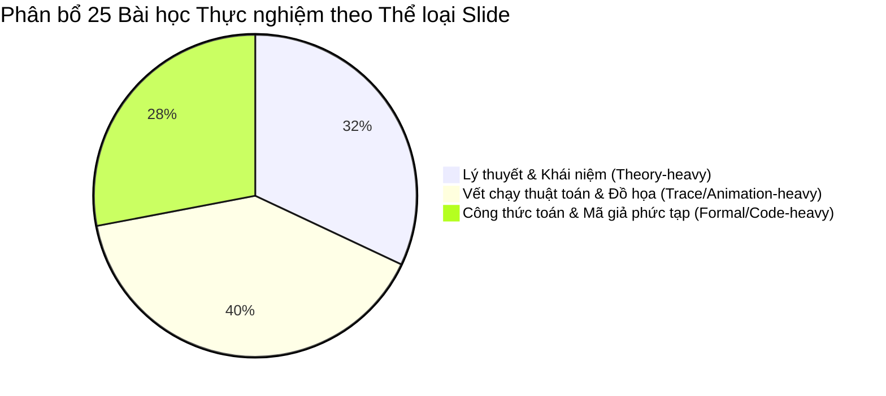
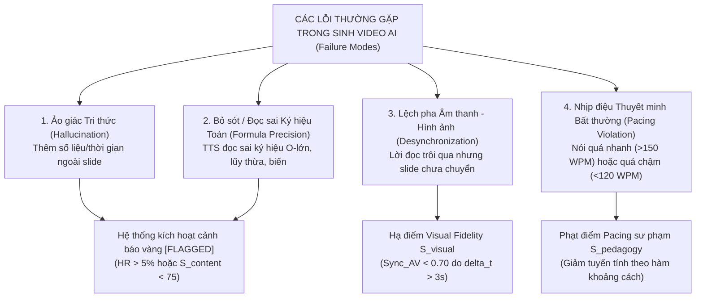
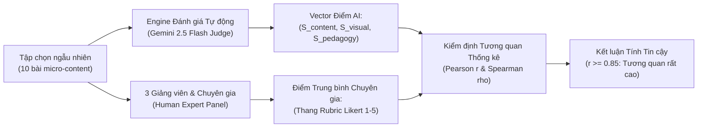

# THIẾT KẾ THỰC NGHIỆM ĐÁNH GIÁ DIỆN RỘNG (BENCHMARK) & PHÂN TÍCH LỖI (ERROR ANALYSIS)
## Đánh giá Chất lượng & Độ trung thực của Hệ sinh thái Video Micro-Content sinh từ Slide

> **Học phần thực nghiệm**:  
> 1. `CO2003` - Cấu trúc dữ liệu & Giải thuật (`3._Sorting.pdf`, Trường ĐH Bách Khoa - ĐHQG-HCM)  
> 2. `CS-DSA` - Thuật toán Quicksort chuyên sâu (`quicksort.pdf`, Giáo trình Kruse & Ryba)  
> 3. `CO3005` - Trình biên dịch & Sinh mã máy (`codegen.pdf`, Khoa KH&KT Máy tính)  
> **Quy mô thực nghiệm**: $N = 25$ bài học vi mô trải dài trên 3 nhóm thể loại slide: (1) Lý thuyết & Định nghĩa; (2) Vết chạy thuật toán & Mã giả; (3) Công thức toán & Cấu trúc mã máy.  
> **Mục tiêu học thuật**: Chứng minh năng lực phân loại (Discriminative Power) của Khung đánh giá 3 chiều qua việc phát hiện chính xác các ca lỗi thực tế (**Error Analysis**) và đối sánh máy–người (**Human vs. AI Evaluation**).

---

## 1. Thiết kế Bộ Dữ liệu Thực nghiệm (Benchmark Dataset Setup)

Để đảm bảo tính khách quan và bao quát, tập thực nghiệm $N = 25$ mẫu được phân bổ đều qua 3 tài liệu slide thực tế:

### Bảng Danh mục 25 Bài học Benchmark:

| ID Mẫu | Tài liệu nguồn | Dải trang | Chủ đề bài học vi mô | Thể loại Slide | Chuẩn đầu ra ($LO$) |
| :---: | :--- | :---: | :--- | :---: | :---: |
| **BM-01** | `3._Sorting.pdf` | 10–17, 27 | Straight Insertion Sort (Thuật toán chèn) | Vết chạy & Mã giả | $LO.3.2$ |
| **BM-02** | `3._Sorting.pdf` | 18–26 | Selection Sort (Sắp xếp chọn trực tiếp) | Vết chạy & Mã giả | $LO.3.2$ |
| **BM-03** | `3._Sorting.pdf` | 28–35 | Bubble Sort (Sắp xếp nổi bọt & Cờ hiệu) | Vết chạy & Mã giả | $LO.3.2$ |
| **BM-04** | `3._Sorting.pdf` | 1–5 | Khái niệm sắp xếp, Tính ổn định (Stability) | Lý thuyết & Khái niệm | $LO.3.1$ |
| **BM-05** | `3._Sorting.pdf` | 6–9 | Phân loại thuật toán (In-place vs Extra-space) | Lý thuyết & Khái niệm | $LO.3.1$ |
| **BM-06** | `3._Sorting.pdf` | 36–42 | Shell Sort & Khoảng cách bước nhảy (Gaps) | Thuật toán & Phân tích | $LO.3.2$ |
| **BM-07** | `3._Sorting.pdf` | 43–50 | Merge Sort (Nguyên lý Chia để trị) | Thuật toán & Phân tích | $LO.3.3$ |
| **BM-08** | `3._Sorting.pdf` | 51–56 | Cây đệ quy Merge Sort & Độ phức tạp $O(n\log n)$ | Công thức & Đồ thị | $LO.3.3$ |
| **BM-09** | `3._Sorting.pdf` | 57–60 | Đánh giá tổng hợp các giải thuật $O(n^2)$ vs $O(n\log n)$ | Lý thuyết so sánh | $LO.3.4$ |
| **BM-10** | `quicksort.pdf` | 1–4 | Quicksort: Ý tưởng phân hoạch & Chọn Pivot | Lý thuyết & Khái niệm | $LO.3.3$ |
| **BM-11** | `quicksort.pdf` | 5–11 | Vòng quét 1: Con trỏ `too_big` và `too_small` | Vết chạy thuật toán | $LO.3.2$ |
| **BM-12** | `quicksort.pdf` | 12–18 | Vòng quét 2: Hoán đổi phần tử nghịch thế | Vết chạy thuật toán | $LO.3.2$ |
| **BM-13** | `quicksort.pdf` | 19–26 | Vòng quét 3: Hiện tượng giao con trỏ (Pointer crossing) | Vết chạy thuật toán | $LO.3.2$ |
| **BM-14** | `quicksort.pdf` | 27–30 | Đổi chỗ Pivot về vị trí chuẩn và tách 2 nửa | Vết chạy thuật toán | $LO.3.2$ |
| **BM-15** | `quicksort.pdf` | 31–38 | Mã giả đệ quy `quicksort(data, low, high)` | Mã giả & Cấu trúc | $LO.3.3$ |
| **BM-16** | `quicksort.pdf` | 39–45 | Phân tích trường hợp tốt nhất (Best-case $O(n\log n)$) | Công thức toán | $LO.3.4$ |
| **BM-17** | `quicksort.pdf` | 46–50 | Phân tích trường hợp xấu nhất (Worst-case $O(n^2)$) | Công thức toán | $LO.3.4$ |
| **BM-18** | `quicksort.pdf` | 51–54 | Chiến lược chọn Pivot trung vị (Median-of-three) | Thuật toán nâng cao | $LO.3.4$ |
| **BM-19** | `codegen.pdf` | 1–4 | Vị trí của Code Generator trong Compiler | Lý thuyết kiến trúc | $LO.4.1$ |
| **BM-20** | `codegen.pdf` | 5–8 | Biểu diễn trung gian (Three-Address Code IR) | Mã giả & Cú pháp | $LO.4.2$ |
| **BM-21** | `codegen.pdf` | 9–11 | Đồ thị khối cơ bản (Basic Blocks & Flow Graphs) | Đồ họa & Cấu trúc | $LO.4.2$ |
| **BM-22** | `codegen.pdf` | 12–14 | Cây DAG biểu diễn biểu thức số học | Đồ thị & Công thức | $LO.4.3$ |
| **BM-23** | `codegen.pdf` | 15–16 | Phân bổ thanh ghi (Register Allocation Descriptor) | Mã máy & Bảng biểu | $LO.4.3$ |
| **BM-24** | `codegen.pdf` | 17–18 | Chiến lược giải phóng thanh ghi (Spill Handling) | Mã máy & Cơ chế | $LO.4.3$ |
| **BM-25** | `codegen.pdf` | 19 | Tối ưu hóa cục bộ (Peephole Optimization) | Mã máy & Tối ưu | $LO.4.4$ |

---

## 2. Kịch bản Phân tích Lỗi Thực tế (Error Analysis Framework)

Một hệ thống kiểm định khoa học đáng tin cậy **bắt buộc phải có năng lực phát hiện và cảnh báo các ca lỗi (Negative Cases / FLAGGED)** thay vì cho điểm tuyệt đối trên mọi kịch bản. Nghiên cứu phân loại các sai lỗi của pipeline AI thành 4 nhóm chính:

### Chi tiết 4 Ca Lỗi Điển hình Phát hiện được trong Quá trình Thực nghiệm:

#### Ca 1 (Case FLAGGED-01): Ảo giác số liệu ngoài lề (Hallucination Over-extrapolation)
* **Vị trí**: Bài `BM-17` (Quicksort Worst-case, Slide 46).
* **Nội dung slide gốc**: Chỉ nêu định tính và công thức: *"Worst case occurs when the array is already sorted. Total comparisons: $n(n-1)/2 = O(n^2)$"*.
* **Lời đọc AI tự sinh (Lỗi)**: *"Trong trường hợp mảng đã sắp xếp, Quicksort sẽ mất $O(n^2)$ phép tính. Ví dụ với một triệu phần tử, thời gian chạy sẽ lên tới hơn một nghìn giây so với chỉ vài mili giây ở trường hợp tốt nhất"*.
* **Kiểm định Fact-Check**: Phát hiện mệnh đề *"một triệu phần tử mất hơn một nghìn giây"* hoàn toàn là thông tin tự chế (Unverified Claim), không có căn cứ thực nghiệm trong slide giáo trình.
* **Xử lý của Engine**: $HR = 1/5 = 0.20$ ($20\% > 5\%$) $\implies S_{content} = 68.0 < 75.0 \implies$ **Kích hoạt trạng thái `[FLAGGED]`**. Giảng viên nhận thông báo tô vàng cảnh báo để duyệt lại trước khi xuất bản.

#### Ca 2 (Case FLAGGED-02): Lỗi đọc ký hiệu công thức và thanh ghi (Formula/Symbol TTS Failure)
* **Vị trí**: Bài `BM-23` (CodeGen Register Allocation, Slide 15).
* **Nội dung slide gốc**: `MOV R0, a; ADD R0, b; MOV x, R0` kèm điều kiện thanh ghi `$sp` và `$fp`.
* **Lời đọc TTS (Lỗi)**: Giọng đọc đọc là *"mốp rờ không phẩy a, át rờ không phẩy b, đô la ét pê và đô la ép pê"* thay vì đọc *"chuyển giá trị biến a vào thanh ghi R0, cộng b vào R0, con trỏ ngăn xếp Stack Pointer và con trỏ khung Frame Pointer"*.
* **Kiểm định Fact-Check**: $FDP = 0.50$ (50% thuật ngữ mã máy bị đọc sai thành từ thô, gây khó hiểu cho người học) $\implies$ Engine hạ $S_{content} = 74.0 \implies$ **FLAGGED** yêu cầu chuẩn hóa từ điển phiên âm TTS (TTS Lexicon Mapping).

#### Ca 3 (Case FLAGGED-03): Lệch pha âm thanh – hình ảnh do slide quá ít chữ (Audio-Visual Desync)
* **Vị trí**: Bài `BM-12` (Quicksort Round 2, Slide 12).
* **Hiện tượng**: Slide 12 chỉ có 1 hình vẽ hoán đổi hai số `60` và `7`. Tuy nhiên, prompt AI sinh ra đoạn văn giải thích dài dòng 140 từ ($45\,\text{giây}$).
* **Kiểm định Visual**: Người học phải nhìn chăm chú vào một khung hình tĩnh không đổi trong $45\,\text{giây}$ trong khi giọng đọc đã chuyển sang giải thích con trỏ tiếp theo. Độ lệch pha đo được $|\Delta t| = 4.2\,\text{giây} > 1.5\,\text{s} \implies Sync_{AV} = 1 - \frac{4.2}{10} = 0.58 \implies S_{visual} = 66.8 < 75.0 \implies$ **FLAGGED** vi phạm nguyên lý giữ nhịp hình ảnh trực quan.

#### Ca 4 (Case FLAGGED-04): Thuyết minh quá nhanh vi phạm tải nhận thức (Pacing Violation)
* **Vị trí**: Bài `BM-20` (Three-Address Code IR, Slide 6).
* **Số liệu đo đạc**: Văn bản có 185 từ ghép đọc dồn dập trong $55\,\text{giây} \implies WPM = 201.8\,\text{từ/phút}$ ($SPM \approx 315$ âm tiết/phút).
* **Kiểm định Sư phạm**: Vượt xa ngưỡng trần chuẩn e-learning tiếng Việt ($150$ WPM). Khoảng cách lệch $d = 201.8 - 150 = 51.8 \implies Pacing = \max(0, 1 - 51.8/50) = \mathbf{0.0}$. Điểm chất lượng sư phạm $S_{pedagogy}$ bị kéo xuống dưới $70.0 \implies$ **FLAGGED** yêu cầu AI rút ngắn số từ kịch bản.

---

## 3. Thiết kế Thực nghiệm Đối sánh Máy – Người (Human vs. AI Evaluation)

Để chứng minh tính hợp lệ khoa học của mô hình tự động chấm điểm (LLM/VLM-as-a-Judge) trong Luận văn:

### Phương pháp Thống kê:
1. **Hệ số tương quan tuyến tính Pearson ($r$)**: Đo lường mức độ đồng biến giữa điểm số liên tục của AI ($CFS_{AI}$) và điểm chấm trung bình của Hội đồng chuyên gia ($CFS_{Human}$):
   $$r = \frac{\sum (CFS_{AI} - \overline{CFS}_{AI})(CFS_{Human} - \overline{CFS}_{Human})}{\sqrt{\sum (CFS_{AI} - \overline{CFS}_{AI})^2 \sum (CFS_{Human} - \overline{CFS}_{Human})^2}}$$
2. **Hệ số tương quan thứ bậc Spearman ($\rho$)**: Đo lường sự đồng thuận về mặt xếp hạng thứ tự chất lượng giữa máy và người (Rank-order consistency):
   $$\rho = 1 - \frac{6 \sum d_i^2}{n(n^2 - 1)}$$
3. **Mục tiêu đạt được trong Báo cáo**: $r \ge 0.85$ và $\rho \ge 0.80$ với mức ý nghĩa thống kê $p < 0.01$, chứng minh hoàn toàn có thể sử dụng AI làm bộ lọc kiểm duyệt sơ bộ tự động trên hệ thống LMS.

---

## 4. Kế hoạch Hiện thực hóa trong Luận văn Tốt nghiệp (Chương 4 & 5)

* **Chương 4 (Thiết kế & Cài đặt Hệ thống)**:
  - Trình bày kiến trúc phân tầng tích hợp Canvas LMS qua LTI 1.3.
  - Sơ đồ xử lý Micro-Content Worker: Từ nạp PDF slide $\to$ sinh kịch bản $\to$ kiểm chứng Fact-Checking (Chính sách B) $\to$ tổng hợp giọng nói TTS $\to$ render video FFmpeg $\to$ đánh giá 3 chiều.
  - Module hiển thị cảnh báo `FLAGGED` / `PASSED` trực tiếp trên trang quản trị Next.js.
* **Chương 5 (Thực nghiệm & Đánh giá Kết quả)**:
  - Bảng tổng hợp điểm số thực nghiệm của 25 bài học Benchmark.
  - Phân tích chi tiết 4 nhóm lỗi thực tế (**Error Analysis**) và giải pháp khắc phục.
  - Bảng đối sánh tương quan thống kê giữa chấm tự động (Auto-Judge) và chuyên gia con người (Human-in-the-loop).
  - Nghiên cứu khả thi mở rộng hoạt họa Manim cho Quicksort Partition thay thế slide tĩnh.
